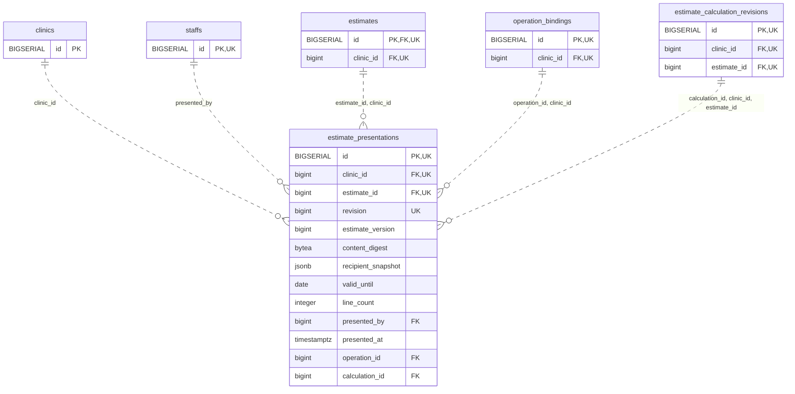

<!-- GENERATED: scripts/tools/generate-erd-detail.py; do not edit -->
# `estimate_presentations`

[詳細ERD一覧](index.md) · [概要ERD](../erd.md)

このページは、マイグレーションをファイル名順に静的解析した最終定義です。稼働DBの状態は未確認です。

## カラム

型・DEFAULTはDDLの宣言表記です。`bigserial` は採番宣言であり、DBカタログ上の型名ではありません。

| カラム | 型（DDL） | NULL | DEFAULT（DDL） | キー構成列 | 定義元 |
|:---|:---|:---|:---|:---|:---|
| `id` | `BIGSERIAL` | NOT NULL | — | PK, UK | [001_init.sql:9499](../../../backend/migrations/001_init.sql#L9499) |
| `clinic_id` | `bigint` | NOT NULL | — | FK, UK | [001_init.sql:9500](../../../backend/migrations/001_init.sql#L9500) |
| `estimate_id` | `bigint` | NOT NULL | — | FK, UK | [001_init.sql:9501](../../../backend/migrations/001_init.sql#L9501) |
| `revision` | `bigint` | NOT NULL | — | UK | [001_init.sql:9502](../../../backend/migrations/001_init.sql#L9502) |
| `estimate_version` | `bigint` | NOT NULL | — | — | [001_init.sql:9503](../../../backend/migrations/001_init.sql#L9503) |
| `content_digest` | `bytea` | NOT NULL | — | — | [001_init.sql:9504](../../../backend/migrations/001_init.sql#L9504) |
| `recipient_snapshot` | `jsonb` | NOT NULL | — | — | [001_init.sql:9505](../../../backend/migrations/001_init.sql#L9505) |
| `valid_until` | `date` | NULL | — | — | [001_init.sql:9506](../../../backend/migrations/001_init.sql#L9506) |
| `line_count` | `integer` | NOT NULL | — | — | [001_init.sql:9508](../../../backend/migrations/001_init.sql#L9508) |
| `presented_by` | `bigint` | NOT NULL | — | FK | [001_init.sql:9509](../../../backend/migrations/001_init.sql#L9509) |
| `presented_at` | `timestamptz` | NOT NULL | `clock_timestamp()` | — | [001_init.sql:9510](../../../backend/migrations/001_init.sql#L9510) |
| `operation_id` | `bigint` | NOT NULL | — | FK | [001_init.sql:9511](../../../backend/migrations/001_init.sql#L9511) |
| `calculation_id` | `bigint` | NOT NULL | — | FK | [001_init.sql:10974](../../../backend/migrations/001_init.sql#L10974) |

PK/FK/UKはキーの構成列を示します。複合キーの各列が単独で一意という意味ではありません。部分uniqueは下記indexの述語を参照してください。

## ERD

このテーブルの全カラムと、すべての参照先を表示します。参照先はFKの対象列だけを表示し、全カラムは各テーブルのページに置きます。

親側の任意参照はFK列のNULL可否、子側の最大1件は無条件のPK/UNIQUEから導出します。部分uniqueによる条件付きの最大件数は図に反映せず、index一覧に記録します。実線はFK全列が子のPKに含まれる識別関係、破線はそれ以外です。

## 外部キー（全件）

| 制約 | 子の列（順序あり） | 参照先 | 親の列（順序あり） | 削除時の動作 | 定義元 |
|:---|:---|:---|:---|:---|:---|
| `estimate_presentations_clinic_id_fkey` | `clinic_id` | [clinics](clinics.md) | `id` | `ON DELETE RESTRICT` | [001_init.sql:9500](../../../backend/migrations/001_init.sql#L9500) |
| `estimate_presentations_presented_by_fkey` | `presented_by` | [staffs](staffs.md) | `id` | `ON DELETE RESTRICT` | [001_init.sql:9509](../../../backend/migrations/001_init.sql#L9509) |
| `estimate_presentations_estimate_id_clinic_id_fkey` | `estimate_id, clinic_id` | [estimates](estimates.md) | `id, clinic_id` | `ON DELETE RESTRICT` | [001_init.sql:9514](../../../backend/migrations/001_init.sql#L9514) |
| `estimate_presentations_operation_id_clinic_id_fkey` | `operation_id, clinic_id` | [operation_bindings](operation_bindings.md) | `id, clinic_id` | `ON DELETE RESTRICT` | [001_init.sql:9515](../../../backend/migrations/001_init.sql#L9515) |
| `fk_estimate_presented_calculation` | `calculation_id, clinic_id, estimate_id` | [estimate_calculation_revisions](estimate_calculation_revisions.md) | `id, clinic_id, estimate_id` | `ON DELETE RESTRICT` | [001_init.sql:10975](../../../backend/migrations/001_init.sql#L10975) |

正確なON UPDATE・MATCH・DEFERRABLE等を含む制約DDL:

- `estimate_presentations_clinic_id_fkey`: `REFERENCES clinics(id) ON DELETE RESTRICT`
- `estimate_presentations_presented_by_fkey`: `REFERENCES staffs(id) ON DELETE RESTRICT`
- `estimate_presentations_estimate_id_clinic_id_fkey`: `FOREIGN KEY (estimate_id,clinic_id) REFERENCES estimates(id,clinic_id) ON DELETE RESTRICT`
- `estimate_presentations_operation_id_clinic_id_fkey`: `FOREIGN KEY (operation_id,clinic_id) REFERENCES operation_bindings(id,clinic_id) ON DELETE RESTRICT`
- `fk_estimate_presented_calculation`: `CONSTRAINT fk_estimate_presented_calculation FOREIGN KEY(calculation_id,clinic_id,estimate_id) REFERENCES estimate_calculation_revisions(id,clinic_id,estimate_id) ON DELETE RESTRICT`

## その他の制約

| 制約 | 種別 | DDL | 定義元 |
|:---|:---|:---|:---|
| `estimate_presentations_pkey` | primary | `PRIMARY KEY` | [001_init.sql:9499](../../../backend/migrations/001_init.sql#L9499) |
| `estimate_presentations_revision_check` | check | `CHECK (revision > 0)` | [001_init.sql:9502](../../../backend/migrations/001_init.sql#L9502) |
| `estimate_presentations_estimate_version_check` | check | `CHECK (estimate_version > 0)` | [001_init.sql:9503](../../../backend/migrations/001_init.sql#L9503) |
| `estimate_presentations_content_digest_check` | check | `CHECK (octet_length(content_digest)=32)` | [001_init.sql:9504](../../../backend/migrations/001_init.sql#L9504) |
| `estimate_presentations_recipient_snapshot_check` | check | `CHECK (jsonb_typeof(recipient_snapshot)='object')` | [001_init.sql:9505](../../../backend/migrations/001_init.sql#L9505) |
| `estimate_presentations_line_count_check` | check | `CHECK (line_count >= 0)` | [001_init.sql:9508](../../../backend/migrations/001_init.sql#L9508) |
| `estimate_presentations_id_clinic_id_estimate_id_key` | unique | `UNIQUE (id,clinic_id,estimate_id)` | [001_init.sql:9512](../../../backend/migrations/001_init.sql#L9512) |
| `estimate_presentations_clinic_id_estimate_id_revision_key` | unique | `UNIQUE (clinic_id,estimate_id,revision)` | [001_init.sql:9513](../../../backend/migrations/001_init.sql#L9513) |

## インデックス

明示的なCREATE INDEXなし。PK/UNIQUEに付随する暗黙のindexは制約欄を参照してください。
