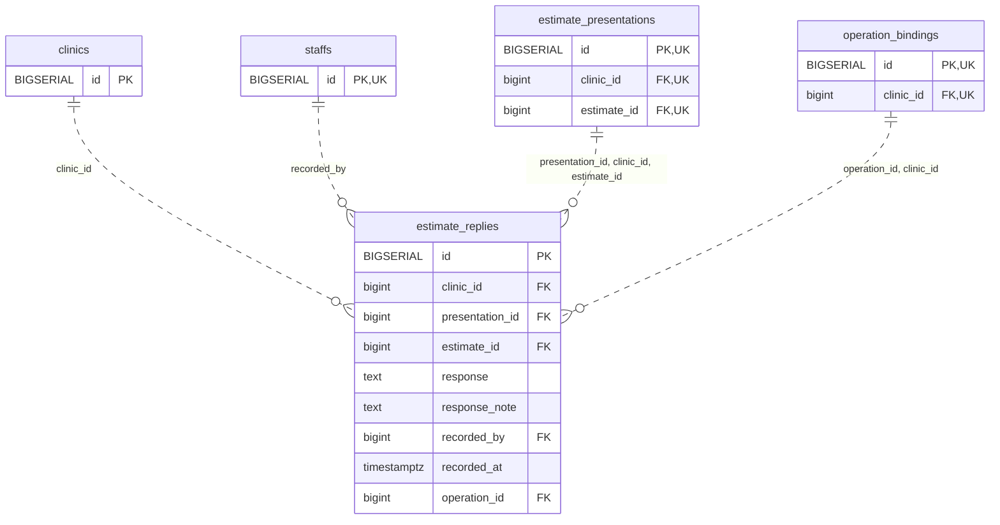

<!-- GENERATED: scripts/tools/generate-erd-detail.py; do not edit -->
# `estimate_replies`

[詳細ERD一覧](index.md) · [概要ERD](../erd.md)

このページは、マイグレーションをファイル名順に静的解析した最終定義です。稼働DBの状態は未確認です。

## カラム

型・DEFAULTはDDLの宣言表記です。`bigserial` は採番宣言であり、DBカタログ上の型名ではありません。

| カラム | 型（DDL） | NULL | DEFAULT（DDL） | キー構成列 | 定義元 |
|:---|:---|:---|:---|:---|:---|
| `id` | `BIGSERIAL` | NOT NULL | — | PK | [001_init.sql:9531](../../../backend/migrations/001_init.sql#L9531) |
| `clinic_id` | `bigint` | NOT NULL | — | FK | [001_init.sql:9532](../../../backend/migrations/001_init.sql#L9532) |
| `presentation_id` | `bigint` | NOT NULL | — | FK | [001_init.sql:9533](../../../backend/migrations/001_init.sql#L9533) |
| `estimate_id` | `bigint` | NOT NULL | — | FK | [001_init.sql:9534](../../../backend/migrations/001_init.sql#L9534) |
| `response` | `text` | NOT NULL | — | — | [001_init.sql:9535](../../../backend/migrations/001_init.sql#L9535) |
| `response_note` | `text` | NULL | — | — | [001_init.sql:9536](../../../backend/migrations/001_init.sql#L9536) |
| `recorded_by` | `bigint` | NOT NULL | — | FK | [001_init.sql:9537](../../../backend/migrations/001_init.sql#L9537) |
| `recorded_at` | `timestamptz` | NOT NULL | `clock_timestamp()` | — | [001_init.sql:9538](../../../backend/migrations/001_init.sql#L9538) |
| `operation_id` | `bigint` | NOT NULL | — | FK | [001_init.sql:9539](../../../backend/migrations/001_init.sql#L9539) |

PK/FK/UKはキーの構成列を示します。複合キーの各列が単独で一意という意味ではありません。部分uniqueは下記indexの述語を参照してください。

## ERD

このテーブルの全カラムと、すべての参照先を表示します。参照先はFKの対象列だけを表示し、全カラムは各テーブルのページに置きます。

親側の任意参照はFK列のNULL可否、子側の最大1件は無条件のPK/UNIQUEから導出します。部分uniqueによる条件付きの最大件数は図に反映せず、index一覧に記録します。実線はFK全列が子のPKに含まれる識別関係、破線はそれ以外です。

## 外部キー（全件）

| 制約 | 子の列（順序あり） | 参照先 | 親の列（順序あり） | 削除時の動作 | 定義元 |
|:---|:---|:---|:---|:---|:---|
| `estimate_replies_clinic_id_fkey` | `clinic_id` | [clinics](clinics.md) | `id` | `ON DELETE RESTRICT` | [001_init.sql:9532](../../../backend/migrations/001_init.sql#L9532) |
| `estimate_replies_recorded_by_fkey` | `recorded_by` | [staffs](staffs.md) | `id` | `ON DELETE RESTRICT` | [001_init.sql:9537](../../../backend/migrations/001_init.sql#L9537) |
| `estimate_replies_presentation_id_clinic_id_estimate_id_fkey` | `presentation_id, clinic_id, estimate_id` | [estimate_presentations](estimate_presentations.md) | `id, clinic_id, estimate_id` | `ON DELETE RESTRICT` | [001_init.sql:9540](../../../backend/migrations/001_init.sql#L9540) |
| `estimate_replies_operation_id_clinic_id_fkey` | `operation_id, clinic_id` | [operation_bindings](operation_bindings.md) | `id, clinic_id` | `ON DELETE RESTRICT` | [001_init.sql:9541](../../../backend/migrations/001_init.sql#L9541) |

正確なON UPDATE・MATCH・DEFERRABLE等を含む制約DDL:

- `estimate_replies_clinic_id_fkey`: `REFERENCES clinics(id) ON DELETE RESTRICT`
- `estimate_replies_recorded_by_fkey`: `REFERENCES staffs(id) ON DELETE RESTRICT`
- `estimate_replies_presentation_id_clinic_id_estimate_id_fkey`: `FOREIGN KEY (presentation_id,clinic_id,estimate_id) REFERENCES estimate_presentations(id,clinic_id,estimate_id) ON DELETE RESTRICT`
- `estimate_replies_operation_id_clinic_id_fkey`: `FOREIGN KEY (operation_id,clinic_id) REFERENCES operation_bindings(id,clinic_id) ON DELETE RESTRICT`

## その他の制約

| 制約 | 種別 | DDL | 定義元 |
|:---|:---|:---|:---|
| `estimate_replies_pkey` | primary | `PRIMARY KEY` | [001_init.sql:9531](../../../backend/migrations/001_init.sql#L9531) |
| `estimate_replies_response_check` | check | `CHECK (response IN ('approved','rejected','withdrawn'))` | [001_init.sql:9535](../../../backend/migrations/001_init.sql#L9535) |

## インデックス

明示的なCREATE INDEXなし。PK/UNIQUEに付随する暗黙のindexは制約欄を参照してください。
