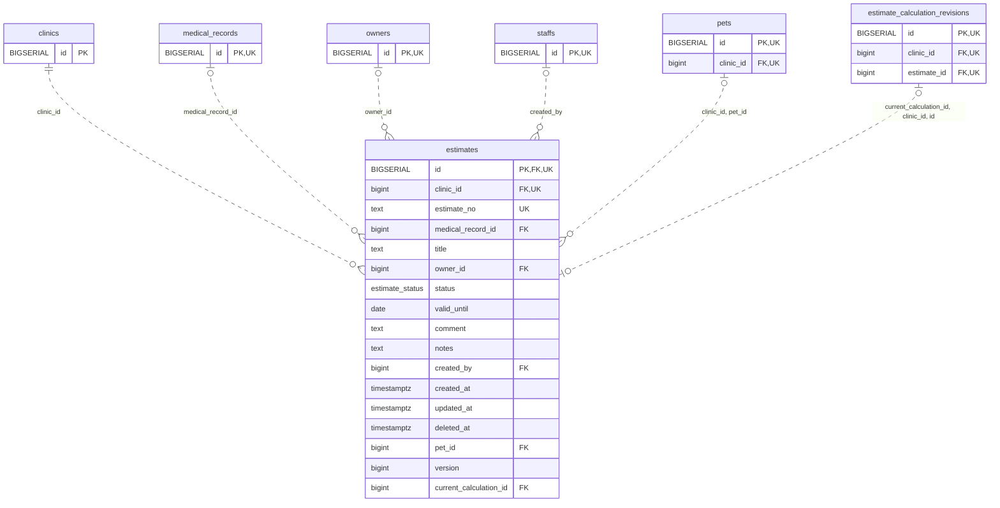

<!-- GENERATED: scripts/tools/generate-erd-detail.py; do not edit -->
# `estimates`

[詳細ERD一覧](index.md) · [概要ERD](../erd.md)

このページは、マイグレーションをファイル名順に静的解析した最終定義です。稼働DBの状態は未確認です。

## カラム

型・DEFAULTはDDLの宣言表記です。`bigserial` は採番宣言であり、DBカタログ上の型名ではありません。

| カラム | 型（DDL） | NULL | DEFAULT（DDL） | キー構成列 | 定義元 |
|:---|:---|:---|:---|:---|:---|
| `id` | `BIGSERIAL` | NOT NULL | — | PK, FK, UK | [001_init.sql:1706](../../../backend/migrations/001_init.sql#L1706) |
| `clinic_id` | `bigint` | NOT NULL | — | FK, UK | [001_init.sql:1707](../../../backend/migrations/001_init.sql#L1707) |
| `estimate_no` | `text` | NOT NULL | — | UK | [001_init.sql:1708](../../../backend/migrations/001_init.sql#L1708) |
| `medical_record_id` | `bigint` | NULL | — | FK | [001_init.sql:1709](../../../backend/migrations/001_init.sql#L1709) |
| `title` | `text` | NOT NULL | `''` | — | [001_init.sql:1710](../../../backend/migrations/001_init.sql#L1710) |
| `owner_id` | `bigint` | NULL | — | FK | [001_init.sql:1711](../../../backend/migrations/001_init.sql#L1711) |
| `status` | `estimate_status` | NULL | `'draft'` | — | [001_init.sql:1712](../../../backend/migrations/001_init.sql#L1712) |
| `valid_until` | `date` | NULL | — | — | [001_init.sql:1718](../../../backend/migrations/001_init.sql#L1718) |
| `comment` | `text` | NOT NULL | `''` | — | [001_init.sql:1719](../../../backend/migrations/001_init.sql#L1719) |
| `notes` | `text` | NOT NULL | `''` | — | [001_init.sql:1720](../../../backend/migrations/001_init.sql#L1720) |
| `created_by` | `bigint` | NULL | — | FK | [001_init.sql:1721](../../../backend/migrations/001_init.sql#L1721) |
| `created_at` | `timestamptz` | NOT NULL | `now()` | — | [001_init.sql:1722](../../../backend/migrations/001_init.sql#L1722) |
| `updated_at` | `timestamptz` | NOT NULL | `now()` | — | [001_init.sql:1723](../../../backend/migrations/001_init.sql#L1723) |
| `deleted_at` | `timestamptz` | NULL | — | — | [001_init.sql:1724](../../../backend/migrations/001_init.sql#L1724) |
| `pet_id` | `bigint` | NULL | — | FK | [001_init.sql:5933](../../../backend/migrations/001_init.sql#L5933) |
| `version` | `bigint` | NOT NULL | `1` | — | [001_init.sql:9507](../../../backend/migrations/001_init.sql#L9507) |
| `current_calculation_id` | `bigint` | NULL | — | FK | [001_init.sql:10983](../../../backend/migrations/001_init.sql#L10983) |

PK/FK/UKはキーの構成列を示します。複合キーの各列が単独で一意という意味ではありません。部分uniqueは下記indexの述語を参照してください。

## ERD

このテーブルの全カラムと、すべての参照先を表示します。参照先はFKの対象列だけを表示し、全カラムは各テーブルのページに置きます。

親側の任意参照はFK列のNULL可否、子側の最大1件は無条件のPK/UNIQUEから導出します。部分uniqueによる条件付きの最大件数は図に反映せず、index一覧に記録します。実線はFK全列が子のPKに含まれる識別関係、破線はそれ以外です。

## 外部キー（全件）

| 制約 | 子の列（順序あり） | 参照先 | 親の列（順序あり） | 削除時の動作 | 定義元 |
|:---|:---|:---|:---|:---|:---|
| `estimates_clinic_id_fkey` | `clinic_id` | [clinics](clinics.md) | `id` | `ON DELETE RESTRICT` | [001_init.sql:1707](../../../backend/migrations/001_init.sql#L1707) |
| `estimates_medical_record_id_fkey` | `medical_record_id` | [medical_records](medical_records.md) | `id` | `ON DELETE RESTRICT` | [001_init.sql:1709](../../../backend/migrations/001_init.sql#L1709) |
| `estimates_owner_id_fkey` | `owner_id` | [owners](owners.md) | `id` | `ON DELETE SET NULL` | [001_init.sql:1711](../../../backend/migrations/001_init.sql#L1711) |
| `estimates_created_by_fkey` | `created_by` | [staffs](staffs.md) | `id` | `ON DELETE SET NULL` | [001_init.sql:1721](../../../backend/migrations/001_init.sql#L1721) |
| `fk_estimates_pet_clinic` | `clinic_id, pet_id` | [pets](pets.md) | `clinic_id, id` | `ON DELETE SET NULL (pet_id)` | [001_init.sql:5937](../../../backend/migrations/001_init.sql#L5937) |
| `fk_estimate_current_calculation` | `current_calculation_id, clinic_id, id` | [estimate_calculation_revisions](estimate_calculation_revisions.md) | `id, clinic_id, estimate_id` | `ON DELETE RESTRICT` | [001_init.sql:10984](../../../backend/migrations/001_init.sql#L10984) |

正確なON UPDATE・MATCH・DEFERRABLE等を含む制約DDL:

- `estimates_clinic_id_fkey`: `REFERENCES clinics(id) ON DELETE RESTRICT`
- `estimates_medical_record_id_fkey`: `REFERENCES medical_records(id) ON DELETE RESTRICT`
- `estimates_owner_id_fkey`: `REFERENCES owners(id) ON DELETE SET NULL`
- `estimates_created_by_fkey`: `REFERENCES staffs(id) ON DELETE SET NULL`
- `fk_estimates_pet_clinic`: `CONSTRAINT fk_estimates_pet_clinic   FOREIGN KEY (clinic_id, pet_id)   REFERENCES pets (clinic_id, id)   ON DELETE SET NULL (pet_id)`
- `fk_estimate_current_calculation`: `CONSTRAINT fk_estimate_current_calculation FOREIGN KEY(current_calculation_id,clinic_id,id) REFERENCES estimate_calculation_revisions(id,clinic_id,estimate_id) ON DELETE RESTRICT`

## その他の制約

| 制約 | 種別 | DDL | 定義元 |
|:---|:---|:---|:---|
| `estimates_pkey` | primary | `PRIMARY KEY` | [001_init.sql:1706](../../../backend/migrations/001_init.sql#L1706) |
| `estimates_version_check` | check | `CHECK (version > 0)` | [001_init.sql:9507](../../../backend/migrations/001_init.sql#L9507) |
| `uq_estimates_id_clinic` | unique | `CONSTRAINT uq_estimates_id_clinic UNIQUE(id,clinic_id)` | [001_init.sql:9509](../../../backend/migrations/001_init.sql#L9509) |

## インデックス

| 名前 | UNIQUE | 述語 | DDL | 定義元 |
|:---|:---|:---|:---|:---|
| `idx_estimates_clinic_estimate_no` | YES | — | `CREATE UNIQUE INDEX idx_estimates_clinic_estimate_no ON estimates(clinic_id, estimate_no)` | [001_init.sql:2208](../../../backend/migrations/001_init.sql#L2208) |
| `idx_estimates_medical_record_id` | NO | — | `CREATE INDEX idx_estimates_medical_record_id ON estimates(medical_record_id)` | [001_init.sql:2346](../../../backend/migrations/001_init.sql#L2346) |
| `idx_estimates_status` | NO | — | `CREATE INDEX idx_estimates_status ON estimates(status)` | [001_init.sql:2347](../../../backend/migrations/001_init.sql#L2347) |
| `idx_estimates_owner_id` | NO | — | `CREATE INDEX idx_estimates_owner_id ON estimates(owner_id)` | [001_init.sql:2348](../../../backend/migrations/001_init.sql#L2348) |
| `idx_estimates_clinic_pet` | NO | `pet_id IS NOT NULL AND deleted_at IS NULL` | `CREATE INDEX IF NOT EXISTS idx_estimates_clinic_pet   ON estimates (clinic_id, pet_id)   WHERE pet_id IS NOT NULL AND deleted_at IS NULL` | [001_init.sql:5942](../../../backend/migrations/001_init.sql#L5942) |
