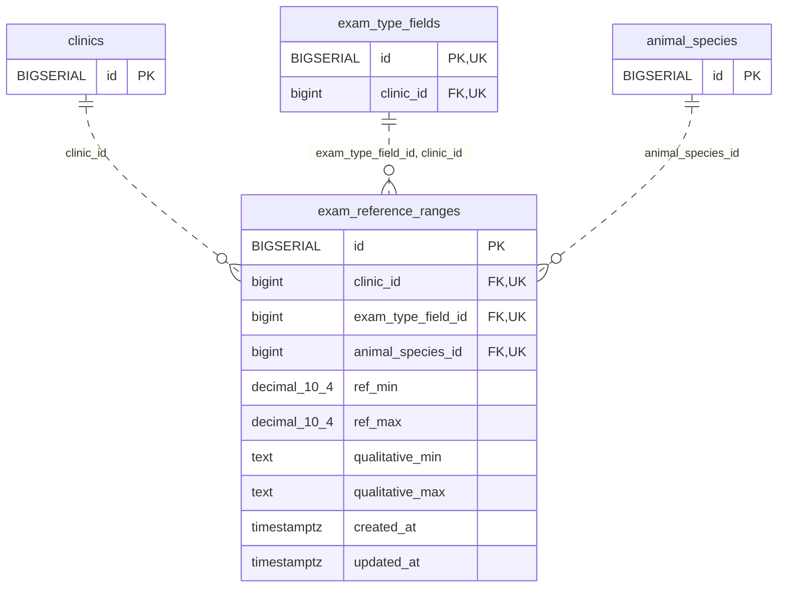

<!-- GENERATED: scripts/tools/generate-erd-detail.py; do not edit -->
# `exam_reference_ranges`

[詳細ERD一覧](index.md) · [概要ERD](../erd.md)

このページは、マイグレーションをファイル名順に静的解析した最終定義です。稼働DBの状態は未確認です。

## カラム

型・DEFAULTはDDLの宣言表記です。`bigserial` は採番宣言であり、DBカタログ上の型名ではありません。

| カラム | 型（DDL） | NULL | DEFAULT（DDL） | キー構成列 | 定義元 |
|:---|:---|:---|:---|:---|:---|
| `id` | `BIGSERIAL` | NOT NULL | — | PK | [001_init.sql:3969](../../../backend/migrations/001_init.sql#L3969) |
| `clinic_id` | `bigint` | NOT NULL | — | FK, UK | [001_init.sql:3970](../../../backend/migrations/001_init.sql#L3970) |
| `exam_type_field_id` | `bigint` | NOT NULL | — | FK, UK | [001_init.sql:3971](../../../backend/migrations/001_init.sql#L3971) |
| `animal_species_id` | `bigint` | NOT NULL | — | FK, UK | [001_init.sql:3972](../../../backend/migrations/001_init.sql#L3972) |
| `ref_min` | `decimal(10,4)` | NULL | — | — | [001_init.sql:3973](../../../backend/migrations/001_init.sql#L3973) |
| `ref_max` | `decimal(10,4)` | NULL | — | — | [001_init.sql:3974](../../../backend/migrations/001_init.sql#L3974) |
| `qualitative_min` | `text` | NULL | — | — | [001_init.sql:3975](../../../backend/migrations/001_init.sql#L3975) |
| `qualitative_max` | `text` | NULL | — | — | [001_init.sql:3976](../../../backend/migrations/001_init.sql#L3976) |
| `created_at` | `timestamptz` | NOT NULL | `now()` | — | [001_init.sql:3977](../../../backend/migrations/001_init.sql#L3977) |
| `updated_at` | `timestamptz` | NOT NULL | `now()` | — | [001_init.sql:3978](../../../backend/migrations/001_init.sql#L3978) |

PK/FK/UKはキーの構成列を示します。複合キーの各列が単独で一意という意味ではありません。部分uniqueは下記indexの述語を参照してください。

## ERD

このテーブルの全カラムと、すべての参照先を表示します。参照先はFKの対象列だけを表示し、全カラムは各テーブルのページに置きます。

親側の任意参照はFK列のNULL可否、子側の最大1件は無条件のPK/UNIQUEから導出します。部分uniqueによる条件付きの最大件数は図に反映せず、index一覧に記録します。実線はFK全列が子のPKに含まれる識別関係、破線はそれ以外です。

## 外部キー（全件）

| 制約 | 子の列（順序あり） | 参照先 | 親の列（順序あり） | 削除時の動作 | 定義元 |
|:---|:---|:---|:---|:---|:---|
| `fk_exam_reference_ranges_clinic` | `clinic_id` | [clinics](clinics.md) | `id` | `ON DELETE RESTRICT` | [001_init.sql:3979](../../../backend/migrations/001_init.sql#L3979) |
| `fk_exam_reference_ranges_field_clinic` | `exam_type_field_id, clinic_id` | [exam_type_fields](exam_type_fields.md) | `id, clinic_id` | `ON DELETE RESTRICT` | [001_init.sql:3981](../../../backend/migrations/001_init.sql#L3981) |
| `fk_exam_reference_ranges_animal_species` | `animal_species_id` | [animal_species](animal_species.md) | `id` | `ON DELETE RESTRICT` | [001_init.sql:3985](../../../backend/migrations/001_init.sql#L3985) |

正確なON UPDATE・MATCH・DEFERRABLE等を含む制約DDL:

- `fk_exam_reference_ranges_clinic`: `CONSTRAINT fk_exam_reference_ranges_clinic         FOREIGN KEY (clinic_id) REFERENCES clinics(id) ON DELETE RESTRICT`
- `fk_exam_reference_ranges_field_clinic`: `CONSTRAINT fk_exam_reference_ranges_field_clinic         FOREIGN KEY (exam_type_field_id, clinic_id)         REFERENCES exam_type_fields (id, clinic_id)         ON DELETE RESTRICT`
- `fk_exam_reference_ranges_animal_species`: `CONSTRAINT fk_exam_reference_ranges_animal_species         FOREIGN KEY (animal_species_id) REFERENCES animal_species(id) ON DELETE RESTRICT`

## その他の制約

| 制約 | 種別 | DDL | 定義元 |
|:---|:---|:---|:---|
| `exam_reference_ranges_pkey` | primary | `PRIMARY KEY` | [001_init.sql:3969](../../../backend/migrations/001_init.sql#L3969) |
| `uq_exam_reference_ranges_clinic_field_species` | unique | `CONSTRAINT uq_exam_reference_ranges_clinic_field_species         UNIQUE (clinic_id, exam_type_field_id, animal_species_id)` | [001_init.sql:3987](../../../backend/migrations/001_init.sql#L3987) |
| `chk_exam_reference_ranges_ref_order` | check | `CONSTRAINT chk_exam_reference_ranges_ref_order         CHECK (ref_min IS NULL OR ref_max IS NULL OR ref_min <= ref_max)` | [001_init.sql:3989](../../../backend/migrations/001_init.sql#L3989) |

## インデックス

| 名前 | UNIQUE | 述語 | DDL | 定義元 |
|:---|:---|:---|:---|:---|
| `idx_exam_reference_ranges_animal_species` | NO | — | `CREATE INDEX idx_exam_reference_ranges_animal_species     ON exam_reference_ranges (animal_species_id)` | [001_init.sql:3993](../../../backend/migrations/001_init.sql#L3993) |
