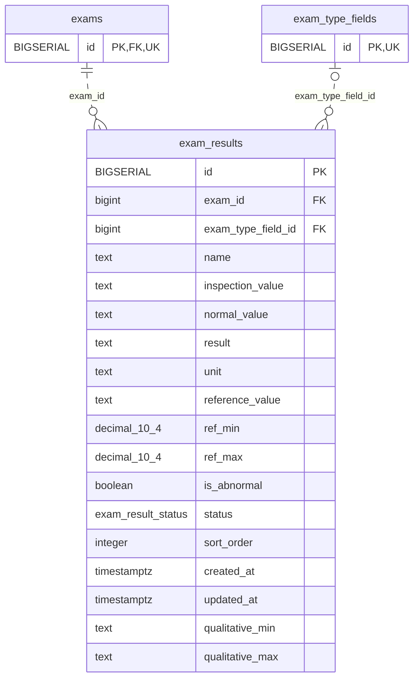

<!-- GENERATED: scripts/tools/generate-erd-detail.py; do not edit -->
# `exam_results`

[詳細ERD一覧](index.md) · [概要ERD](../erd.md)

このページは、マイグレーションをファイル名順に静的解析した最終定義です。稼働DBの状態は未確認です。

## カラム

型・DEFAULTはDDLの宣言表記です。`bigserial` は採番宣言であり、DBカタログ上の型名ではありません。

| カラム | 型（DDL） | NULL | DEFAULT（DDL） | キー構成列 | 定義元 |
|:---|:---|:---|:---|:---|:---|
| `id` | `BIGSERIAL` | NOT NULL | — | PK | [001_init.sql:1731](../../../backend/migrations/001_init.sql#L1731) |
| `exam_id` | `bigint` | NOT NULL | — | FK | [001_init.sql:1732](../../../backend/migrations/001_init.sql#L1732) |
| `exam_type_field_id` | `bigint` | NULL | — | FK | [001_init.sql:1733](../../../backend/migrations/001_init.sql#L1733) |
| `name` | `text` | NOT NULL | `''` | — | [001_init.sql:1734](../../../backend/migrations/001_init.sql#L1734) |
| `inspection_value` | `text` | NOT NULL | `''` | — | [001_init.sql:1735](../../../backend/migrations/001_init.sql#L1735) |
| `normal_value` | `text` | NOT NULL | `''` | — | [001_init.sql:1736](../../../backend/migrations/001_init.sql#L1736) |
| `result` | `text` | NOT NULL | `''` | — | [001_init.sql:1737](../../../backend/migrations/001_init.sql#L1737) |
| `unit` | `text` | NOT NULL | `''` | — | [001_init.sql:1738](../../../backend/migrations/001_init.sql#L1738) |
| `reference_value` | `text` | NOT NULL | `''` | — | [001_init.sql:1739](../../../backend/migrations/001_init.sql#L1739) |
| `ref_min` | `decimal(10,4)` | NULL | — | — | [001_init.sql:1740](../../../backend/migrations/001_init.sql#L1740) |
| `ref_max` | `decimal(10,4)` | NULL | — | — | [001_init.sql:1741](../../../backend/migrations/001_init.sql#L1741) |
| `is_abnormal` | `boolean` | NULL | `false` | — | [001_init.sql:1742](../../../backend/migrations/001_init.sql#L1742) |
| `status` | `exam_result_status` | NULL | `'normal'` | — | [001_init.sql:1743](../../../backend/migrations/001_init.sql#L1743) |
| `sort_order` | `integer` | NULL | `0` | — | [001_init.sql:1744](../../../backend/migrations/001_init.sql#L1744) |
| `created_at` | `timestamptz` | NOT NULL | `now()` | — | [001_init.sql:1745](../../../backend/migrations/001_init.sql#L1745) |
| `updated_at` | `timestamptz` | NOT NULL | `now()` | — | [001_init.sql:1746](../../../backend/migrations/001_init.sql#L1746) |
| `qualitative_min` | `text` | NULL | — | — | [001_init.sql:4149](../../../backend/migrations/001_init.sql#L4149) |
| `qualitative_max` | `text` | NULL | — | — | [001_init.sql:4150](../../../backend/migrations/001_init.sql#L4150) |

PK/FK/UKはキーの構成列を示します。複合キーの各列が単独で一意という意味ではありません。部分uniqueは下記indexの述語を参照してください。

## ERD

このテーブルの全カラムと、すべての参照先を表示します。参照先はFKの対象列だけを表示し、全カラムは各テーブルのページに置きます。

親側の任意参照はFK列のNULL可否、子側の最大1件は無条件のPK/UNIQUEから導出します。部分uniqueによる条件付きの最大件数は図に反映せず、index一覧に記録します。実線はFK全列が子のPKに含まれる識別関係、破線はそれ以外です。

## 外部キー（全件）

| 制約 | 子の列（順序あり） | 参照先 | 親の列（順序あり） | 削除時の動作 | 定義元 |
|:---|:---|:---|:---|:---|:---|
| `exam_results_exam_id_fkey` | `exam_id` | [exams](exams.md) | `id` | `ON DELETE CASCADE` | [001_init.sql:1732](../../../backend/migrations/001_init.sql#L1732) |
| `exam_results_exam_type_field_id_fkey` | `exam_type_field_id` | [exam_type_fields](exam_type_fields.md) | `id` | `ON DELETE SET NULL` | [001_init.sql:1733](../../../backend/migrations/001_init.sql#L1733) |

正確なON UPDATE・MATCH・DEFERRABLE等を含む制約DDL:

- `exam_results_exam_id_fkey`: `REFERENCES exams(id) ON DELETE CASCADE`
- `exam_results_exam_type_field_id_fkey`: `REFERENCES exam_type_fields(id) ON DELETE SET NULL`

## その他の制約

| 制約 | 種別 | DDL | 定義元 |
|:---|:---|:---|:---|
| `exam_results_pkey` | primary | `PRIMARY KEY` | [001_init.sql:1731](../../../backend/migrations/001_init.sql#L1731) |

## インデックス

| 名前 | UNIQUE | 述語 | DDL | 定義元 |
|:---|:---|:---|:---|:---|
| `idx_exam_results_exam_id` | NO | — | `CREATE INDEX IF NOT EXISTS idx_exam_results_exam_id     ON exam_results (exam_id)` | [001_init.sql:3368](../../../backend/migrations/001_init.sql#L3368) |
| `idx_exam_results_exam_type_field_id` | NO | — | `CREATE INDEX idx_exam_results_exam_type_field_id ON exam_results (exam_type_field_id)` | [001_init.sql:4171](../../../backend/migrations/001_init.sql#L4171) |
