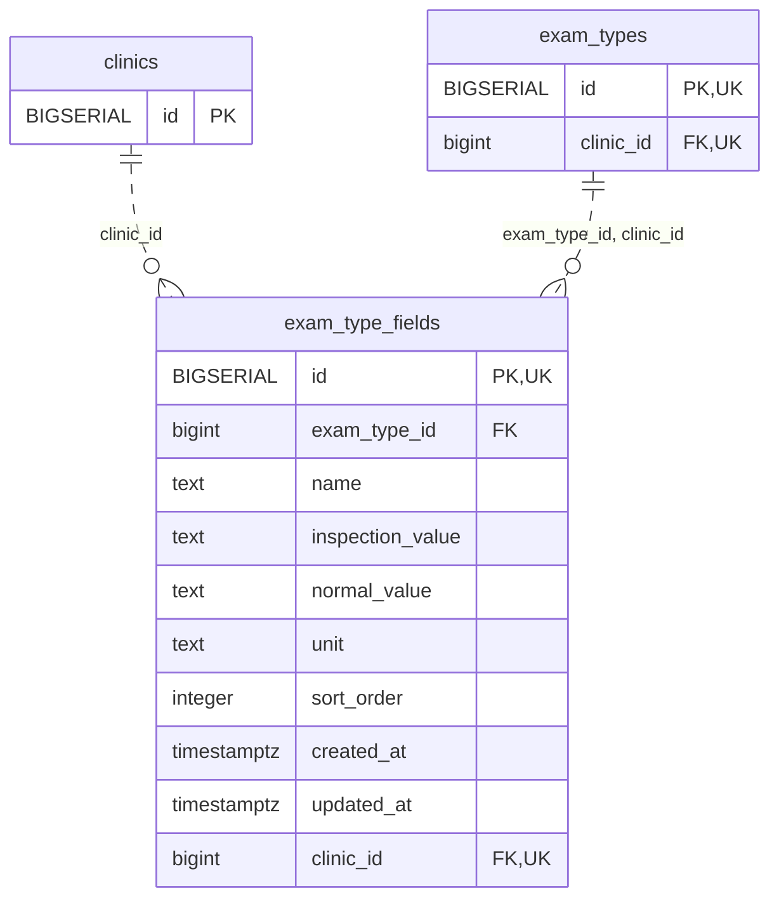

<!-- GENERATED: scripts/tools/generate-erd-detail.py; do not edit -->
# `exam_type_fields`

[詳細ERD一覧](index.md) · [概要ERD](../erd.md)

このページは、マイグレーションをファイル名順に静的解析した最終定義です。稼働DBの状態は未確認です。

## カラム

型・DEFAULTはDDLの宣言表記です。`bigserial` は採番宣言であり、DBカタログ上の型名ではありません。

| カラム | 型（DDL） | NULL | DEFAULT（DDL） | キー構成列 | 定義元 |
|:---|:---|:---|:---|:---|:---|
| `id` | `BIGSERIAL` | NOT NULL | — | PK, UK | [001_init.sql:726](../../../backend/migrations/001_init.sql#L726) |
| `exam_type_id` | `bigint` | NOT NULL | — | FK | [001_init.sql:727](../../../backend/migrations/001_init.sql#L727) |
| `name` | `text` | NOT NULL | — | — | [001_init.sql:728](../../../backend/migrations/001_init.sql#L728) |
| `inspection_value` | `text` | NOT NULL | `''` | — | [001_init.sql:729](../../../backend/migrations/001_init.sql#L729) |
| `normal_value` | `text` | NOT NULL | `''` | — | [001_init.sql:730](../../../backend/migrations/001_init.sql#L730) |
| `unit` | `text` | NOT NULL | `''` | — | [001_init.sql:731](../../../backend/migrations/001_init.sql#L731) |
| `sort_order` | `integer` | NULL | `0` | — | [001_init.sql:732](../../../backend/migrations/001_init.sql#L732) |
| `created_at` | `timestamptz` | NOT NULL | `now()` | — | [001_init.sql:733](../../../backend/migrations/001_init.sql#L733) |
| `updated_at` | `timestamptz` | NOT NULL | `now()` | — | [001_init.sql:734](../../../backend/migrations/001_init.sql#L734) |
| `clinic_id` | `bigint` | NOT NULL | — | FK, UK | [001_init.sql:3951](../../../backend/migrations/001_init.sql#L3951) |

PK/FK/UKはキーの構成列を示します。複合キーの各列が単独で一意という意味ではありません。部分uniqueは下記indexの述語を参照してください。

## ERD

このテーブルの全カラムと、すべての参照先を表示します。参照先はFKの対象列だけを表示し、全カラムは各テーブルのページに置きます。

親側の任意参照はFK列のNULL可否、子側の最大1件は無条件のPK/UNIQUEから導出します。部分uniqueによる条件付きの最大件数は図に反映せず、index一覧に記録します。実線はFK全列が子のPKに含まれる識別関係、破線はそれ以外です。

## 外部キー（全件）

| 制約 | 子の列（順序あり） | 参照先 | 親の列（順序あり） | 削除時の動作 | 定義元 |
|:---|:---|:---|:---|:---|:---|
| `fk_exam_type_fields_clinic` | `clinic_id` | [clinics](clinics.md) | `id` | `ON DELETE RESTRICT` | [001_init.sql:3952](../../../backend/migrations/001_init.sql#L3952) |
| `fk_exam_type_fields_type_clinic` | `exam_type_id, clinic_id` | [exam_types](exam_types.md) | `id, clinic_id` | `ON DELETE CASCADE` | [001_init.sql:3960](../../../backend/migrations/001_init.sql#L3960) |

正確なON UPDATE・MATCH・DEFERRABLE等を含む制約DDL:

- `fk_exam_type_fields_clinic`: `CONSTRAINT fk_exam_type_fields_clinic         FOREIGN KEY (clinic_id) REFERENCES clinics(id) ON DELETE RESTRICT`
- `fk_exam_type_fields_type_clinic`: `CONSTRAINT fk_exam_type_fields_type_clinic     FOREIGN KEY (exam_type_id, clinic_id)     REFERENCES exam_types (id, clinic_id)     ON DELETE CASCADE`

## その他の制約

| 制約 | 種別 | DDL | 定義元 |
|:---|:---|:---|:---|
| `exam_type_fields_pkey` | primary | `PRIMARY KEY` | [001_init.sql:726](../../../backend/migrations/001_init.sql#L726) |
| `uq_exam_type_fields_id_clinic` | unique | `CONSTRAINT uq_exam_type_fields_id_clinic UNIQUE (id, clinic_id)` | [001_init.sql:3954](../../../backend/migrations/001_init.sql#L3954) |

## インデックス

| 名前 | UNIQUE | 述語 | DDL | 定義元 |
|:---|:---|:---|:---|:---|
| `idx_exam_type_fields_clinic_type_sort` | NO | — | `CREATE INDEX idx_exam_type_fields_clinic_type_sort     ON exam_type_fields (clinic_id, exam_type_id, sort_order)` | [001_init.sql:3965](../../../backend/migrations/001_init.sql#L3965) |
