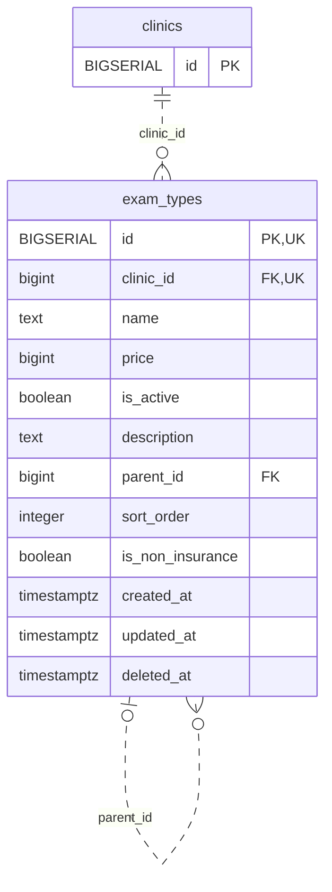

<!-- GENERATED: scripts/tools/generate-erd-detail.py; do not edit -->
# `exam_types`

[詳細ERD一覧](index.md) · [概要ERD](../erd.md)

このページは、マイグレーションをファイル名順に静的解析した最終定義です。稼働DBの状態は未確認です。

## カラム

型・DEFAULTはDDLの宣言表記です。`bigserial` は採番宣言であり、DBカタログ上の型名ではありません。

| カラム | 型（DDL） | NULL | DEFAULT（DDL） | キー構成列 | 定義元 |
|:---|:---|:---|:---|:---|:---|
| `id` | `BIGSERIAL` | NOT NULL | — | PK, UK | [001_init.sql:688](../../../backend/migrations/001_init.sql#L688) |
| `clinic_id` | `bigint` | NOT NULL | — | FK, UK | [001_init.sql:689](../../../backend/migrations/001_init.sql#L689) |
| `name` | `text` | NOT NULL | — | — | [001_init.sql:690](../../../backend/migrations/001_init.sql#L690) |
| `price` | `bigint` | NULL | — | — | [001_init.sql:691](../../../backend/migrations/001_init.sql#L691) |
| `is_active` | `boolean` | NOT NULL | `true` | — | [001_init.sql:692](../../../backend/migrations/001_init.sql#L692) |
| `description` | `text` | NOT NULL | `''` | — | [001_init.sql:693](../../../backend/migrations/001_init.sql#L693) |
| `parent_id` | `bigint` | NULL | — | FK | [001_init.sql:694](../../../backend/migrations/001_init.sql#L694) |
| `sort_order` | `integer` | NULL | `0` | — | [001_init.sql:695](../../../backend/migrations/001_init.sql#L695) |
| `is_non_insurance` | `boolean` | NOT NULL | `false` | — | [001_init.sql:696](../../../backend/migrations/001_init.sql#L696) |
| `created_at` | `timestamptz` | NOT NULL | `now()` | — | [001_init.sql:697](../../../backend/migrations/001_init.sql#L697) |
| `updated_at` | `timestamptz` | NOT NULL | `now()` | — | [001_init.sql:698](../../../backend/migrations/001_init.sql#L698) |
| `deleted_at` | `timestamptz` | NULL | — | — | [001_init.sql:699](../../../backend/migrations/001_init.sql#L699) |

PK/FK/UKはキーの構成列を示します。複合キーの各列が単独で一意という意味ではありません。部分uniqueは下記indexの述語を参照してください。

## ERD

このテーブルの全カラムと、すべての参照先を表示します。参照先はFKの対象列だけを表示し、全カラムは各テーブルのページに置きます。

親側の任意参照はFK列のNULL可否、子側の最大1件は無条件のPK/UNIQUEから導出します。部分uniqueによる条件付きの最大件数は図に反映せず、index一覧に記録します。実線はFK全列が子のPKに含まれる識別関係、破線はそれ以外です。

## 外部キー（全件）

| 制約 | 子の列（順序あり） | 参照先 | 親の列（順序あり） | 削除時の動作 | 定義元 |
|:---|:---|:---|:---|:---|:---|
| `exam_types_clinic_id_fkey` | `clinic_id` | [clinics](clinics.md) | `id` | `ON DELETE RESTRICT` | [001_init.sql:689](../../../backend/migrations/001_init.sql#L689) |
| `exam_types_parent_id_fkey` | `parent_id` | [exam_types](exam_types.md) | `id` | `ON DELETE SET NULL` | [001_init.sql:694](../../../backend/migrations/001_init.sql#L694) |

正確なON UPDATE・MATCH・DEFERRABLE等を含む制約DDL:

- `exam_types_clinic_id_fkey`: `REFERENCES clinics(id) ON DELETE RESTRICT`
- `exam_types_parent_id_fkey`: `REFERENCES exam_types(id) ON DELETE SET NULL`

## その他の制約

| 制約 | 種別 | DDL | 定義元 |
|:---|:---|:---|:---|
| `exam_types_pkey` | primary | `PRIMARY KEY` | [001_init.sql:688](../../../backend/migrations/001_init.sql#L688) |
| `uq_exam_types_id_clinic` | unique | `CONSTRAINT uq_exam_types_id_clinic UNIQUE (id, clinic_id)` | [001_init.sql:3904](../../../backend/migrations/001_init.sql#L3904) |

## インデックス

| 名前 | UNIQUE | 述語 | DDL | 定義元 |
|:---|:---|:---|:---|:---|
| `idx_exam_types_clinic_id` | NO | — | `CREATE INDEX idx_exam_types_clinic_id ON exam_types(clinic_id)` | [001_init.sql:2212](../../../backend/migrations/001_init.sql#L2212) |
| `idx_exam_types_parent_id` | NO | — | `CREATE INDEX idx_exam_types_parent_id ON exam_types(parent_id)` | [001_init.sql:2213](../../../backend/migrations/001_init.sql#L2213) |
| `idx_exam_types_clinic_sort` | NO | `deleted_at IS NULL` | `CREATE INDEX idx_exam_types_clinic_sort        ON exam_types(clinic_id, sort_order)              WHERE deleted_at IS NULL` | [001_init.sql:2255](../../../backend/migrations/001_init.sql#L2255) |
| `idx_exam_types_clinic_name` | YES | `deleted_at IS NULL` | `CREATE UNIQUE INDEX idx_exam_types_clinic_name ON exam_types(clinic_id, name) WHERE deleted_at IS NULL` | [001_init.sql:2450](../../../backend/migrations/001_init.sql#L2450) |
| `idx_exam_types_active` | NO | `deleted_at IS NULL` | `CREATE INDEX idx_exam_types_active ON exam_types(id) WHERE deleted_at IS NULL` | [001_init.sql:2470](../../../backend/migrations/001_init.sql#L2470) |
