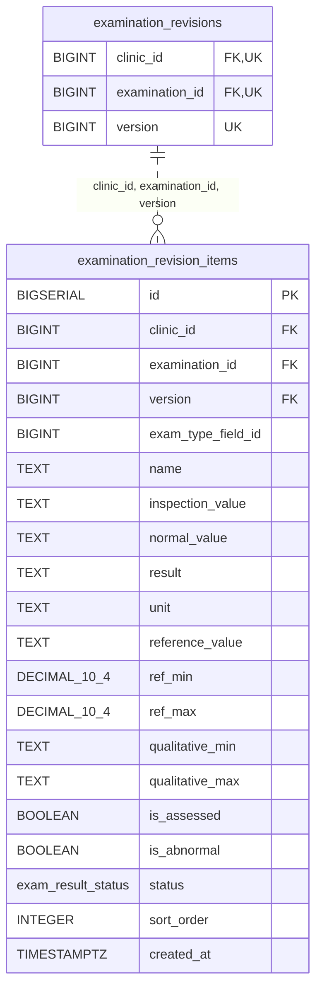

<!-- GENERATED: scripts/tools/generate-erd-detail.py; do not edit -->
# `examination_revision_items`

[詳細ERD一覧](index.md) · [概要ERD](../erd.md)

このページは、マイグレーションをファイル名順に静的解析した最終定義です。稼働DBの状態は未確認です。

## カラム

型・DEFAULTはDDLの宣言表記です。`bigserial` は採番宣言であり、DBカタログ上の型名ではありません。

| カラム | 型（DDL） | NULL | DEFAULT（DDL） | キー構成列 | 定義元 |
|:---|:---|:---|:---|:---|:---|
| `id` | `BIGSERIAL` | NOT NULL | — | PK | [001_init.sql:5020](../../../backend/migrations/001_init.sql#L5020) |
| `clinic_id` | `BIGINT` | NOT NULL | — | FK | [001_init.sql:5021](../../../backend/migrations/001_init.sql#L5021) |
| `examination_id` | `BIGINT` | NOT NULL | — | FK | [001_init.sql:5022](../../../backend/migrations/001_init.sql#L5022) |
| `version` | `BIGINT` | NOT NULL | — | FK | [001_init.sql:5023](../../../backend/migrations/001_init.sql#L5023) |
| `exam_type_field_id` | `BIGINT` | NULL | — | — | [001_init.sql:5024](../../../backend/migrations/001_init.sql#L5024) |
| `name` | `TEXT` | NOT NULL | `''` | — | [001_init.sql:5025](../../../backend/migrations/001_init.sql#L5025) |
| `inspection_value` | `TEXT` | NOT NULL | `''` | — | [001_init.sql:5026](../../../backend/migrations/001_init.sql#L5026) |
| `normal_value` | `TEXT` | NOT NULL | `''` | — | [001_init.sql:5027](../../../backend/migrations/001_init.sql#L5027) |
| `result` | `TEXT` | NOT NULL | `''` | — | [001_init.sql:5028](../../../backend/migrations/001_init.sql#L5028) |
| `unit` | `TEXT` | NOT NULL | `''` | — | [001_init.sql:5029](../../../backend/migrations/001_init.sql#L5029) |
| `reference_value` | `TEXT` | NOT NULL | `''` | — | [001_init.sql:5030](../../../backend/migrations/001_init.sql#L5030) |
| `ref_min` | `DECIMAL(10,4)` | NULL | — | — | [001_init.sql:5031](../../../backend/migrations/001_init.sql#L5031) |
| `ref_max` | `DECIMAL(10,4)` | NULL | — | — | [001_init.sql:5032](../../../backend/migrations/001_init.sql#L5032) |
| `qualitative_min` | `TEXT` | NULL | — | — | [001_init.sql:5033](../../../backend/migrations/001_init.sql#L5033) |
| `qualitative_max` | `TEXT` | NULL | — | — | [001_init.sql:5034](../../../backend/migrations/001_init.sql#L5034) |
| `is_assessed` | `BOOLEAN` | NOT NULL | — | — | [001_init.sql:5035](../../../backend/migrations/001_init.sql#L5035) |
| `is_abnormal` | `BOOLEAN` | NOT NULL | — | — | [001_init.sql:5036](../../../backend/migrations/001_init.sql#L5036) |
| `status` | `exam_result_status` | NOT NULL | — | — | [001_init.sql:5037](../../../backend/migrations/001_init.sql#L5037) |
| `sort_order` | `INTEGER` | NOT NULL | `0` | — | [001_init.sql:5038](../../../backend/migrations/001_init.sql#L5038) |
| `created_at` | `TIMESTAMPTZ` | NOT NULL | `CURRENT_TIMESTAMP` | — | [001_init.sql:5039](../../../backend/migrations/001_init.sql#L5039) |

PK/FK/UKはキーの構成列を示します。複合キーの各列が単独で一意という意味ではありません。部分uniqueは下記indexの述語を参照してください。

## ERD

このテーブルの全カラムと、すべての参照先を表示します。参照先はFKの対象列だけを表示し、全カラムは各テーブルのページに置きます。

親側の任意参照はFK列のNULL可否、子側の最大1件は無条件のPK/UNIQUEから導出します。部分uniqueによる条件付きの最大件数は図に反映せず、index一覧に記録します。実線はFK全列が子のPKに含まれる識別関係、破線はそれ以外です。

## 外部キー（全件）

| 制約 | 子の列（順序あり） | 参照先 | 親の列（順序あり） | 削除時の動作 | 定義元 |
|:---|:---|:---|:---|:---|:---|
| `fk_examination_revision_items_revision` | `clinic_id, examination_id, version` | [examination_revisions](examination_revisions.md) | `clinic_id, examination_id, version` | `ON DELETE RESTRICT` | [001_init.sql:5051](../../../backend/migrations/001_init.sql#L5051) |

正確なON UPDATE・MATCH・DEFERRABLE等を含む制約DDL:

- `fk_examination_revision_items_revision`: `CONSTRAINT fk_examination_revision_items_revision         FOREIGN KEY (clinic_id, examination_id, version)         REFERENCES examination_revisions (clinic_id, examination_id, version)         ON DELETE RESTRICT NOT DEFERRABLE`

## その他の制約

| 制約 | 種別 | DDL | 定義元 |
|:---|:---|:---|:---|
| `examination_revision_items_pkey` | primary | `PRIMARY KEY` | [001_init.sql:5020](../../../backend/migrations/001_init.sql#L5020) |
| `examination_revision_items_version_check` | check | `CHECK (version >= 1)` | [001_init.sql:5023](../../../backend/migrations/001_init.sql#L5023) |
| `ck_examination_revision_items_reference_range` | check | `CONSTRAINT ck_examination_revision_items_reference_range         CHECK (ref_min IS NULL OR ref_max IS NULL OR ref_min <= ref_max)` | [001_init.sql:5040](../../../backend/migrations/001_init.sql#L5040) |

## インデックス

| 名前 | UNIQUE | 述語 | DDL | 定義元 |
|:---|:---|:---|:---|:---|
| `idx_examination_revision_items_revision_sort` | NO | — | `CREATE INDEX idx_examination_revision_items_revision_sort     ON examination_revision_items (clinic_id, examination_id, version, sort_order, id)` | [001_init.sql:5065](../../../backend/migrations/001_init.sql#L5065) |
