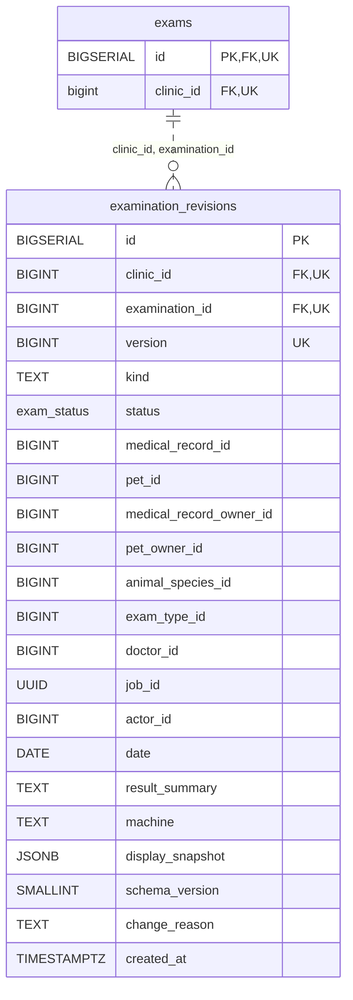

<!-- GENERATED: scripts/tools/generate-erd-detail.py; do not edit -->
# `examination_revisions`

[詳細ERD一覧](index.md) · [概要ERD](../erd.md)

このページは、マイグレーションをファイル名順に静的解析した最終定義です。稼働DBの状態は未確認です。

## カラム

型・DEFAULTはDDLの宣言表記です。`bigserial` は採番宣言であり、DBカタログ上の型名ではありません。

| カラム | 型（DDL） | NULL | DEFAULT（DDL） | キー構成列 | 定義元 |
|:---|:---|:---|:---|:---|:---|
| `id` | `BIGSERIAL` | NOT NULL | — | PK | [001_init.sql:4973](../../../backend/migrations/001_init.sql#L4973) |
| `clinic_id` | `BIGINT` | NOT NULL | — | FK, UK | [001_init.sql:4974](../../../backend/migrations/001_init.sql#L4974) |
| `examination_id` | `BIGINT` | NOT NULL | — | FK, UK | [001_init.sql:4975](../../../backend/migrations/001_init.sql#L4975) |
| `version` | `BIGINT` | NOT NULL | — | UK | [001_init.sql:4976](../../../backend/migrations/001_init.sql#L4976) |
| `kind` | `TEXT` | NOT NULL | — | — | [001_init.sql:4977](../../../backend/migrations/001_init.sql#L4977) |
| `status` | `exam_status` | NOT NULL | — | — | [001_init.sql:4978](../../../backend/migrations/001_init.sql#L4978) |
| `medical_record_id` | `BIGINT` | NULL | — | — | [001_init.sql:4979](../../../backend/migrations/001_init.sql#L4979) |
| `pet_id` | `BIGINT` | NULL | — | — | [001_init.sql:4980](../../../backend/migrations/001_init.sql#L4980) |
| `medical_record_owner_id` | `BIGINT` | NULL | — | — | [001_init.sql:4981](../../../backend/migrations/001_init.sql#L4981) |
| `pet_owner_id` | `BIGINT` | NULL | — | — | [001_init.sql:4982](../../../backend/migrations/001_init.sql#L4982) |
| `animal_species_id` | `BIGINT` | NULL | — | — | [001_init.sql:4983](../../../backend/migrations/001_init.sql#L4983) |
| `exam_type_id` | `BIGINT` | NOT NULL | — | — | [001_init.sql:4984](../../../backend/migrations/001_init.sql#L4984) |
| `doctor_id` | `BIGINT` | NULL | — | — | [001_init.sql:4985](../../../backend/migrations/001_init.sql#L4985) |
| `job_id` | `UUID` | NULL | — | — | [001_init.sql:4986](../../../backend/migrations/001_init.sql#L4986) |
| `actor_id` | `BIGINT` | NOT NULL | — | — | [001_init.sql:4987](../../../backend/migrations/001_init.sql#L4987) |
| `date` | `DATE` | NOT NULL | — | — | [001_init.sql:4988](../../../backend/migrations/001_init.sql#L4988) |
| `result_summary` | `TEXT` | NOT NULL | `''` | — | [001_init.sql:4989](../../../backend/migrations/001_init.sql#L4989) |
| `machine` | `TEXT` | NOT NULL | `''` | — | [001_init.sql:4990](../../../backend/migrations/001_init.sql#L4990) |
| `display_snapshot` | `JSONB` | NOT NULL | — | — | [001_init.sql:4991](../../../backend/migrations/001_init.sql#L4991) |
| `schema_version` | `SMALLINT` | NOT NULL | `1` | — | [001_init.sql:4992](../../../backend/migrations/001_init.sql#L4992) |
| `change_reason` | `TEXT` | NULL | — | — | [001_init.sql:4993](../../../backend/migrations/001_init.sql#L4993) |
| `created_at` | `TIMESTAMPTZ` | NOT NULL | `CURRENT_TIMESTAMP` | — | [001_init.sql:4994](../../../backend/migrations/001_init.sql#L4994) |

PK/FK/UKはキーの構成列を示します。複合キーの各列が単独で一意という意味ではありません。部分uniqueは下記indexの述語を参照してください。

## ERD

このテーブルの全カラムと、すべての参照先を表示します。参照先はFKの対象列だけを表示し、全カラムは各テーブルのページに置きます。

親側の任意参照はFK列のNULL可否、子側の最大1件は無条件のPK/UNIQUEから導出します。部分uniqueによる条件付きの最大件数は図に反映せず、index一覧に記録します。実線はFK全列が子のPKに含まれる識別関係、破線はそれ以外です。

## 外部キー（全件）

| 制約 | 子の列（順序あり） | 参照先 | 親の列（順序あり） | 削除時の動作 | 定義元 |
|:---|:---|:---|:---|:---|:---|
| `fk_examination_revisions_exam` | `clinic_id, examination_id` | [exams](exams.md) | `clinic_id, id` | `ON DELETE RESTRICT` | [001_init.sql:5045](../../../backend/migrations/001_init.sql#L5045) |

正確なON UPDATE・MATCH・DEFERRABLE等を含む制約DDL:

- `fk_examination_revisions_exam`: `CONSTRAINT fk_examination_revisions_exam         FOREIGN KEY (clinic_id, examination_id)         REFERENCES exams (clinic_id, id)         ON DELETE RESTRICT NOT DEFERRABLE`

## その他の制約

| 制約 | 種別 | DDL | 定義元 |
|:---|:---|:---|:---|
| `examination_revisions_pkey` | primary | `PRIMARY KEY` | [001_init.sql:4973](../../../backend/migrations/001_init.sql#L4973) |
| `examination_revisions_version_check` | check | `CHECK (version >= 1)` | [001_init.sql:4976](../../../backend/migrations/001_init.sql#L4976) |
| `examination_revisions_kind_check` | check | `CHECK (kind IN ('working', 'official'))` | [001_init.sql:4977](../../../backend/migrations/001_init.sql#L4977) |
| `uq_examination_revisions_clinic_exam_version` | unique | `CONSTRAINT uq_examination_revisions_clinic_exam_version         UNIQUE (clinic_id, examination_id, version)` | [001_init.sql:4995](../../../backend/migrations/001_init.sql#L4995) |
| `ck_examination_revisions_schema_version` | check | `CONSTRAINT ck_examination_revisions_schema_version         CHECK (schema_version = 1)` | [001_init.sql:4997](../../../backend/migrations/001_init.sql#L4997) |
| `ck_examination_revisions_change_reason` | check | `CONSTRAINT ck_examination_revisions_change_reason         CHECK (change_reason IS NULL OR btrim(change_reason) <> '')` | [001_init.sql:4999](../../../backend/migrations/001_init.sql#L4999) |
| `ck_examination_revisions_kind_status` | check | `CONSTRAINT ck_examination_revisions_kind_status         CHECK (             (kind = 'official' AND status = 'confirmed') OR             (kind = 'working' AND status IN ('pending', 'in_progress', 'result_entered', 'completed'))         )` | [001_init.sql:5001](../../../backend/migrations/001_init.sql#L5001) |
| `ck_examination_revisions_display_snapshot` | check | `CONSTRAINT ck_examination_revisions_display_snapshot         CHECK (             jsonb_typeof(display_snapshot) = 'object' AND             COALESCE(jsonb_typeof(display_snapshot -> 'medical_record_no'), '') = 'string' AND             COALESCE(jsonb_typeof(display_snapshot -> 'pet_name'), '') = 'string' AND             COALESCE(jsonb_typeof(display_snapshot -> 'medical_record_owner_name'), '') = 'string' AND             COALESCE(jsonb_typeof(display_snapshot -> 'pet_owner_name'), '') = 'string' AND             COALESCE(jsonb_typeof(display_snapshot -> 'species_name'), '') = 'string' AND             COALESCE(jsonb_typeof(display_snapshot -> 'exam_type_name'), '') = 'string' AND             COALESCE(jsonb_typeof(display_snapshot -> 'doctor_name'), '') = 'string'         )` | [001_init.sql:5006](../../../backend/migrations/001_init.sql#L5006) |

## インデックス

| 名前 | UNIQUE | 述語 | DDL | 定義元 |
|:---|:---|:---|:---|:---|
| `idx_examination_revisions_latest_kind` | NO | — | `CREATE INDEX idx_examination_revisions_latest_kind     ON examination_revisions (clinic_id, examination_id, kind, version DESC)` | [001_init.sql:5062](../../../backend/migrations/001_init.sql#L5062) |
