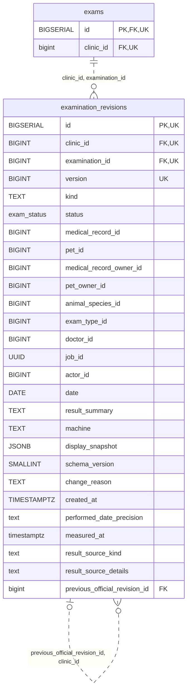

<!-- GENERATED: scripts/tools/generate-erd-detail.py; do not edit -->
# `examination_revisions`

[詳細ERD一覧](index.md) · [概要ERD](../erd.md)

このページは、マイグレーションをファイル名順に静的解析した最終定義です。稼働DBの状態は未確認です。

## カラム

型・DEFAULTはDDLの宣言表記です。`bigserial` は採番宣言であり、DBカタログ上の型名ではありません。

| カラム | 型（DDL） | NULL | DEFAULT（DDL） | キー構成列 | 定義元 |
|:---|:---|:---|:---|:---|:---|
| `id` | `BIGSERIAL` | NOT NULL | — | PK, UK | [001_init.sql:4993](../../../backend/migrations/001_init.sql#L4993) |
| `clinic_id` | `BIGINT` | NOT NULL | — | FK, UK | [001_init.sql:4994](../../../backend/migrations/001_init.sql#L4994) |
| `examination_id` | `BIGINT` | NOT NULL | — | FK, UK | [001_init.sql:4995](../../../backend/migrations/001_init.sql#L4995) |
| `version` | `BIGINT` | NOT NULL | — | UK | [001_init.sql:4996](../../../backend/migrations/001_init.sql#L4996) |
| `kind` | `TEXT` | NOT NULL | — | — | [001_init.sql:4997](../../../backend/migrations/001_init.sql#L4997) |
| `status` | `exam_status` | NOT NULL | — | — | [001_init.sql:4998](../../../backend/migrations/001_init.sql#L4998) |
| `medical_record_id` | `BIGINT` | NULL | — | — | [001_init.sql:4999](../../../backend/migrations/001_init.sql#L4999) |
| `pet_id` | `BIGINT` | NULL | — | — | [001_init.sql:5000](../../../backend/migrations/001_init.sql#L5000) |
| `medical_record_owner_id` | `BIGINT` | NULL | — | — | [001_init.sql:5001](../../../backend/migrations/001_init.sql#L5001) |
| `pet_owner_id` | `BIGINT` | NULL | — | — | [001_init.sql:5002](../../../backend/migrations/001_init.sql#L5002) |
| `animal_species_id` | `BIGINT` | NULL | — | — | [001_init.sql:5003](../../../backend/migrations/001_init.sql#L5003) |
| `exam_type_id` | `BIGINT` | NOT NULL | — | — | [001_init.sql:5004](../../../backend/migrations/001_init.sql#L5004) |
| `doctor_id` | `BIGINT` | NULL | — | — | [001_init.sql:5005](../../../backend/migrations/001_init.sql#L5005) |
| `job_id` | `UUID` | NULL | — | — | [001_init.sql:5006](../../../backend/migrations/001_init.sql#L5006) |
| `actor_id` | `BIGINT` | NOT NULL | — | — | [001_init.sql:5007](../../../backend/migrations/001_init.sql#L5007) |
| `date` | `DATE` | NULL | — | — | [001_init.sql:10129](../../../backend/migrations/001_init.sql#L10129) |
| `result_summary` | `TEXT` | NOT NULL | `''` | — | [001_init.sql:5009](../../../backend/migrations/001_init.sql#L5009) |
| `machine` | `TEXT` | NOT NULL | `''` | — | [001_init.sql:5010](../../../backend/migrations/001_init.sql#L5010) |
| `display_snapshot` | `JSONB` | NOT NULL | — | — | [001_init.sql:5011](../../../backend/migrations/001_init.sql#L5011) |
| `schema_version` | `SMALLINT` | NOT NULL | `1` | — | [001_init.sql:5012](../../../backend/migrations/001_init.sql#L5012) |
| `change_reason` | `TEXT` | NULL | — | — | [001_init.sql:5013](../../../backend/migrations/001_init.sql#L5013) |
| `created_at` | `TIMESTAMPTZ` | NOT NULL | `CURRENT_TIMESTAMP` | — | [001_init.sql:5014](../../../backend/migrations/001_init.sql#L5014) |
| `performed_date_precision` | `text` | NULL | — | — | [001_init.sql:10131](../../../backend/migrations/001_init.sql#L10131) |
| `measured_at` | `timestamptz` | NULL | — | — | [001_init.sql:10132](../../../backend/migrations/001_init.sql#L10132) |
| `result_source_kind` | `text` | NULL | — | — | [001_init.sql:10133](../../../backend/migrations/001_init.sql#L10133) |
| `result_source_details` | `text` | NULL | — | — | [001_init.sql:10134](../../../backend/migrations/001_init.sql#L10134) |
| `previous_official_revision_id` | `bigint` | NULL | — | FK | [001_init.sql:10135](../../../backend/migrations/001_init.sql#L10135) |

PK/FK/UKはキーの構成列を示します。複合キーの各列が単独で一意という意味ではありません。部分uniqueは下記indexの述語を参照してください。

## ERD

このテーブルの全カラムと、すべての参照先を表示します。参照先はFKの対象列だけを表示し、全カラムは各テーブルのページに置きます。

親側の任意参照はFK列のNULL可否、子側の最大1件は無条件のPK/UNIQUEから導出します。部分uniqueによる条件付きの最大件数は図に反映せず、index一覧に記録します。実線はFK全列が子のPKに含まれる識別関係、破線はそれ以外です。

## 外部キー（全件）

| 制約 | 子の列（順序あり） | 参照先 | 親の列（順序あり） | 削除時の動作 | 定義元 |
|:---|:---|:---|:---|:---|:---|
| `fk_examination_revisions_exam` | `clinic_id, examination_id` | [exams](exams.md) | `clinic_id, id` | `ON DELETE RESTRICT` | [001_init.sql:5065](../../../backend/migrations/001_init.sql#L5065) |
| `fk_exam_previous_official` | `previous_official_revision_id, clinic_id` | [examination_revisions](examination_revisions.md) | `id, clinic_id` | `ON DELETE RESTRICT` | [001_init.sql:10136](../../../backend/migrations/001_init.sql#L10136) |

正確なON UPDATE・MATCH・DEFERRABLE等を含む制約DDL:

- `fk_examination_revisions_exam`: `CONSTRAINT fk_examination_revisions_exam         FOREIGN KEY (clinic_id, examination_id)         REFERENCES exams (clinic_id, id)         ON DELETE RESTRICT NOT DEFERRABLE`
- `fk_exam_previous_official`: `CONSTRAINT fk_exam_previous_official FOREIGN KEY(previous_official_revision_id,clinic_id) REFERENCES examination_revisions(id,clinic_id) ON DELETE RESTRICT`

## その他の制約

| 制約 | 種別 | DDL | 定義元 |
|:---|:---|:---|:---|
| `examination_revisions_pkey` | primary | `PRIMARY KEY` | [001_init.sql:4993](../../../backend/migrations/001_init.sql#L4993) |
| `examination_revisions_version_check` | check | `CHECK (version >= 1)` | [001_init.sql:4996](../../../backend/migrations/001_init.sql#L4996) |
| `examination_revisions_kind_check` | check | `CHECK (kind IN ('working', 'official'))` | [001_init.sql:4997](../../../backend/migrations/001_init.sql#L4997) |
| `uq_examination_revisions_clinic_exam_version` | unique | `CONSTRAINT uq_examination_revisions_clinic_exam_version         UNIQUE (clinic_id, examination_id, version)` | [001_init.sql:5015](../../../backend/migrations/001_init.sql#L5015) |
| `ck_examination_revisions_schema_version` | check | `CONSTRAINT ck_examination_revisions_schema_version         CHECK (schema_version = 1)` | [001_init.sql:5017](../../../backend/migrations/001_init.sql#L5017) |
| `ck_examination_revisions_change_reason` | check | `CONSTRAINT ck_examination_revisions_change_reason         CHECK (change_reason IS NULL OR btrim(change_reason) <> '')` | [001_init.sql:5019](../../../backend/migrations/001_init.sql#L5019) |
| `ck_examination_revisions_kind_status` | check | `CONSTRAINT ck_examination_revisions_kind_status         CHECK (             (kind = 'official' AND status = 'confirmed') OR             (kind = 'working' AND status IN ('pending', 'in_progress', 'result_entered', 'completed'))         )` | [001_init.sql:5021](../../../backend/migrations/001_init.sql#L5021) |
| `ck_examination_revisions_display_snapshot` | check | `CONSTRAINT ck_examination_revisions_display_snapshot         CHECK (             jsonb_typeof(display_snapshot) = 'object' AND             COALESCE(jsonb_typeof(display_snapshot -> 'medical_record_no'), '') = 'string' AND             COALESCE(jsonb_typeof(display_snapshot -> 'pet_name'), '') = 'string' AND             COALESCE(jsonb_typeof(display_snapshot -> 'medical_record_owner_name'), '') = 'string' AND             COALESCE(jsonb_typeof(display_snapshot -> 'pet_owner_name'), '') = 'string' AND             COALESCE(jsonb_typeof(display_snapshot -> 'species_name'), '') = 'string' AND             COALESCE(jsonb_typeof(display_snapshot -> 'exam_type_name'), '') = 'string' AND             COALESCE(jsonb_typeof(display_snapshot -> 'doctor_name'), '') = 'string'         )` | [001_init.sql:5026](../../../backend/migrations/001_init.sql#L5026) |
| `uq_examination_revisions_id_clinic` | unique | `CONSTRAINT uq_examination_revisions_id_clinic UNIQUE(id,clinic_id)` | [001_init.sql:9113](../../../backend/migrations/001_init.sql#L9113) |
| `examination_revisions_performed_date_precision_check` | check | `CHECK(performed_date_precision IN('day','unknown'))` | [001_init.sql:10131](../../../backend/migrations/001_init.sql#L10131) |
| `examination_revisions_result_source_kind_check` | check | `CHECK(result_source_kind IN('in_clinic','external_manual','legacy_unknown'))` | [001_init.sql:10133](../../../backend/migrations/001_init.sql#L10133) |
| `ck_exam_revision_date_precision` | check | `CONSTRAINT ck_exam_revision_date_precision CHECK(performed_date_precision IS NULL OR(performed_date_precision='day' AND date IS NOT NULL) OR(performed_date_precision='unknown' AND date IS NULL))` | [001_init.sql:10138](../../../backend/migrations/001_init.sql#L10138) |

## インデックス

| 名前 | UNIQUE | 述語 | DDL | 定義元 |
|:---|:---|:---|:---|:---|
| `idx_examination_revisions_latest_kind` | NO | — | `CREATE INDEX idx_examination_revisions_latest_kind     ON examination_revisions (clinic_id, examination_id, kind, version DESC)` | [001_init.sql:5082](../../../backend/migrations/001_init.sql#L5082) |
