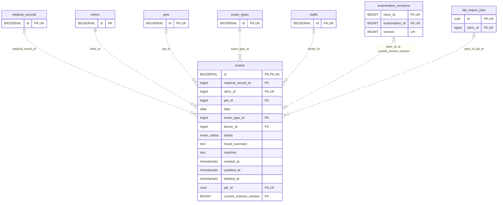

<!-- GENERATED: scripts/tools/generate-erd-detail.py; do not edit -->
# `exams`

[詳細ERD一覧](index.md) · [概要ERD](../erd.md)

このページは、マイグレーションをファイル名順に静的解析した最終定義です。稼働DBの状態は未確認です。

## カラム

型・DEFAULTはDDLの宣言表記です。`bigserial` は採番宣言であり、DBカタログ上の型名ではありません。

| カラム | 型（DDL） | NULL | DEFAULT（DDL） | キー構成列 | 定義元 |
|:---|:---|:---|:---|:---|:---|
| `id` | `BIGSERIAL` | NOT NULL | — | PK, FK, UK | [001_init.sql:1528](../../../backend/migrations/001_init.sql#L1528) |
| `medical_record_id` | `bigint` | NULL | — | FK | [001_init.sql:1529](../../../backend/migrations/001_init.sql#L1529) |
| `clinic_id` | `bigint` | NOT NULL | — | FK, UK | [001_init.sql:1530](../../../backend/migrations/001_init.sql#L1530) |
| `pet_id` | `bigint` | NULL | — | FK | [001_init.sql:1531](../../../backend/migrations/001_init.sql#L1531) |
| `date` | `date` | NOT NULL | — | — | [001_init.sql:1532](../../../backend/migrations/001_init.sql#L1532) |
| `exam_type_id` | `bigint` | NOT NULL | — | FK | [001_init.sql:1533](../../../backend/migrations/001_init.sql#L1533) |
| `doctor_id` | `bigint` | NULL | — | FK | [001_init.sql:1534](../../../backend/migrations/001_init.sql#L1534) |
| `status` | `exam_status` | NULL | `'pending'` | — | [001_init.sql:1535](../../../backend/migrations/001_init.sql#L1535) |
| `result_summary` | `text` | NOT NULL | `''` | — | [001_init.sql:1536](../../../backend/migrations/001_init.sql#L1536) |
| `machine` | `text` | NOT NULL | `''` | — | [001_init.sql:1537](../../../backend/migrations/001_init.sql#L1537) |
| `created_at` | `timestamptz` | NOT NULL | `now()` | — | [001_init.sql:1538](../../../backend/migrations/001_init.sql#L1538) |
| `updated_at` | `timestamptz` | NOT NULL | `now()` | — | [001_init.sql:1539](../../../backend/migrations/001_init.sql#L1539) |
| `deleted_at` | `timestamptz` | NULL | — | — | [001_init.sql:1540](../../../backend/migrations/001_init.sql#L1540) |
| `job_id` | `uuid` | NULL | — | FK, UK | [001_init.sql:3409](../../../backend/migrations/001_init.sql#L3409) |
| `current_revision_version` | `BIGINT` | NULL | — | FK | [001_init.sql:4975](../../../backend/migrations/001_init.sql#L4975) |

PK/FK/UKはキーの構成列を示します。複合キーの各列が単独で一意という意味ではありません。部分uniqueは下記indexの述語を参照してください。

## ERD

このテーブルの全カラムと、すべての参照先を表示します。参照先はFKの対象列だけを表示し、全カラムは各テーブルのページに置きます。

親側の任意参照はFK列のNULL可否、子側の最大1件は無条件のPK/UNIQUEから導出します。部分uniqueによる条件付きの最大件数は図に反映せず、index一覧に記録します。実線はFK全列が子のPKに含まれる識別関係、破線はそれ以外です。

## 外部キー（全件）

| 制約 | 子の列（順序あり） | 参照先 | 親の列（順序あり） | 削除時の動作 | 定義元 |
|:---|:---|:---|:---|:---|:---|
| `exams_medical_record_id_fkey` | `medical_record_id` | [medical_records](medical_records.md) | `id` | `ON DELETE CASCADE` | [001_init.sql:1529](../../../backend/migrations/001_init.sql#L1529) |
| `exams_clinic_id_fkey` | `clinic_id` | [clinics](clinics.md) | `id` | `ON DELETE RESTRICT` | [001_init.sql:1530](../../../backend/migrations/001_init.sql#L1530) |
| `exams_pet_id_fkey` | `pet_id` | [pets](pets.md) | `id` | `ON DELETE RESTRICT` | [001_init.sql:1531](../../../backend/migrations/001_init.sql#L1531) |
| `exams_exam_type_id_fkey` | `exam_type_id` | [exam_types](exam_types.md) | `id` | `ON DELETE RESTRICT` | [001_init.sql:1533](../../../backend/migrations/001_init.sql#L1533) |
| `exams_doctor_id_fkey` | `doctor_id` | [staffs](staffs.md) | `id` | `ON DELETE SET NULL` | [001_init.sql:1534](../../../backend/migrations/001_init.sql#L1534) |
| `fk_exams_current_revision` | `clinic_id, id, current_revision_version` | [examination_revisions](examination_revisions.md) | `clinic_id, examination_id, version` | `ON DELETE RESTRICT` | [001_init.sql:5065](../../../backend/migrations/001_init.sql#L5065) |
| `fk_exams_clinic_job` | `clinic_id, job_id` | [lab_import_jobs](lab_import_jobs.md) | `clinic_id, id` | `ON DELETE RESTRICT` | [001_init.sql:5420](../../../backend/migrations/001_init.sql#L5420) |

正確なON UPDATE・MATCH・DEFERRABLE等を含む制約DDL:

- `exams_medical_record_id_fkey`: `REFERENCES medical_records(id) ON DELETE CASCADE`
- `exams_clinic_id_fkey`: `REFERENCES clinics(id) ON DELETE RESTRICT`
- `exams_pet_id_fkey`: `REFERENCES pets(id) ON DELETE RESTRICT`
- `exams_exam_type_id_fkey`: `REFERENCES exam_types(id) ON DELETE RESTRICT`
- `exams_doctor_id_fkey`: `REFERENCES staffs(id) ON DELETE SET NULL`
- `fk_exams_current_revision`: `CONSTRAINT fk_exams_current_revision         FOREIGN KEY (clinic_id, id, current_revision_version)         REFERENCES examination_revisions (clinic_id, examination_id, version)         ON DELETE RESTRICT NOT DEFERRABLE`
- `fk_exams_clinic_job`: `CONSTRAINT fk_exams_clinic_job     FOREIGN KEY (clinic_id, job_id)     REFERENCES lab_import_jobs (clinic_id, id)     ON DELETE RESTRICT`

## その他の制約

| 制約 | 種別 | DDL | 定義元 |
|:---|:---|:---|:---|
| `exams_pkey` | primary | `PRIMARY KEY` | [001_init.sql:1528](../../../backend/migrations/001_init.sql#L1528) |
| `exams_current_revision_version_check` | check | `CHECK (current_revision_version >= 1)` | [001_init.sql:4975](../../../backend/migrations/001_init.sql#L4975) |
| `uq_exams_clinic_id_id` | unique | `CONSTRAINT uq_exams_clinic_id_id         UNIQUE (clinic_id, id)` | [001_init.sql:4977](../../../backend/migrations/001_init.sql#L4977) |
| `uq_exams_id_clinic` | unique | `CONSTRAINT uq_exams_id_clinic UNIQUE (id, clinic_id)` | [001_init.sql:6171](../../../backend/migrations/001_init.sql#L6171) |

## インデックス

| 名前 | UNIQUE | 述語 | DDL | 定義元 |
|:---|:---|:---|:---|:---|
| `idx_exams_medical_record_id` | NO | — | `CREATE INDEX idx_exams_medical_record_id ON exams(medical_record_id)` | [001_init.sql:2290](../../../backend/migrations/001_init.sql#L2290) |
| `idx_exams_pet_id` | NO | — | `CREATE INDEX idx_exams_pet_id ON exams(pet_id)` | [001_init.sql:2291](../../../backend/migrations/001_init.sql#L2291) |
| `idx_exams_exam_type_id` | NO | — | `CREATE INDEX idx_exams_exam_type_id ON exams(exam_type_id)` | [001_init.sql:2292](../../../backend/migrations/001_init.sql#L2292) |
| `idx_exams_clinic_id` | NO | — | `CREATE INDEX idx_exams_clinic_id ON exams(clinic_id)` | [001_init.sql:2454](../../../backend/migrations/001_init.sql#L2454) |
| `idx_exams_clinic_exam_type_date` | NO | `deleted_at IS NULL` | `CREATE INDEX IF NOT EXISTS idx_exams_clinic_exam_type_date     ON exams (clinic_id, exam_type_id, date)     WHERE deleted_at IS NULL` | [001_init.sql:3394](../../../backend/migrations/001_init.sql#L3394) |
| `idx_exams_current_revision_pointer` | NO | — | `CREATE INDEX idx_exams_current_revision_pointer     ON exams (clinic_id, id, current_revision_version)` | [001_init.sql:5076](../../../backend/migrations/001_init.sql#L5076) |
| `uq_exams_clinic_id_job_id` | YES | — | `CREATE UNIQUE INDEX IF NOT EXISTS uq_exams_clinic_id_job_id     ON exams (clinic_id, id, job_id)` | [001_init.sql:5399](../../../backend/migrations/001_init.sql#L5399) |
| `idx_exams_clinic_job_fk` | NO | `job_id IS NOT NULL` | `CREATE INDEX idx_exams_clinic_job_fk     ON exams (clinic_id, job_id)     WHERE job_id IS NOT NULL` | [001_init.sql:5410](../../../backend/migrations/001_init.sql#L5410) |
| `idx_exams_clinic_job_active` | NO | `deleted_at IS NULL AND job_id IS NOT NULL` | `CREATE INDEX IF NOT EXISTS idx_exams_clinic_job_active     ON exams (clinic_id, job_id, id)     WHERE deleted_at IS NULL AND job_id IS NOT NULL` | [001_init.sql:5415](../../../backend/migrations/001_init.sql#L5415) |
