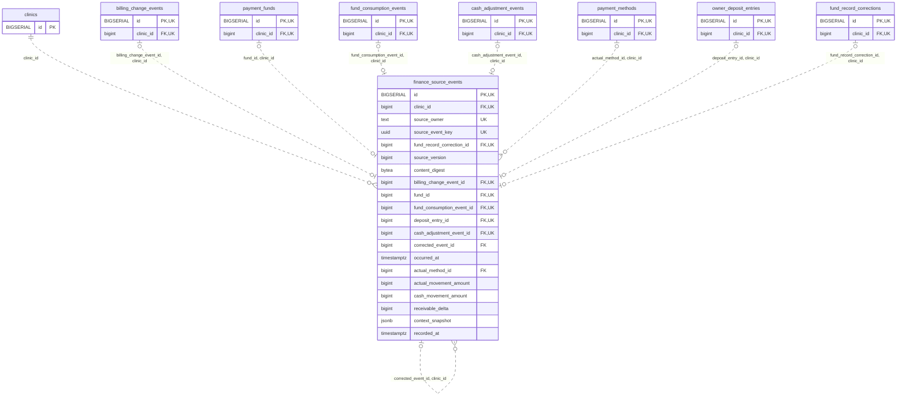

<!-- GENERATED: scripts/tools/generate-erd-detail.py; do not edit -->
# `finance_source_events`

[詳細ERD一覧](index.md) · [概要ERD](../erd.md)

このページは、マイグレーションをファイル名順に静的解析した最終定義です。稼働DBの状態は未確認です。

## カラム

型・DEFAULTはDDLの宣言表記です。`bigserial` は採番宣言であり、DBカタログ上の型名ではありません。

| カラム | 型（DDL） | NULL | DEFAULT（DDL） | キー構成列 | 定義元 |
|:---|:---|:---|:---|:---|:---|
| `id` | `BIGSERIAL` | NOT NULL | — | PK, UK | [001_init.sql:9820](../../../backend/migrations/001_init.sql#L9820) |
| `clinic_id` | `bigint` | NOT NULL | — | FK, UK | [001_init.sql:9821](../../../backend/migrations/001_init.sql#L9821) |
| `source_owner` | `text` | NOT NULL | — | UK | [001_init.sql:9822](../../../backend/migrations/001_init.sql#L9822) |
| `source_event_key` | `uuid` | NOT NULL | — | UK | [001_init.sql:9823](../../../backend/migrations/001_init.sql#L9823) |
| `fund_record_correction_id` | `bigint` | NULL | — | FK, UK | [001_init.sql:9824](../../../backend/migrations/001_init.sql#L9824) |
| `source_version` | `bigint` | NOT NULL | — | — | [001_init.sql:9825](../../../backend/migrations/001_init.sql#L9825) |
| `content_digest` | `bytea` | NOT NULL | — | — | [001_init.sql:9826](../../../backend/migrations/001_init.sql#L9826) |
| `billing_change_event_id` | `bigint` | NULL | — | FK, UK | [001_init.sql:9827](../../../backend/migrations/001_init.sql#L9827) |
| `fund_id` | `bigint` | NULL | — | FK, UK | [001_init.sql:9828](../../../backend/migrations/001_init.sql#L9828) |
| `fund_consumption_event_id` | `bigint` | NULL | — | FK, UK | [001_init.sql:9829](../../../backend/migrations/001_init.sql#L9829) |
| `deposit_entry_id` | `bigint` | NULL | — | FK, UK | [001_init.sql:9830](../../../backend/migrations/001_init.sql#L9830) |
| `cash_adjustment_event_id` | `bigint` | NULL | — | FK, UK | [001_init.sql:9831](../../../backend/migrations/001_init.sql#L9831) |
| `corrected_event_id` | `bigint` | NULL | — | FK | [001_init.sql:9832](../../../backend/migrations/001_init.sql#L9832) |
| `occurred_at` | `timestamptz` | NOT NULL | — | — | [001_init.sql:9833](../../../backend/migrations/001_init.sql#L9833) |
| `actual_method_id` | `bigint` | NULL | — | FK | [001_init.sql:9834](../../../backend/migrations/001_init.sql#L9834) |
| `actual_movement_amount` | `bigint` | NOT NULL | — | — | [001_init.sql:9835](../../../backend/migrations/001_init.sql#L9835) |
| `cash_movement_amount` | `bigint` | NOT NULL | — | — | [001_init.sql:9836](../../../backend/migrations/001_init.sql#L9836) |
| `receivable_delta` | `bigint` | NOT NULL | — | — | [001_init.sql:9837](../../../backend/migrations/001_init.sql#L9837) |
| `context_snapshot` | `jsonb` | NOT NULL | — | — | [001_init.sql:9838](../../../backend/migrations/001_init.sql#L9838) |
| `recorded_at` | `timestamptz` | NOT NULL | `clock_timestamp()` | — | [001_init.sql:9839](../../../backend/migrations/001_init.sql#L9839) |

PK/FK/UKはキーの構成列を示します。複合キーの各列が単独で一意という意味ではありません。部分uniqueは下記indexの述語を参照してください。

## ERD

このテーブルの全カラムと、すべての参照先を表示します。参照先はFKの対象列だけを表示し、全カラムは各テーブルのページに置きます。

親側の任意参照はFK列のNULL可否、子側の最大1件は無条件のPK/UNIQUEから導出します。部分uniqueによる条件付きの最大件数は図に反映せず、index一覧に記録します。実線はFK全列が子のPKに含まれる識別関係、破線はそれ以外です。

## 外部キー（全件）

| 制約 | 子の列（順序あり） | 参照先 | 親の列（順序あり） | 削除時の動作 | 定義元 |
|:---|:---|:---|:---|:---|:---|
| `finance_source_events_clinic_id_fkey` | `clinic_id` | [clinics](clinics.md) | `id` | `ON DELETE RESTRICT` | [001_init.sql:9821](../../../backend/migrations/001_init.sql#L9821) |
| `finance_source_events_billing_change_event_id_clinic_id_fkey` | `billing_change_event_id, clinic_id` | [billing_change_events](billing_change_events.md) | `id, clinic_id` | `ON DELETE RESTRICT` | [001_init.sql:9849](../../../backend/migrations/001_init.sql#L9849) |
| `finance_source_events_fund_id_clinic_id_fkey` | `fund_id, clinic_id` | [payment_funds](payment_funds.md) | `id, clinic_id` | `ON DELETE RESTRICT` | [001_init.sql:9850](../../../backend/migrations/001_init.sql#L9850) |
| `finance_source_events_fund_consumption_event_id_clinic_id_fkey` | `fund_consumption_event_id, clinic_id` | [fund_consumption_events](fund_consumption_events.md) | `id, clinic_id` | `ON DELETE RESTRICT` | [001_init.sql:9851](../../../backend/migrations/001_init.sql#L9851) |
| `finance_source_events_cash_adjustment_event_id_clinic_id_fkey` | `cash_adjustment_event_id, clinic_id` | [cash_adjustment_events](cash_adjustment_events.md) | `id, clinic_id` | `ON DELETE RESTRICT` | [001_init.sql:9853](../../../backend/migrations/001_init.sql#L9853) |
| `finance_source_events_corrected_event_id_clinic_id_fkey` | `corrected_event_id, clinic_id` | [finance_source_events](finance_source_events.md) | `id, clinic_id` | `ON DELETE RESTRICT` | [001_init.sql:9854](../../../backend/migrations/001_init.sql#L9854) |
| `finance_source_events_actual_method_id_clinic_id_fkey` | `actual_method_id, clinic_id` | [payment_methods](payment_methods.md) | `id, clinic_id` | `ON DELETE RESTRICT` | [001_init.sql:9855](../../../backend/migrations/001_init.sql#L9855) |
| `fk_finance_deposit_event_clinic` | `deposit_entry_id, clinic_id` | [owner_deposit_entries](owner_deposit_entries.md) | `id, clinic_id` | `ON DELETE RESTRICT` | [001_init.sql:10106](../../../backend/migrations/001_init.sql#L10106) |
| `fk_finance_fund_correction` | `fund_record_correction_id, clinic_id` | [fund_record_corrections](fund_record_corrections.md) | `id, clinic_id` | `ON DELETE RESTRICT` | [001_init.sql:10109](../../../backend/migrations/001_init.sql#L10109) |

正確なON UPDATE・MATCH・DEFERRABLE等を含む制約DDL:

- `finance_source_events_clinic_id_fkey`: `REFERENCES clinics(id) ON DELETE RESTRICT`
- `finance_source_events_billing_change_event_id_clinic_id_fkey`: `FOREIGN KEY (billing_change_event_id,clinic_id) REFERENCES billing_change_events(id,clinic_id) ON DELETE RESTRICT`
- `finance_source_events_fund_id_clinic_id_fkey`: `FOREIGN KEY (fund_id,clinic_id) REFERENCES payment_funds(id,clinic_id) ON DELETE RESTRICT`
- `finance_source_events_fund_consumption_event_id_clinic_id_fkey`: `FOREIGN KEY (fund_consumption_event_id,clinic_id) REFERENCES fund_consumption_events(id,clinic_id) ON DELETE RESTRICT`
- `finance_source_events_cash_adjustment_event_id_clinic_id_fkey`: `FOREIGN KEY (cash_adjustment_event_id,clinic_id) REFERENCES cash_adjustment_events(id,clinic_id) ON DELETE RESTRICT`
- `finance_source_events_corrected_event_id_clinic_id_fkey`: `FOREIGN KEY (corrected_event_id,clinic_id) REFERENCES finance_source_events(id,clinic_id) ON DELETE RESTRICT`
- `finance_source_events_actual_method_id_clinic_id_fkey`: `FOREIGN KEY (actual_method_id,clinic_id) REFERENCES payment_methods(id,clinic_id) ON DELETE RESTRICT`
- `fk_finance_deposit_event_clinic`: `CONSTRAINT fk_finance_deposit_event_clinic FOREIGN KEY(deposit_entry_id,clinic_id) REFERENCES owner_deposit_entries(id,clinic_id) ON DELETE RESTRICT`
- `fk_finance_fund_correction`: `CONSTRAINT fk_finance_fund_correction FOREIGN KEY(fund_record_correction_id,clinic_id) REFERENCES fund_record_corrections(id,clinic_id) ON DELETE RESTRICT`

## その他の制約

| 制約 | 種別 | DDL | 定義元 |
|:---|:---|:---|:---|
| `finance_source_events_pkey` | primary | `PRIMARY KEY` | [001_init.sql:9820](../../../backend/migrations/001_init.sql#L9820) |
| `finance_source_events_source_version_check` | check | `CHECK (source_version > 0)` | [001_init.sql:9825](../../../backend/migrations/001_init.sql#L9825) |
| `finance_source_events_content_digest_check` | check | `CHECK (octet_length(content_digest)=32)` | [001_init.sql:9826](../../../backend/migrations/001_init.sql#L9826) |
| `finance_source_events_context_snapshot_check` | check | `CHECK (jsonb_typeof(context_snapshot)='object')` | [001_init.sql:9838](../../../backend/migrations/001_init.sql#L9838) |
| `finance_source_events_id_clinic_id_key` | unique | `UNIQUE (id,clinic_id)` | [001_init.sql:9840](../../../backend/migrations/001_init.sql#L9840) |
| `finance_source_events_clinic_id_source_owner_source_event_k_key` | unique | `UNIQUE (clinic_id,source_owner,source_event_key)` | [001_init.sql:9841](../../../backend/migrations/001_init.sql#L9841) |
| `finance_source_events_clinic_id_billing_change_event_id_key` | unique | `UNIQUE (clinic_id,billing_change_event_id)` | [001_init.sql:9842](../../../backend/migrations/001_init.sql#L9842) |
| `finance_source_events_clinic_id_fund_id_key` | unique | `UNIQUE (clinic_id,fund_id)` | [001_init.sql:9843](../../../backend/migrations/001_init.sql#L9843) |
| `finance_source_events_clinic_id_fund_consumption_event_id_key` | unique | `UNIQUE (clinic_id,fund_consumption_event_id)` | [001_init.sql:9844](../../../backend/migrations/001_init.sql#L9844) |
| `finance_source_events_clinic_id_deposit_entry_id_key` | unique | `UNIQUE (clinic_id,deposit_entry_id)` | [001_init.sql:9845](../../../backend/migrations/001_init.sql#L9845) |
| `finance_source_events_clinic_id_cash_adjustment_event_id_key` | unique | `UNIQUE (clinic_id,cash_adjustment_event_id)` | [001_init.sql:9846](../../../backend/migrations/001_init.sql#L9846) |
| `ck_finance_typed_source` | check | `CONSTRAINT ck_finance_typed_source CHECK (num_nonnulls(billing_change_event_id,fund_id,fund_consumption_event_id,deposit_entry_id,cash_adjustment_event_id,fund_record_correction_id)=1)` | [001_init.sql:9847](../../../backend/migrations/001_init.sql#L9847) |
| `finance_source_events_check` | check | `CHECK (actual_movement_amount=0 OR actual_method_id IS NOT NULL)` | [001_init.sql:9848](../../../backend/migrations/001_init.sql#L9848) |
| `uq_finance_fund_correction` | unique | `CONSTRAINT uq_finance_fund_correction UNIQUE(fund_record_correction_id)` | [001_init.sql:10110](../../../backend/migrations/001_init.sql#L10110) |

## インデックス

明示的なCREATE INDEXなし。PK/UNIQUEに付随する暗黙のindexは制約欄を参照してください。
