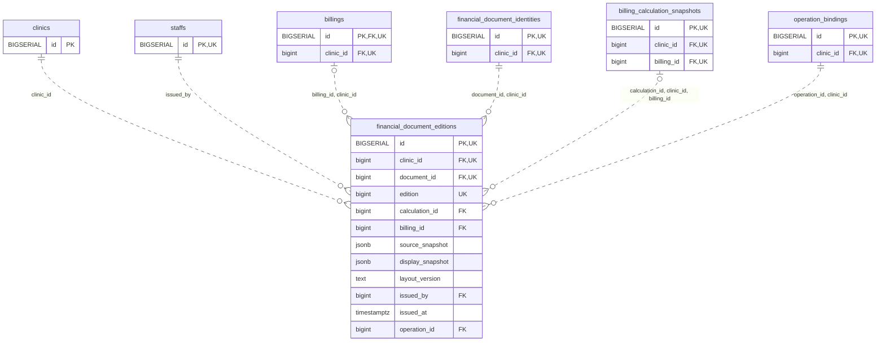

<!-- GENERATED: scripts/tools/generate-erd-detail.py; do not edit -->
# `financial_document_editions`

[詳細ERD一覧](index.md) · [概要ERD](../erd.md)

このページは、マイグレーションをファイル名順に静的解析した最終定義です。稼働DBの状態は未確認です。

## カラム

型・DEFAULTはDDLの宣言表記です。`bigserial` は採番宣言であり、DBカタログ上の型名ではありません。

| カラム | 型（DDL） | NULL | DEFAULT（DDL） | キー構成列 | 定義元 |
|:---|:---|:---|:---|:---|:---|
| `id` | `BIGSERIAL` | NOT NULL | — | PK, UK | [001_init.sql:9713](../../../backend/migrations/001_init.sql#L9713) |
| `clinic_id` | `bigint` | NOT NULL | — | FK, UK | [001_init.sql:9714](../../../backend/migrations/001_init.sql#L9714) |
| `document_id` | `bigint` | NOT NULL | — | FK, UK | [001_init.sql:9715](../../../backend/migrations/001_init.sql#L9715) |
| `edition` | `bigint` | NOT NULL | — | UK | [001_init.sql:9716](../../../backend/migrations/001_init.sql#L9716) |
| `calculation_id` | `bigint` | NULL | — | FK | [001_init.sql:9717](../../../backend/migrations/001_init.sql#L9717) |
| `billing_id` | `bigint` | NULL | — | FK | [001_init.sql:9718](../../../backend/migrations/001_init.sql#L9718) |
| `source_snapshot` | `jsonb` | NOT NULL | — | — | [001_init.sql:9719](../../../backend/migrations/001_init.sql#L9719) |
| `display_snapshot` | `jsonb` | NOT NULL | — | — | [001_init.sql:9720](../../../backend/migrations/001_init.sql#L9720) |
| `layout_version` | `text` | NOT NULL | — | — | [001_init.sql:9721](../../../backend/migrations/001_init.sql#L9721) |
| `issued_by` | `bigint` | NOT NULL | — | FK | [001_init.sql:9722](../../../backend/migrations/001_init.sql#L9722) |
| `issued_at` | `timestamptz` | NOT NULL | `clock_timestamp()` | — | [001_init.sql:9723](../../../backend/migrations/001_init.sql#L9723) |
| `operation_id` | `bigint` | NOT NULL | — | FK | [001_init.sql:9724](../../../backend/migrations/001_init.sql#L9724) |

PK/FK/UKはキーの構成列を示します。複合キーの各列が単独で一意という意味ではありません。部分uniqueは下記indexの述語を参照してください。

## ERD

このテーブルの全カラムと、すべての参照先を表示します。参照先はFKの対象列だけを表示し、全カラムは各テーブルのページに置きます。

親側の任意参照はFK列のNULL可否、子側の最大1件は無条件のPK/UNIQUEから導出します。部分uniqueによる条件付きの最大件数は図に反映せず、index一覧に記録します。実線はFK全列が子のPKに含まれる識別関係、破線はそれ以外です。

## 外部キー（全件）

| 制約 | 子の列（順序あり） | 参照先 | 親の列（順序あり） | 削除時の動作 | 定義元 |
|:---|:---|:---|:---|:---|:---|
| `financial_document_editions_clinic_id_fkey` | `clinic_id` | [clinics](clinics.md) | `id` | `ON DELETE RESTRICT` | [001_init.sql:9714](../../../backend/migrations/001_init.sql#L9714) |
| `financial_document_editions_issued_by_fkey` | `issued_by` | [staffs](staffs.md) | `id` | `ON DELETE RESTRICT` | [001_init.sql:9722](../../../backend/migrations/001_init.sql#L9722) |
| `financial_document_editions_billing_id_clinic_id_fkey` | `billing_id, clinic_id` | [billings](billings.md) | `id, clinic_id` | `ON DELETE RESTRICT` | [001_init.sql:9728](../../../backend/migrations/001_init.sql#L9728) |
| `financial_document_editions_document_id_clinic_id_fkey` | `document_id, clinic_id` | [financial_document_identities](financial_document_identities.md) | `id, clinic_id` | `ON DELETE RESTRICT` | [001_init.sql:9729](../../../backend/migrations/001_init.sql#L9729) |
| `financial_document_editions_calculation_id_clinic_id_billi_fkey` | `calculation_id, clinic_id, billing_id` | [billing_calculation_snapshots](billing_calculation_snapshots.md) | `id, clinic_id, billing_id` | `ON DELETE RESTRICT` | [001_init.sql:9730](../../../backend/migrations/001_init.sql#L9730) |
| `financial_document_editions_operation_id_clinic_id_fkey` | `operation_id, clinic_id` | [operation_bindings](operation_bindings.md) | `id, clinic_id` | `ON DELETE RESTRICT` | [001_init.sql:9731](../../../backend/migrations/001_init.sql#L9731) |

正確なON UPDATE・MATCH・DEFERRABLE等を含む制約DDL:

- `financial_document_editions_clinic_id_fkey`: `REFERENCES clinics(id) ON DELETE RESTRICT`
- `financial_document_editions_issued_by_fkey`: `REFERENCES staffs(id) ON DELETE RESTRICT`
- `financial_document_editions_billing_id_clinic_id_fkey`: `FOREIGN KEY (billing_id,clinic_id) REFERENCES billings(id,clinic_id) ON DELETE RESTRICT`
- `financial_document_editions_document_id_clinic_id_fkey`: `FOREIGN KEY (document_id,clinic_id) REFERENCES financial_document_identities(id,clinic_id) ON DELETE RESTRICT`
- `financial_document_editions_calculation_id_clinic_id_billi_fkey`: `FOREIGN KEY (calculation_id,clinic_id,billing_id) REFERENCES billing_calculation_snapshots(id,clinic_id,billing_id) ON DELETE RESTRICT`
- `financial_document_editions_operation_id_clinic_id_fkey`: `FOREIGN KEY (operation_id,clinic_id) REFERENCES operation_bindings(id,clinic_id) ON DELETE RESTRICT`

## その他の制約

| 制約 | 種別 | DDL | 定義元 |
|:---|:---|:---|:---|
| `financial_document_editions_pkey` | primary | `PRIMARY KEY` | [001_init.sql:9713](../../../backend/migrations/001_init.sql#L9713) |
| `financial_document_editions_edition_check` | check | `CHECK (edition > 0)` | [001_init.sql:9716](../../../backend/migrations/001_init.sql#L9716) |
| `financial_document_editions_source_snapshot_check` | check | `CHECK (jsonb_typeof(source_snapshot)='object')` | [001_init.sql:9719](../../../backend/migrations/001_init.sql#L9719) |
| `financial_document_editions_display_snapshot_check` | check | `CHECK (jsonb_typeof(display_snapshot)='object')` | [001_init.sql:9720](../../../backend/migrations/001_init.sql#L9720) |
| `financial_document_editions_id_clinic_id_key` | unique | `UNIQUE (id,clinic_id)` | [001_init.sql:9725](../../../backend/migrations/001_init.sql#L9725) |
| `financial_document_editions_clinic_id_document_id_edition_key` | unique | `UNIQUE (clinic_id,document_id,edition)` | [001_init.sql:9726](../../../backend/migrations/001_init.sql#L9726) |
| `financial_document_editions_check` | check | `CHECK (calculation_id IS NULL OR billing_id IS NOT NULL)` | [001_init.sql:9727](../../../backend/migrations/001_init.sql#L9727) |

## インデックス

明示的なCREATE INDEXなし。PK/UNIQUEに付随する暗黙のindexは制約欄を参照してください。
