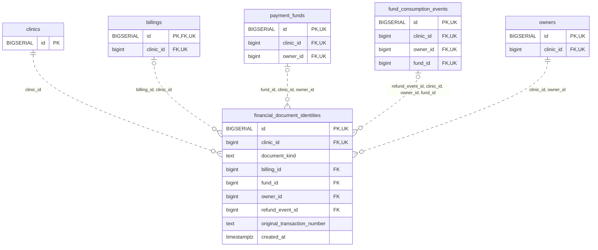

<!-- GENERATED: scripts/tools/generate-erd-detail.py; do not edit -->
# `financial_document_identities`

[詳細ERD一覧](index.md) · [概要ERD](../erd.md)

このページは、マイグレーションをファイル名順に静的解析した最終定義です。稼働DBの状態は未確認です。

## カラム

型・DEFAULTはDDLの宣言表記です。`bigserial` は採番宣言であり、DBカタログ上の型名ではありません。

| カラム | 型（DDL） | NULL | DEFAULT（DDL） | キー構成列 | 定義元 |
|:---|:---|:---|:---|:---|:---|
| `id` | `BIGSERIAL` | NOT NULL | — | PK, UK | [001_init.sql:9678](../../../backend/migrations/001_init.sql#L9678) |
| `clinic_id` | `bigint` | NOT NULL | — | FK, UK | [001_init.sql:9679](../../../backend/migrations/001_init.sql#L9679) |
| `document_kind` | `text` | NOT NULL | — | — | [001_init.sql:9680](../../../backend/migrations/001_init.sql#L9680) |
| `billing_id` | `bigint` | NULL | — | FK | [001_init.sql:9681](../../../backend/migrations/001_init.sql#L9681) |
| `fund_id` | `bigint` | NULL | — | FK | [001_init.sql:9682](../../../backend/migrations/001_init.sql#L9682) |
| `owner_id` | `bigint` | NOT NULL | — | FK | [001_init.sql:9683](../../../backend/migrations/001_init.sql#L9683) |
| `refund_event_id` | `bigint` | NULL | — | FK | [001_init.sql:9684](../../../backend/migrations/001_init.sql#L9684) |
| `original_transaction_number` | `text` | NOT NULL | — | — | [001_init.sql:9685](../../../backend/migrations/001_init.sql#L9685) |
| `created_at` | `timestamptz` | NOT NULL | `clock_timestamp()` | — | [001_init.sql:9686](../../../backend/migrations/001_init.sql#L9686) |

PK/FK/UKはキーの構成列を示します。複合キーの各列が単独で一意という意味ではありません。部分uniqueは下記indexの述語を参照してください。

## ERD

このテーブルの全カラムと、すべての参照先を表示します。参照先はFKの対象列だけを表示し、全カラムは各テーブルのページに置きます。

親側の任意参照はFK列のNULL可否、子側の最大1件は無条件のPK/UNIQUEから導出します。部分uniqueによる条件付きの最大件数は図に反映せず、index一覧に記録します。実線はFK全列が子のPKに含まれる識別関係、破線はそれ以外です。

## 外部キー（全件）

| 制約 | 子の列（順序あり） | 参照先 | 親の列（順序あり） | 削除時の動作 | 定義元 |
|:---|:---|:---|:---|:---|:---|
| `financial_document_identities_clinic_id_fkey` | `clinic_id` | [clinics](clinics.md) | `id` | `ON DELETE RESTRICT` | [001_init.sql:9679](../../../backend/migrations/001_init.sql#L9679) |
| `financial_document_identities_billing_id_clinic_id_fkey` | `billing_id, clinic_id` | [billings](billings.md) | `id, clinic_id` | `ON DELETE RESTRICT` | [001_init.sql:9691](../../../backend/migrations/001_init.sql#L9691) |
| `financial_document_identities_fund_id_clinic_id_owner_id_fkey` | `fund_id, clinic_id, owner_id` | [payment_funds](payment_funds.md) | `id, clinic_id, owner_id` | `ON DELETE RESTRICT` | [001_init.sql:9692](../../../backend/migrations/001_init.sql#L9692) |
| `financial_document_identities_refund_event_id_clinic_id_ow_fkey` | `refund_event_id, clinic_id, owner_id, fund_id` | [fund_consumption_events](fund_consumption_events.md) | `id, clinic_id, owner_id, fund_id` | `ON DELETE RESTRICT` | [001_init.sql:9693](../../../backend/migrations/001_init.sql#L9693) |
| `financial_document_identities_clinic_id_owner_id_fkey` | `clinic_id, owner_id` | [owners](owners.md) | `clinic_id, id` | `ON DELETE RESTRICT` | [001_init.sql:9694](../../../backend/migrations/001_init.sql#L9694) |

正確なON UPDATE・MATCH・DEFERRABLE等を含む制約DDL:

- `financial_document_identities_clinic_id_fkey`: `REFERENCES clinics(id) ON DELETE RESTRICT`
- `financial_document_identities_billing_id_clinic_id_fkey`: `FOREIGN KEY (billing_id,clinic_id) REFERENCES billings(id,clinic_id) ON DELETE RESTRICT`
- `financial_document_identities_fund_id_clinic_id_owner_id_fkey`: `FOREIGN KEY (fund_id,clinic_id,owner_id) REFERENCES payment_funds(id,clinic_id,owner_id) ON DELETE RESTRICT`
- `financial_document_identities_refund_event_id_clinic_id_ow_fkey`: `FOREIGN KEY (refund_event_id,clinic_id,owner_id,fund_id) REFERENCES fund_consumption_events(id,clinic_id,owner_id,fund_id) ON DELETE RESTRICT`
- `financial_document_identities_clinic_id_owner_id_fkey`: `FOREIGN KEY (clinic_id,owner_id) REFERENCES owners(clinic_id,id) ON DELETE RESTRICT`

## その他の制約

| 制約 | 種別 | DDL | 定義元 |
|:---|:---|:---|:---|
| `financial_document_identities_pkey` | primary | `PRIMARY KEY` | [001_init.sql:9678](../../../backend/migrations/001_init.sql#L9678) |
| `financial_document_identities_document_kind_check` | check | `CHECK (document_kind IN ('invoice','payment_receipt','deposit_receipt','refund_receipt'))` | [001_init.sql:9680](../../../backend/migrations/001_init.sql#L9680) |
| `financial_document_identities_id_clinic_id_key` | unique | `UNIQUE (id,clinic_id)` | [001_init.sql:9687](../../../backend/migrations/001_init.sql#L9687) |
| `financial_document_identities_check` | check | `CHECK ((document_kind='invoice' AND billing_id IS NOT NULL AND fund_id IS NULL AND refund_event_id IS NULL)       OR (document_kind IN ('payment_receipt','deposit_receipt') AND fund_id IS NOT NULL AND refund_event_id IS NULL)       OR (document_kind='refund_receipt' AND fund_id IS NOT NULL AND refund_event_id IS NOT NULL))` | [001_init.sql:9688](../../../backend/migrations/001_init.sql#L9688) |

## インデックス

明示的なCREATE INDEXなし。PK/UNIQUEに付随する暗黙のindexは制約欄を参照してください。
