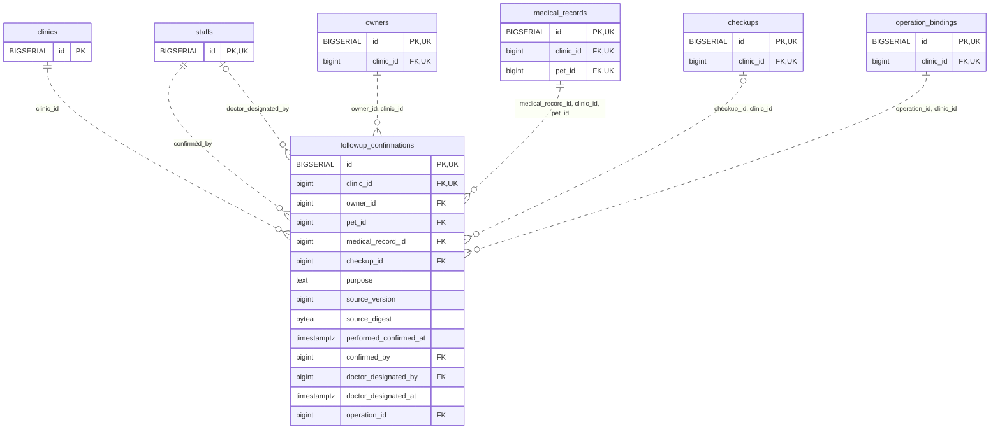

<!-- GENERATED: scripts/tools/generate-erd-detail.py; do not edit -->
# `followup_confirmations`

[詳細ERD一覧](index.md) · [概要ERD](../erd.md)

このページは、マイグレーションをファイル名順に静的解析した最終定義です。稼働DBの状態は未確認です。

## カラム

型・DEFAULTはDDLの宣言表記です。`bigserial` は採番宣言であり、DBカタログ上の型名ではありません。

| カラム | 型（DDL） | NULL | DEFAULT（DDL） | キー構成列 | 定義元 |
|:---|:---|:---|:---|:---|:---|
| `id` | `BIGSERIAL` | NOT NULL | — | PK, UK | [001_init.sql:10170](../../../backend/migrations/001_init.sql#L10170) |
| `clinic_id` | `bigint` | NOT NULL | — | FK, UK | [001_init.sql:10170](../../../backend/migrations/001_init.sql#L10170) |
| `owner_id` | `bigint` | NOT NULL | — | FK | [001_init.sql:10171](../../../backend/migrations/001_init.sql#L10171) |
| `pet_id` | `bigint` | NOT NULL | — | FK | [001_init.sql:10171](../../../backend/migrations/001_init.sql#L10171) |
| `medical_record_id` | `bigint` | NOT NULL | — | FK | [001_init.sql:10171](../../../backend/migrations/001_init.sql#L10171) |
| `checkup_id` | `bigint` | NULL | — | FK | [001_init.sql:10172](../../../backend/migrations/001_init.sql#L10172) |
| `purpose` | `text` | NOT NULL | — | — | [001_init.sql:10172](../../../backend/migrations/001_init.sql#L10172) |
| `source_version` | `bigint` | NOT NULL | — | — | [001_init.sql:10173](../../../backend/migrations/001_init.sql#L10173) |
| `source_digest` | `bytea` | NOT NULL | — | — | [001_init.sql:10173](../../../backend/migrations/001_init.sql#L10173) |
| `performed_confirmed_at` | `timestamptz` | NOT NULL | — | — | [001_init.sql:10174](../../../backend/migrations/001_init.sql#L10174) |
| `confirmed_by` | `bigint` | NOT NULL | — | FK | [001_init.sql:10174](../../../backend/migrations/001_init.sql#L10174) |
| `doctor_designated_by` | `bigint` | NULL | — | FK | [001_init.sql:10175](../../../backend/migrations/001_init.sql#L10175) |
| `doctor_designated_at` | `timestamptz` | NULL | — | — | [001_init.sql:10175](../../../backend/migrations/001_init.sql#L10175) |
| `operation_id` | `bigint` | NOT NULL | — | FK | [001_init.sql:10176](../../../backend/migrations/001_init.sql#L10176) |

PK/FK/UKはキーの構成列を示します。複合キーの各列が単独で一意という意味ではありません。部分uniqueは下記indexの述語を参照してください。

## ERD

このテーブルの全カラムと、すべての参照先を表示します。参照先はFKの対象列だけを表示し、全カラムは各テーブルのページに置きます。

親側の任意参照はFK列のNULL可否、子側の最大1件は無条件のPK/UNIQUEから導出します。部分uniqueによる条件付きの最大件数は図に反映せず、index一覧に記録します。実線はFK全列が子のPKに含まれる識別関係、破線はそれ以外です。

## 外部キー（全件）

| 制約 | 子の列（順序あり） | 参照先 | 親の列（順序あり） | 削除時の動作 | 定義元 |
|:---|:---|:---|:---|:---|:---|
| `followup_confirmations_clinic_id_fkey` | `clinic_id` | [clinics](clinics.md) | `id` | `ON DELETE RESTRICT` | [001_init.sql:10170](../../../backend/migrations/001_init.sql#L10170) |
| `followup_confirmations_confirmed_by_fkey` | `confirmed_by` | [staffs](staffs.md) | `id` | `ON DELETE RESTRICT` | [001_init.sql:10174](../../../backend/migrations/001_init.sql#L10174) |
| `followup_confirmations_doctor_designated_by_fkey` | `doctor_designated_by` | [staffs](staffs.md) | `id` | `ON DELETE RESTRICT` | [001_init.sql:10175](../../../backend/migrations/001_init.sql#L10175) |
| `followup_confirmations_owner_id_clinic_id_fkey` | `owner_id, clinic_id` | [owners](owners.md) | `id, clinic_id` | `ON DELETE RESTRICT` | [001_init.sql:10178](../../../backend/migrations/001_init.sql#L10178) |
| `followup_confirmations_medical_record_id_clinic_id_pet_id_fkey` | `medical_record_id, clinic_id, pet_id` | [medical_records](medical_records.md) | `id, clinic_id, pet_id` | `ON DELETE RESTRICT` | [001_init.sql:10179](../../../backend/migrations/001_init.sql#L10179) |
| `followup_confirmations_checkup_id_clinic_id_fkey` | `checkup_id, clinic_id` | [checkups](checkups.md) | `id, clinic_id` | `ON DELETE RESTRICT` | [001_init.sql:10180](../../../backend/migrations/001_init.sql#L10180) |
| `followup_confirmations_operation_id_clinic_id_fkey` | `operation_id, clinic_id` | [operation_bindings](operation_bindings.md) | `id, clinic_id` | `ON DELETE RESTRICT` | [001_init.sql:10181](../../../backend/migrations/001_init.sql#L10181) |

正確なON UPDATE・MATCH・DEFERRABLE等を含む制約DDL:

- `followup_confirmations_clinic_id_fkey`: `REFERENCES clinics(id) ON DELETE RESTRICT`
- `followup_confirmations_confirmed_by_fkey`: `REFERENCES staffs(id) ON DELETE RESTRICT`
- `followup_confirmations_doctor_designated_by_fkey`: `REFERENCES staffs(id) ON DELETE RESTRICT`
- `followup_confirmations_owner_id_clinic_id_fkey`: `FOREIGN KEY(owner_id,clinic_id) REFERENCES owners(id,clinic_id) ON DELETE RESTRICT`
- `followup_confirmations_medical_record_id_clinic_id_pet_id_fkey`: `FOREIGN KEY(medical_record_id,clinic_id,pet_id) REFERENCES medical_records(id,clinic_id,pet_id) ON DELETE RESTRICT`
- `followup_confirmations_checkup_id_clinic_id_fkey`: `FOREIGN KEY(checkup_id,clinic_id) REFERENCES checkups(id,clinic_id) ON DELETE RESTRICT`
- `followup_confirmations_operation_id_clinic_id_fkey`: `FOREIGN KEY(operation_id,clinic_id) REFERENCES operation_bindings(id,clinic_id) ON DELETE RESTRICT`

## その他の制約

| 制約 | 種別 | DDL | 定義元 |
|:---|:---|:---|:---|
| `followup_confirmations_pkey` | primary | `PRIMARY KEY` | [001_init.sql:10170](../../../backend/migrations/001_init.sql#L10170) |
| `followup_confirmations_purpose_check` | check | `CHECK(purpose IN('general_guidance','medical_followup'))` | [001_init.sql:10172](../../../backend/migrations/001_init.sql#L10172) |
| `followup_confirmations_source_version_check` | check | `CHECK(source_version>0)` | [001_init.sql:10173](../../../backend/migrations/001_init.sql#L10173) |
| `followup_confirmations_source_digest_check` | check | `CHECK(octet_length(source_digest)=32)` | [001_init.sql:10173](../../../backend/migrations/001_init.sql#L10173) |
| `followup_confirmations_id_clinic_id_key` | unique | `UNIQUE(id,clinic_id)` | [001_init.sql:10176](../../../backend/migrations/001_init.sql#L10176) |
| `followup_confirmations_check` | check | `CHECK(purpose<>'medical_followup' OR(doctor_designated_by IS NOT NULL AND doctor_designated_at IS NOT NULL))` | [001_init.sql:10177](../../../backend/migrations/001_init.sql#L10177) |

## インデックス

明示的なCREATE INDEXなし。PK/UNIQUEに付随する暗黙のindexは制約欄を参照してください。
