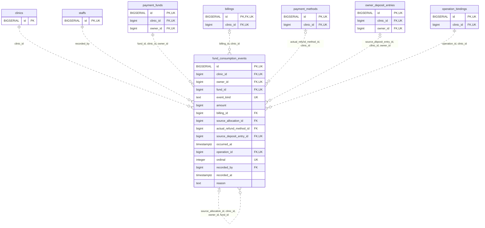

<!-- GENERATED: scripts/tools/generate-erd-detail.py; do not edit -->
# `fund_consumption_events`

[詳細ERD一覧](index.md) · [概要ERD](../erd.md)

このページは、マイグレーションをファイル名順に静的解析した最終定義です。稼働DBの状態は未確認です。

## カラム

型・DEFAULTはDDLの宣言表記です。`bigserial` は採番宣言であり、DBカタログ上の型名ではありません。

| カラム | 型（DDL） | NULL | DEFAULT（DDL） | キー構成列 | 定義元 |
|:---|:---|:---|:---|:---|:---|
| `id` | `BIGSERIAL` | NOT NULL | — | PK, UK | [001_init.sql:9622](../../../backend/migrations/001_init.sql#L9622) |
| `clinic_id` | `bigint` | NOT NULL | — | FK, UK | [001_init.sql:9623](../../../backend/migrations/001_init.sql#L9623) |
| `owner_id` | `bigint` | NOT NULL | — | FK, UK | [001_init.sql:9624](../../../backend/migrations/001_init.sql#L9624) |
| `fund_id` | `bigint` | NOT NULL | — | FK, UK | [001_init.sql:9625](../../../backend/migrations/001_init.sql#L9625) |
| `event_kind` | `text` | NOT NULL | — | UK | [001_init.sql:9626](../../../backend/migrations/001_init.sql#L9626) |
| `amount` | `bigint` | NOT NULL | — | — | [001_init.sql:9627](../../../backend/migrations/001_init.sql#L9627) |
| `billing_id` | `bigint` | NULL | — | FK | [001_init.sql:9628](../../../backend/migrations/001_init.sql#L9628) |
| `source_allocation_id` | `bigint` | NULL | — | FK | [001_init.sql:9629](../../../backend/migrations/001_init.sql#L9629) |
| `actual_refund_method_id` | `bigint` | NULL | — | FK | [001_init.sql:9630](../../../backend/migrations/001_init.sql#L9630) |
| `source_deposit_entry_id` | `bigint` | NULL | — | FK, UK | [001_init.sql:9631](../../../backend/migrations/001_init.sql#L9631) |
| `occurred_at` | `timestamptz` | NOT NULL | — | — | [001_init.sql:9632](../../../backend/migrations/001_init.sql#L9632) |
| `operation_id` | `bigint` | NOT NULL | — | FK, UK | [001_init.sql:9633](../../../backend/migrations/001_init.sql#L9633) |
| `ordinal` | `integer` | NOT NULL | — | UK | [001_init.sql:9634](../../../backend/migrations/001_init.sql#L9634) |
| `recorded_by` | `bigint` | NOT NULL | — | FK | [001_init.sql:9635](../../../backend/migrations/001_init.sql#L9635) |
| `recorded_at` | `timestamptz` | NOT NULL | `clock_timestamp()` | — | [001_init.sql:9636](../../../backend/migrations/001_init.sql#L9636) |
| `reason` | `text` | NULL | — | — | [001_init.sql:10947](../../../backend/migrations/001_init.sql#L10947) |

PK/FK/UKはキーの構成列を示します。複合キーの各列が単独で一意という意味ではありません。部分uniqueは下記indexの述語を参照してください。

## ERD

このテーブルの全カラムと、すべての参照先を表示します。参照先はFKの対象列だけを表示し、全カラムは各テーブルのページに置きます。

親側の任意参照はFK列のNULL可否、子側の最大1件は無条件のPK/UNIQUEから導出します。部分uniqueによる条件付きの最大件数は図に反映せず、index一覧に記録します。実線はFK全列が子のPKに含まれる識別関係、破線はそれ以外です。

## 外部キー（全件）

| 制約 | 子の列（順序あり） | 参照先 | 親の列（順序あり） | 削除時の動作 | 定義元 |
|:---|:---|:---|:---|:---|:---|
| `fund_consumption_events_clinic_id_fkey` | `clinic_id` | [clinics](clinics.md) | `id` | `ON DELETE RESTRICT` | [001_init.sql:9623](../../../backend/migrations/001_init.sql#L9623) |
| `fund_consumption_events_recorded_by_fkey` | `recorded_by` | [staffs](staffs.md) | `id` | `ON DELETE RESTRICT` | [001_init.sql:9635](../../../backend/migrations/001_init.sql#L9635) |
| `fund_consumption_events_fund_id_clinic_id_owner_id_fkey` | `fund_id, clinic_id, owner_id` | [payment_funds](payment_funds.md) | `id, clinic_id, owner_id` | `ON DELETE RESTRICT` | [001_init.sql:9643](../../../backend/migrations/001_init.sql#L9643) |
| `fund_consumption_events_source_allocation_id_clinic_id_own_fkey` | `source_allocation_id, clinic_id, owner_id, fund_id` | [fund_consumption_events](fund_consumption_events.md) | `id, clinic_id, owner_id, fund_id` | `ON DELETE RESTRICT` | [001_init.sql:9644](../../../backend/migrations/001_init.sql#L9644) |
| `fund_consumption_events_billing_id_clinic_id_fkey` | `billing_id, clinic_id` | [billings](billings.md) | `id, clinic_id` | `ON DELETE RESTRICT` | [001_init.sql:9645](../../../backend/migrations/001_init.sql#L9645) |
| `fund_consumption_events_actual_refund_method_id_clinic_id_fkey` | `actual_refund_method_id, clinic_id` | [payment_methods](payment_methods.md) | `id, clinic_id` | `ON DELETE RESTRICT` | [001_init.sql:9646](../../../backend/migrations/001_init.sql#L9646) |
| `fund_consumption_events_source_deposit_entry_id_clinic_id__fkey` | `source_deposit_entry_id, clinic_id, owner_id` | [owner_deposit_entries](owner_deposit_entries.md) | `id, clinic_id, owner_id` | `ON DELETE RESTRICT` | [001_init.sql:9647](../../../backend/migrations/001_init.sql#L9647) |
| `fund_consumption_events_operation_id_clinic_id_fkey` | `operation_id, clinic_id` | [operation_bindings](operation_bindings.md) | `id, clinic_id` | `ON DELETE RESTRICT` | [001_init.sql:9648](../../../backend/migrations/001_init.sql#L9648) |

正確なON UPDATE・MATCH・DEFERRABLE等を含む制約DDL:

- `fund_consumption_events_clinic_id_fkey`: `REFERENCES clinics(id) ON DELETE RESTRICT`
- `fund_consumption_events_recorded_by_fkey`: `REFERENCES staffs(id) ON DELETE RESTRICT`
- `fund_consumption_events_fund_id_clinic_id_owner_id_fkey`: `FOREIGN KEY (fund_id,clinic_id,owner_id) REFERENCES payment_funds(id,clinic_id,owner_id) ON DELETE RESTRICT`
- `fund_consumption_events_source_allocation_id_clinic_id_own_fkey`: `FOREIGN KEY (source_allocation_id,clinic_id,owner_id,fund_id) REFERENCES fund_consumption_events(id,clinic_id,owner_id,fund_id) ON DELETE RESTRICT`
- `fund_consumption_events_billing_id_clinic_id_fkey`: `FOREIGN KEY (billing_id,clinic_id) REFERENCES billings(id,clinic_id) ON DELETE RESTRICT`
- `fund_consumption_events_actual_refund_method_id_clinic_id_fkey`: `FOREIGN KEY (actual_refund_method_id,clinic_id) REFERENCES payment_methods(id,clinic_id) ON DELETE RESTRICT`
- `fund_consumption_events_source_deposit_entry_id_clinic_id__fkey`: `FOREIGN KEY (source_deposit_entry_id,clinic_id,owner_id) REFERENCES owner_deposit_entries(id,clinic_id,owner_id) ON DELETE RESTRICT`
- `fund_consumption_events_operation_id_clinic_id_fkey`: `FOREIGN KEY (operation_id,clinic_id) REFERENCES operation_bindings(id,clinic_id) ON DELETE RESTRICT`

## その他の制約

| 制約 | 種別 | DDL | 定義元 |
|:---|:---|:---|:---|
| `fund_consumption_events_pkey` | primary | `PRIMARY KEY` | [001_init.sql:9622](../../../backend/migrations/001_init.sql#L9622) |
| `fund_consumption_events_amount_check` | check | `CHECK (amount > 0)` | [001_init.sql:9627](../../../backend/migrations/001_init.sql#L9627) |
| `fund_consumption_events_ordinal_check` | check | `CHECK (ordinal > 0)` | [001_init.sql:9634](../../../backend/migrations/001_init.sql#L9634) |
| `fund_consumption_events_id_clinic_id_owner_id_fund_id_key` | unique | `UNIQUE (id,clinic_id,owner_id,fund_id)` | [001_init.sql:9637](../../../backend/migrations/001_init.sql#L9637) |
| `fund_consumption_events_clinic_id_operation_id_ordinal_key` | unique | `UNIQUE (clinic_id,operation_id,ordinal)` | [001_init.sql:9639](../../../backend/migrations/001_init.sql#L9639) |
| `uq_fund_consumption_id_clinic` | unique | `CONSTRAINT uq_fund_consumption_id_clinic UNIQUE(id,clinic_id)` | [001_init.sql:9834](../../../backend/migrations/001_init.sql#L9834) |
| `ck_fund_consumption_kind` | check | `CONSTRAINT ck_fund_consumption_kind CHECK(event_kind IN('allocate','release','refund','deposit_allocate','deposit_release'))` | [001_init.sql:10948](../../../backend/migrations/001_init.sql#L10948) |
| `ck_fund_consumption_target` | check | `CONSTRAINT ck_fund_consumption_target CHECK(  (event_kind='allocate' AND billing_id IS NOT NULL AND source_allocation_id IS NULL AND actual_refund_method_id IS NULL)  OR(event_kind='release' AND billing_id IS NOT NULL AND source_allocation_id IS NOT NULL AND actual_refund_method_id IS NULL)  OR(event_kind='refund' AND billing_id IS NULL AND source_allocation_id IS NULL AND actual_refund_method_id IS NOT NULL AND reason IS NOT NULL AND btrim(reason)<>'')  OR(event_kind='deposit_allocate' AND billing_id IS NULL AND source_deposit_entry_id IS NOT NULL AND source_allocation_id IS NULL AND actual_refund_method_id IS NULL)  OR(event_kind='deposit_release' AND billing_id IS NULL AND source_deposit_entry_id IS NOT NULL AND source_allocation_id IS NOT NULL AND actual_refund_method_id IS NULL))` | [001_init.sql:10949](../../../backend/migrations/001_init.sql#L10949) |
| `uq_fund_deposit_projection_kind` | unique | `CONSTRAINT uq_fund_deposit_projection_kind UNIQUE(clinic_id,source_deposit_entry_id,event_kind)` | [001_init.sql:10955](../../../backend/migrations/001_init.sql#L10955) |

## インデックス

| 名前 | UNIQUE | 述語 | DDL | 定義元 |
|:---|:---|:---|:---|:---|
| `idx_fund_consumption_source` | NO | — | `CREATE INDEX idx_fund_consumption_source ON fund_consumption_events(clinic_id,fund_id,source_allocation_id)` | [001_init.sql:9650](../../../backend/migrations/001_init.sql#L9650) |
| `idx_fund_consumption_bill` | NO | — | `CREATE INDEX idx_fund_consumption_bill ON fund_consumption_events(clinic_id,billing_id,occurred_at)` | [001_init.sql:9651](../../../backend/migrations/001_init.sql#L9651) |
