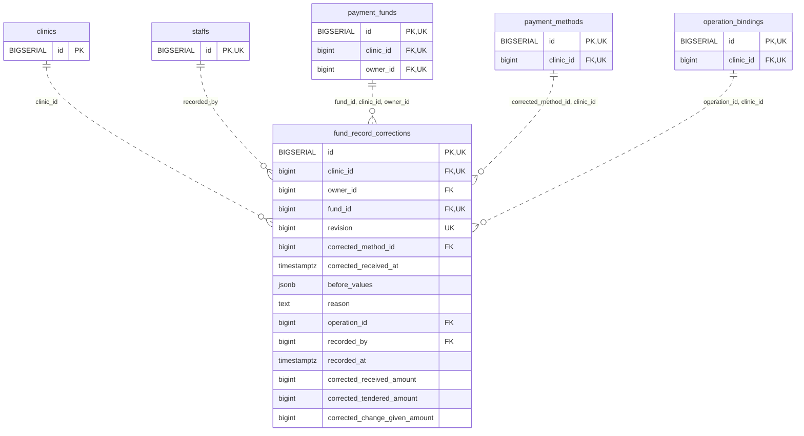

<!-- GENERATED: scripts/tools/generate-erd-detail.py; do not edit -->
# `fund_record_corrections`

[詳細ERD一覧](index.md) · [概要ERD](../erd.md)

このページは、マイグレーションをファイル名順に静的解析した最終定義です。稼働DBの状態は未確認です。

## カラム

型・DEFAULTはDDLの宣言表記です。`bigserial` は採番宣言であり、DBカタログ上の型名ではありません。

| カラム | 型（DDL） | NULL | DEFAULT（DDL） | キー構成列 | 定義元 |
|:---|:---|:---|:---|:---|:---|
| `id` | `BIGSERIAL` | NOT NULL | — | PK, UK | [001_init.sql:9653](../../../backend/migrations/001_init.sql#L9653) |
| `clinic_id` | `bigint` | NOT NULL | — | FK, UK | [001_init.sql:9654](../../../backend/migrations/001_init.sql#L9654) |
| `owner_id` | `bigint` | NOT NULL | — | FK | [001_init.sql:9655](../../../backend/migrations/001_init.sql#L9655) |
| `fund_id` | `bigint` | NOT NULL | — | FK, UK | [001_init.sql:9656](../../../backend/migrations/001_init.sql#L9656) |
| `revision` | `bigint` | NOT NULL | — | UK | [001_init.sql:9657](../../../backend/migrations/001_init.sql#L9657) |
| `corrected_method_id` | `bigint` | NOT NULL | — | FK | [001_init.sql:10939](../../../backend/migrations/001_init.sql#L10939) |
| `corrected_received_at` | `timestamptz` | NOT NULL | — | — | [001_init.sql:10940](../../../backend/migrations/001_init.sql#L10940) |
| `before_values` | `jsonb` | NOT NULL | — | — | [001_init.sql:9660](../../../backend/migrations/001_init.sql#L9660) |
| `reason` | `text` | NOT NULL | — | — | [001_init.sql:9661](../../../backend/migrations/001_init.sql#L9661) |
| `operation_id` | `bigint` | NOT NULL | — | FK | [001_init.sql:9662](../../../backend/migrations/001_init.sql#L9662) |
| `recorded_by` | `bigint` | NOT NULL | — | FK | [001_init.sql:9663](../../../backend/migrations/001_init.sql#L9663) |
| `recorded_at` | `timestamptz` | NOT NULL | `clock_timestamp()` | — | [001_init.sql:9664](../../../backend/migrations/001_init.sql#L9664) |
| `corrected_received_amount` | `bigint` | NOT NULL | — | — | [001_init.sql:10936](../../../backend/migrations/001_init.sql#L10936) |
| `corrected_tendered_amount` | `bigint` | NULL | — | — | [001_init.sql:10937](../../../backend/migrations/001_init.sql#L10937) |
| `corrected_change_given_amount` | `bigint` | NULL | — | — | [001_init.sql:10938](../../../backend/migrations/001_init.sql#L10938) |

PK/FK/UKはキーの構成列を示します。複合キーの各列が単独で一意という意味ではありません。部分uniqueは下記indexの述語を参照してください。

## ERD

このテーブルの全カラムと、すべての参照先を表示します。参照先はFKの対象列だけを表示し、全カラムは各テーブルのページに置きます。

親側の任意参照はFK列のNULL可否、子側の最大1件は無条件のPK/UNIQUEから導出します。部分uniqueによる条件付きの最大件数は図に反映せず、index一覧に記録します。実線はFK全列が子のPKに含まれる識別関係、破線はそれ以外です。

## 外部キー（全件）

| 制約 | 子の列（順序あり） | 参照先 | 親の列（順序あり） | 削除時の動作 | 定義元 |
|:---|:---|:---|:---|:---|:---|
| `fund_record_corrections_clinic_id_fkey` | `clinic_id` | [clinics](clinics.md) | `id` | `ON DELETE RESTRICT` | [001_init.sql:9654](../../../backend/migrations/001_init.sql#L9654) |
| `fund_record_corrections_recorded_by_fkey` | `recorded_by` | [staffs](staffs.md) | `id` | `ON DELETE RESTRICT` | [001_init.sql:9663](../../../backend/migrations/001_init.sql#L9663) |
| `fund_record_corrections_fund_id_clinic_id_owner_id_fkey` | `fund_id, clinic_id, owner_id` | [payment_funds](payment_funds.md) | `id, clinic_id, owner_id` | `ON DELETE RESTRICT` | [001_init.sql:9666](../../../backend/migrations/001_init.sql#L9666) |
| `fund_record_corrections_corrected_method_id_clinic_id_fkey` | `corrected_method_id, clinic_id` | [payment_methods](payment_methods.md) | `id, clinic_id` | `ON DELETE RESTRICT` | [001_init.sql:9667](../../../backend/migrations/001_init.sql#L9667) |
| `fund_record_corrections_operation_id_clinic_id_fkey` | `operation_id, clinic_id` | [operation_bindings](operation_bindings.md) | `id, clinic_id` | `ON DELETE RESTRICT` | [001_init.sql:9668](../../../backend/migrations/001_init.sql#L9668) |

正確なON UPDATE・MATCH・DEFERRABLE等を含む制約DDL:

- `fund_record_corrections_clinic_id_fkey`: `REFERENCES clinics(id) ON DELETE RESTRICT`
- `fund_record_corrections_recorded_by_fkey`: `REFERENCES staffs(id) ON DELETE RESTRICT`
- `fund_record_corrections_fund_id_clinic_id_owner_id_fkey`: `FOREIGN KEY (fund_id,clinic_id,owner_id) REFERENCES payment_funds(id,clinic_id,owner_id) ON DELETE RESTRICT`
- `fund_record_corrections_corrected_method_id_clinic_id_fkey`: `FOREIGN KEY (corrected_method_id,clinic_id) REFERENCES payment_methods(id,clinic_id) ON DELETE RESTRICT`
- `fund_record_corrections_operation_id_clinic_id_fkey`: `FOREIGN KEY (operation_id,clinic_id) REFERENCES operation_bindings(id,clinic_id) ON DELETE RESTRICT`

## その他の制約

| 制約 | 種別 | DDL | 定義元 |
|:---|:---|:---|:---|
| `fund_record_corrections_pkey` | primary | `PRIMARY KEY` | [001_init.sql:9653](../../../backend/migrations/001_init.sql#L9653) |
| `fund_record_corrections_revision_check` | check | `CHECK (revision > 0)` | [001_init.sql:9657](../../../backend/migrations/001_init.sql#L9657) |
| `fund_record_corrections_before_values_check` | check | `CHECK (jsonb_typeof(before_values)='object')` | [001_init.sql:9660](../../../backend/migrations/001_init.sql#L9660) |
| `fund_record_corrections_reason_check` | check | `CHECK (btrim(reason)<>'')` | [001_init.sql:9661](../../../backend/migrations/001_init.sql#L9661) |
| `fund_record_corrections_clinic_id_fund_id_revision_key` | unique | `UNIQUE (clinic_id,fund_id,revision)` | [001_init.sql:9665](../../../backend/migrations/001_init.sql#L9665) |
| `uq_fund_correction_id_clinic` | unique | `CONSTRAINT uq_fund_correction_id_clinic UNIQUE(id,clinic_id)` | [001_init.sql:10123](../../../backend/migrations/001_init.sql#L10123) |
| `fund_record_corrections_corrected_received_amount_check` | check | `CHECK(corrected_received_amount>0)` | [001_init.sql:10936](../../../backend/migrations/001_init.sql#L10936) |
| `fund_record_corrections_corrected_tendered_amount_check` | check | `CHECK(corrected_tendered_amount>=0)` | [001_init.sql:10937](../../../backend/migrations/001_init.sql#L10937) |
| `fund_record_corrections_corrected_change_given_amount_check` | check | `CHECK(corrected_change_given_amount>=0)` | [001_init.sql:10938](../../../backend/migrations/001_init.sql#L10938) |
| `ck_fund_correction_cash_inputs` | check | `CONSTRAINT ck_fund_correction_cash_inputs CHECK((corrected_tendered_amount IS NULL AND corrected_change_given_amount IS NULL)  OR(corrected_tendered_amount IS NOT NULL AND corrected_change_given_amount IS NOT NULL AND corrected_received_amount=corrected_tendered_amount-corrected_change_given_amount))` | [001_init.sql:10941](../../../backend/migrations/001_init.sql#L10941) |

## インデックス

明示的なCREATE INDEXなし。PK/UNIQUEに付随する暗黙のindexは制約欄を参照してください。
