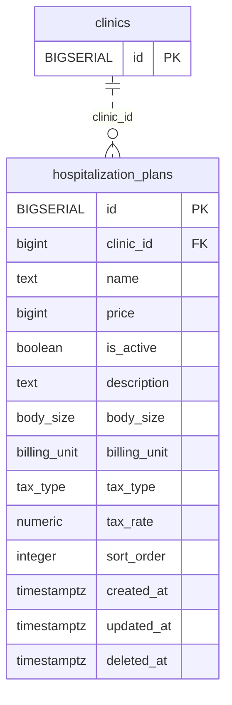

<!-- GENERATED: scripts/tools/generate-erd-detail.py; do not edit -->
# `hospitalization_plans`

[詳細ERD一覧](index.md) · [概要ERD](../erd.md)

このページは、マイグレーションをファイル名順に静的解析した最終定義です。稼働DBの状態は未確認です。

## カラム

型・DEFAULTはDDLの宣言表記です。`bigserial` は採番宣言であり、DBカタログ上の型名ではありません。

| カラム | 型（DDL） | NULL | DEFAULT（DDL） | キー構成列 | 定義元 |
|:---|:---|:---|:---|:---|:---|
| `id` | `BIGSERIAL` | NOT NULL | — | PK | [001_init.sql:970](../../../backend/migrations/001_init.sql#L970) |
| `clinic_id` | `bigint` | NOT NULL | — | FK | [001_init.sql:971](../../../backend/migrations/001_init.sql#L971) |
| `name` | `text` | NOT NULL | — | — | [001_init.sql:972](../../../backend/migrations/001_init.sql#L972) |
| `price` | `bigint` | NULL | — | — | [001_init.sql:973](../../../backend/migrations/001_init.sql#L973) |
| `is_active` | `boolean` | NOT NULL | `true` | — | [001_init.sql:974](../../../backend/migrations/001_init.sql#L974) |
| `description` | `text` | NOT NULL | `''` | — | [001_init.sql:975](../../../backend/migrations/001_init.sql#L975) |
| `body_size` | `body_size` | NULL | — | — | [001_init.sql:976](../../../backend/migrations/001_init.sql#L976) |
| `billing_unit` | `billing_unit` | NULL | `'per_day'` | — | [001_init.sql:977](../../../backend/migrations/001_init.sql#L977) |
| `tax_type` | `tax_type` | NOT NULL | `'excluded'` | — | [001_init.sql:978](../../../backend/migrations/001_init.sql#L978) |
| `tax_rate` | `numeric` | NOT NULL | `0.10` | — | [001_init.sql:979](../../../backend/migrations/001_init.sql#L979) |
| `sort_order` | `integer` | NULL | `0` | — | [001_init.sql:980](../../../backend/migrations/001_init.sql#L980) |
| `created_at` | `timestamptz` | NOT NULL | `now()` | — | [001_init.sql:981](../../../backend/migrations/001_init.sql#L981) |
| `updated_at` | `timestamptz` | NOT NULL | `now()` | — | [001_init.sql:982](../../../backend/migrations/001_init.sql#L982) |
| `deleted_at` | `timestamptz` | NULL | — | — | [001_init.sql:983](../../../backend/migrations/001_init.sql#L983) |

PK/FK/UKはキーの構成列を示します。複合キーの各列が単独で一意という意味ではありません。部分uniqueは下記indexの述語を参照してください。

## ERD

このテーブルの全カラムと、すべての参照先を表示します。参照先はFKの対象列だけを表示し、全カラムは各テーブルのページに置きます。

親側の任意参照はFK列のNULL可否、子側の最大1件は無条件のPK/UNIQUEから導出します。部分uniqueによる条件付きの最大件数は図に反映せず、index一覧に記録します。実線はFK全列が子のPKに含まれる識別関係、破線はそれ以外です。

## 外部キー（全件）

| 制約 | 子の列（順序あり） | 参照先 | 親の列（順序あり） | 削除時の動作 | 定義元 |
|:---|:---|:---|:---|:---|:---|
| `hospitalization_plans_clinic_id_fkey` | `clinic_id` | [clinics](clinics.md) | `id` | `ON DELETE RESTRICT` | [001_init.sql:971](../../../backend/migrations/001_init.sql#L971) |

正確なON UPDATE・MATCH・DEFERRABLE等を含む制約DDL:

- `hospitalization_plans_clinic_id_fkey`: `REFERENCES clinics(id) ON DELETE RESTRICT`

## その他の制約

| 制約 | 種別 | DDL | 定義元 |
|:---|:---|:---|:---|
| `hospitalization_plans_pkey` | primary | `PRIMARY KEY` | [001_init.sql:970](../../../backend/migrations/001_init.sql#L970) |

## インデックス

| 名前 | UNIQUE | 述語 | DDL | 定義元 |
|:---|:---|:---|:---|:---|
| `idx_hospitalization_plans_clinic_id` | NO | — | `CREATE INDEX idx_hospitalization_plans_clinic_id ON hospitalization_plans(clinic_id)` | [001_init.sql:2245](../../../backend/migrations/001_init.sql#L2245) |
| `idx_hospitalization_plans_clinic_name` | YES | `deleted_at IS NULL` | `CREATE UNIQUE INDEX idx_hospitalization_plans_clinic_name ON hospitalization_plans(clinic_id, name) WHERE deleted_at IS NULL` | [001_init.sql:2482](../../../backend/migrations/001_init.sql#L2482) |
| `idx_hospitalization_plans_active` | NO | `deleted_at IS NULL` | `CREATE INDEX idx_hospitalization_plans_active ON hospitalization_plans(clinic_id, id) WHERE deleted_at IS NULL` | [001_init.sql:2505](../../../backend/migrations/001_init.sql#L2505) |
