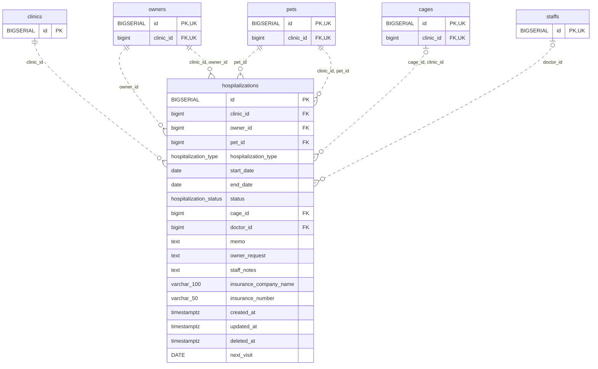

<!-- GENERATED: scripts/tools/generate-erd-detail.py; do not edit -->
# `hospitalizations`

[詳細ERD一覧](index.md) · [概要ERD](../erd.md)

このページは、マイグレーションをファイル名順に静的解析した最終定義です。稼働DBの状態は未確認です。

## カラム

型・DEFAULTはDDLの宣言表記です。`bigserial` は採番宣言であり、DBカタログ上の型名ではありません。

| カラム | 型（DDL） | NULL | DEFAULT（DDL） | キー構成列 | 定義元 |
|:---|:---|:---|:---|:---|:---|
| `id` | `BIGSERIAL` | NOT NULL | — | PK | [001_init.sql:1359](../../../backend/migrations/001_init.sql#L1359) |
| `clinic_id` | `bigint` | NOT NULL | — | FK | [001_init.sql:1360](../../../backend/migrations/001_init.sql#L1360) |
| `owner_id` | `bigint` | NOT NULL | — | FK | [001_init.sql:1361](../../../backend/migrations/001_init.sql#L1361) |
| `pet_id` | `bigint` | NOT NULL | — | FK | [001_init.sql:1362](../../../backend/migrations/001_init.sql#L1362) |
| `hospitalization_type` | `hospitalization_type` | NOT NULL | — | — | [001_init.sql:1363](../../../backend/migrations/001_init.sql#L1363) |
| `start_date` | `date` | NOT NULL | — | — | [001_init.sql:1364](../../../backend/migrations/001_init.sql#L1364) |
| `end_date` | `date` | NOT NULL | — | — | [001_init.sql:1365](../../../backend/migrations/001_init.sql#L1365) |
| `status` | `hospitalization_status` | NULL | `'reserved'` | — | [001_init.sql:1366](../../../backend/migrations/001_init.sql#L1366) |
| `cage_id` | `bigint` | NULL | — | FK | [001_init.sql:1367](../../../backend/migrations/001_init.sql#L1367) |
| `doctor_id` | `bigint` | NULL | — | FK | [001_init.sql:1368](../../../backend/migrations/001_init.sql#L1368) |
| `memo` | `text` | NOT NULL | `''` | — | [001_init.sql:1369](../../../backend/migrations/001_init.sql#L1369) |
| `owner_request` | `text` | NOT NULL | `''` | — | [001_init.sql:1370](../../../backend/migrations/001_init.sql#L1370) |
| `staff_notes` | `text` | NOT NULL | `''` | — | [001_init.sql:1371](../../../backend/migrations/001_init.sql#L1371) |
| `insurance_company_name` | `varchar(100)` | NULL | — | — | [001_init.sql:1372](../../../backend/migrations/001_init.sql#L1372) |
| `insurance_number` | `varchar(50)` | NULL | — | — | [001_init.sql:1373](../../../backend/migrations/001_init.sql#L1373) |
| `created_at` | `timestamptz` | NOT NULL | `now()` | — | [001_init.sql:1374](../../../backend/migrations/001_init.sql#L1374) |
| `updated_at` | `timestamptz` | NOT NULL | `now()` | — | [001_init.sql:1375](../../../backend/migrations/001_init.sql#L1375) |
| `deleted_at` | `timestamptz` | NULL | — | — | [001_init.sql:1376](../../../backend/migrations/001_init.sql#L1376) |
| `next_visit` | `DATE` | NULL | — | — | [001_init.sql:7553](../../../backend/migrations/001_init.sql#L7553) |

PK/FK/UKはキーの構成列を示します。複合キーの各列が単独で一意という意味ではありません。部分uniqueは下記indexの述語を参照してください。

## ERD

このテーブルの全カラムと、すべての参照先を表示します。参照先はFKの対象列だけを表示し、全カラムは各テーブルのページに置きます。

親側の任意参照はFK列のNULL可否、子側の最大1件は無条件のPK/UNIQUEから導出します。部分uniqueによる条件付きの最大件数は図に反映せず、index一覧に記録します。実線はFK全列が子のPKに含まれる識別関係、破線はそれ以外です。

## 外部キー（全件）

| 制約 | 子の列（順序あり） | 参照先 | 親の列（順序あり） | 削除時の動作 | 定義元 |
|:---|:---|:---|:---|:---|:---|
| `hospitalizations_clinic_id_fkey` | `clinic_id` | [clinics](clinics.md) | `id` | `ON DELETE RESTRICT` | [001_init.sql:1360](../../../backend/migrations/001_init.sql#L1360) |
| `hospitalizations_owner_id_fkey` | `owner_id` | [owners](owners.md) | `id` | `ON DELETE RESTRICT` | [001_init.sql:1361](../../../backend/migrations/001_init.sql#L1361) |
| `hospitalizations_pet_id_fkey` | `pet_id` | [pets](pets.md) | `id` | `ON DELETE RESTRICT` | [001_init.sql:1362](../../../backend/migrations/001_init.sql#L1362) |
| `fk_hospitalizations_owner_clinic` | `clinic_id, owner_id` | [owners](owners.md) | `clinic_id, id` | `ON DELETE RESTRICT` | [001_init.sql:5781](../../../backend/migrations/001_init.sql#L5781) |
| `fk_hospitalizations_pet_clinic` | `clinic_id, pet_id` | [pets](pets.md) | `clinic_id, id` | `ON DELETE RESTRICT` | [001_init.sql:5787](../../../backend/migrations/001_init.sql#L5787) |
| `fk_hospitalizations_cage_clinic` | `cage_id, clinic_id` | [cages](cages.md) | `id, clinic_id` | `ON DELETE SET NULL (cage_id)` | [001_init.sql:5793](../../../backend/migrations/001_init.sql#L5793) |
| `fk_hospitalizations_doctor` | `doctor_id` | [staffs](staffs.md) | `id` | `ON DELETE SET NULL` | [001_init.sql:6776](../../../backend/migrations/001_init.sql#L6776) |

正確なON UPDATE・MATCH・DEFERRABLE等を含む制約DDL:

- `hospitalizations_clinic_id_fkey`: `REFERENCES clinics(id) ON DELETE RESTRICT`
- `hospitalizations_owner_id_fkey`: `REFERENCES owners(id) ON DELETE RESTRICT`
- `hospitalizations_pet_id_fkey`: `REFERENCES pets(id) ON DELETE RESTRICT`
- `fk_hospitalizations_owner_clinic`: `CONSTRAINT fk_hospitalizations_owner_clinic     FOREIGN KEY (clinic_id, owner_id)     REFERENCES owners (clinic_id, id)     ON DELETE RESTRICT`
- `fk_hospitalizations_pet_clinic`: `CONSTRAINT fk_hospitalizations_pet_clinic     FOREIGN KEY (clinic_id, pet_id)     REFERENCES pets (clinic_id, id)     ON DELETE RESTRICT`
- `fk_hospitalizations_cage_clinic`: `CONSTRAINT fk_hospitalizations_cage_clinic     FOREIGN KEY (cage_id, clinic_id)     REFERENCES cages (id, clinic_id)     ON DELETE SET NULL (cage_id)`
- `fk_hospitalizations_doctor`: `CONSTRAINT fk_hospitalizations_doctor         FOREIGN KEY (doctor_id) REFERENCES staffs (id) ON DELETE SET NULL`

## その他の制約

| 制約 | 種別 | DDL | 定義元 |
|:---|:---|:---|:---|
| `hospitalizations_pkey` | primary | `PRIMARY KEY` | [001_init.sql:1359](../../../backend/migrations/001_init.sql#L1359) |
| `chk_hospitalizations_dates` | check | `CONSTRAINT chk_hospitalizations_dates CHECK (end_date >= start_date)` | [001_init.sql:1377](../../../backend/migrations/001_init.sql#L1377) |

## インデックス

| 名前 | UNIQUE | 述語 | DDL | 定義元 |
|:---|:---|:---|:---|:---|
| `idx_hospitalizations_clinic_id` | NO | — | `CREATE INDEX idx_hospitalizations_clinic_id ON hospitalizations(clinic_id)` | [001_init.sql:2251](../../../backend/migrations/001_init.sql#L2251) |
| `idx_hospitalizations_pet_id` | NO | — | `CREATE INDEX idx_hospitalizations_pet_id ON hospitalizations(pet_id)` | [001_init.sql:2308](../../../backend/migrations/001_init.sql#L2308) |
| `idx_hospitalizations_owner_id` | NO | — | `CREATE INDEX idx_hospitalizations_owner_id ON hospitalizations(owner_id)` | [001_init.sql:2309](../../../backend/migrations/001_init.sql#L2309) |
| `idx_hospitalizations_cage_id` | NO | — | `CREATE INDEX idx_hospitalizations_cage_id ON hospitalizations(cage_id)` | [001_init.sql:2310](../../../backend/migrations/001_init.sql#L2310) |
| `idx_hospitalizations_clinic_status` | NO | `deleted_at IS NULL` | `CREATE INDEX idx_hospitalizations_clinic_status   ON hospitalizations(clinic_id, status)   WHERE deleted_at IS NULL` | [001_init.sql:2423](../../../backend/migrations/001_init.sql#L2423) |
| `idx_hospitalizations_clinic_doctor` | NO | `deleted_at IS NULL` | `CREATE INDEX idx_hospitalizations_clinic_doctor   ON hospitalizations(clinic_id, doctor_id)   WHERE deleted_at IS NULL` | [001_init.sql:2427](../../../backend/migrations/001_init.sql#L2427) |
