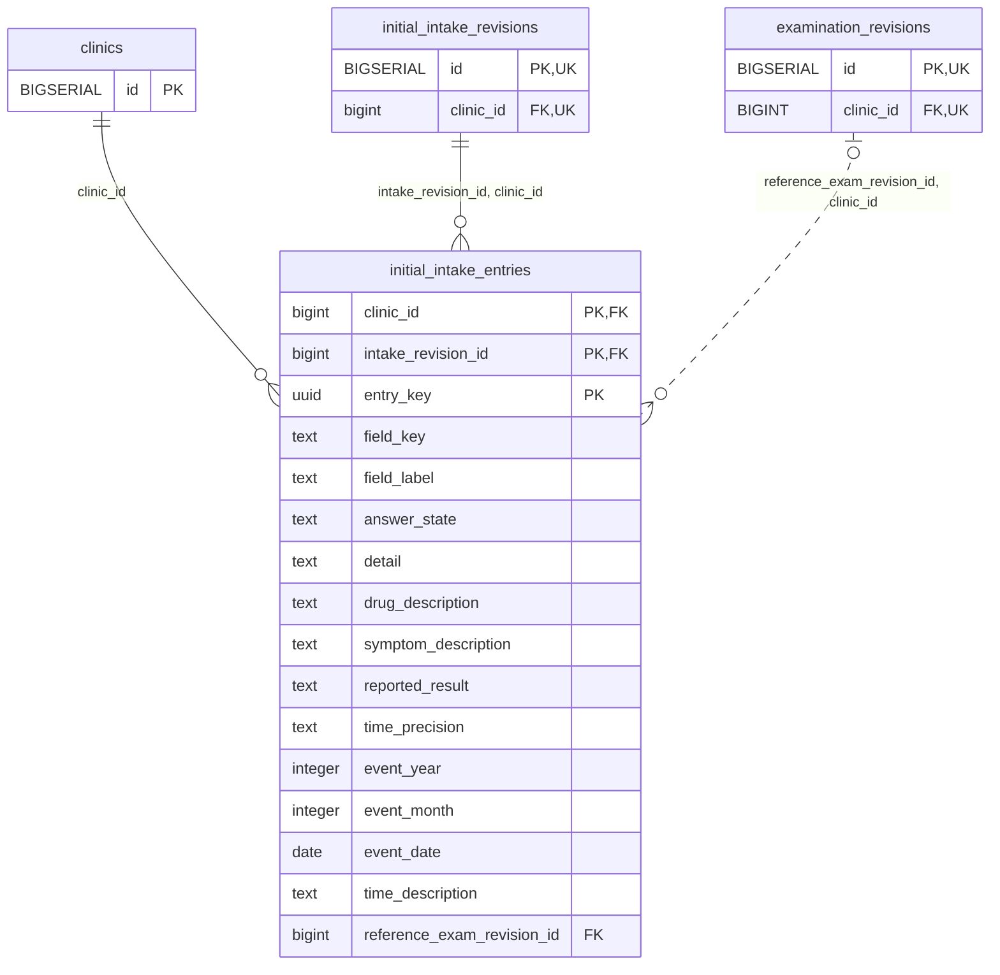

<!-- GENERATED: scripts/tools/generate-erd-detail.py; do not edit -->
# `initial_intake_entries`

[詳細ERD一覧](index.md) · [概要ERD](../erd.md)

このページは、マイグレーションをファイル名順に静的解析した最終定義です。稼働DBの状態は未確認です。

## カラム

型・DEFAULTはDDLの宣言表記です。`bigserial` は採番宣言であり、DBカタログ上の型名ではありません。

| カラム | 型（DDL） | NULL | DEFAULT（DDL） | キー構成列 | 定義元 |
|:---|:---|:---|:---|:---|:---|
| `clinic_id` | `bigint` | NOT NULL | — | PK, FK | [001_init.sql:9103](../../../backend/migrations/001_init.sql#L9103) |
| `intake_revision_id` | `bigint` | NOT NULL | — | PK, FK | [001_init.sql:9104](../../../backend/migrations/001_init.sql#L9104) |
| `entry_key` | `uuid` | NOT NULL | — | PK | [001_init.sql:9105](../../../backend/migrations/001_init.sql#L9105) |
| `field_key` | `text` | NOT NULL | — | — | [001_init.sql:9106](../../../backend/migrations/001_init.sql#L9106) |
| `field_label` | `text` | NOT NULL | — | — | [001_init.sql:9107](../../../backend/migrations/001_init.sql#L9107) |
| `answer_state` | `text` | NULL | — | — | [001_init.sql:9108](../../../backend/migrations/001_init.sql#L9108) |
| `detail` | `text` | NULL | — | — | [001_init.sql:9109](../../../backend/migrations/001_init.sql#L9109) |
| `drug_description` | `text` | NULL | — | — | [001_init.sql:9110](../../../backend/migrations/001_init.sql#L9110) |
| `symptom_description` | `text` | NULL | — | — | [001_init.sql:9111](../../../backend/migrations/001_init.sql#L9111) |
| `reported_result` | `text` | NULL | — | — | [001_init.sql:9112](../../../backend/migrations/001_init.sql#L9112) |
| `time_precision` | `text` | NULL | — | — | [001_init.sql:9113](../../../backend/migrations/001_init.sql#L9113) |
| `event_year` | `integer` | NULL | — | — | [001_init.sql:9114](../../../backend/migrations/001_init.sql#L9114) |
| `event_month` | `integer` | NULL | — | — | [001_init.sql:9115](../../../backend/migrations/001_init.sql#L9115) |
| `event_date` | `date` | NULL | — | — | [001_init.sql:9116](../../../backend/migrations/001_init.sql#L9116) |
| `time_description` | `text` | NULL | — | — | [001_init.sql:9117](../../../backend/migrations/001_init.sql#L9117) |
| `reference_exam_revision_id` | `bigint` | NULL | — | FK | [001_init.sql:9118](../../../backend/migrations/001_init.sql#L9118) |

PK/FK/UKはキーの構成列を示します。複合キーの各列が単独で一意という意味ではありません。部分uniqueは下記indexの述語を参照してください。

## ERD

このテーブルの全カラムと、すべての参照先を表示します。参照先はFKの対象列だけを表示し、全カラムは各テーブルのページに置きます。

親側の任意参照はFK列のNULL可否、子側の最大1件は無条件のPK/UNIQUEから導出します。部分uniqueによる条件付きの最大件数は図に反映せず、index一覧に記録します。実線はFK全列が子のPKに含まれる識別関係、破線はそれ以外です。

## 外部キー（全件）

| 制約 | 子の列（順序あり） | 参照先 | 親の列（順序あり） | 削除時の動作 | 定義元 |
|:---|:---|:---|:---|:---|:---|
| `initial_intake_entries_clinic_id_fkey` | `clinic_id` | [clinics](clinics.md) | `id` | `ON DELETE RESTRICT` | [001_init.sql:9103](../../../backend/migrations/001_init.sql#L9103) |
| `initial_intake_entries_intake_revision_id_clinic_id_fkey` | `intake_revision_id, clinic_id` | [initial_intake_revisions](initial_intake_revisions.md) | `id, clinic_id` | `ON DELETE RESTRICT` | [001_init.sql:9121](../../../backend/migrations/001_init.sql#L9121) |
| `initial_intake_entries_reference_exam_revision_id_clinic_i_fkey` | `reference_exam_revision_id, clinic_id` | [examination_revisions](examination_revisions.md) | `id, clinic_id` | `ON DELETE RESTRICT` | [001_init.sql:9122](../../../backend/migrations/001_init.sql#L9122) |

正確なON UPDATE・MATCH・DEFERRABLE等を含む制約DDL:

- `initial_intake_entries_clinic_id_fkey`: `REFERENCES clinics(id) ON DELETE RESTRICT`
- `initial_intake_entries_intake_revision_id_clinic_id_fkey`: `FOREIGN KEY (intake_revision_id,clinic_id) REFERENCES initial_intake_revisions(id,clinic_id) ON DELETE RESTRICT`
- `initial_intake_entries_reference_exam_revision_id_clinic_i_fkey`: `FOREIGN KEY (reference_exam_revision_id,clinic_id) REFERENCES examination_revisions(id,clinic_id) ON DELETE RESTRICT`

## その他の制約

| 制約 | 種別 | DDL | 定義元 |
|:---|:---|:---|:---|
| `initial_intake_entries_answer_state_check` | check | `CHECK (answer_state IN ('yes','no','unknown'))` | [001_init.sql:9108](../../../backend/migrations/001_init.sql#L9108) |
| `initial_intake_entries_pkey` | primary | `PRIMARY KEY (clinic_id,intake_revision_id,entry_key)` | [001_init.sql:9119](../../../backend/migrations/001_init.sql#L9119) |
| `initial_intake_entries_check` | check | `CHECK (app_private.valid_partial_clinical_date(time_precision,event_year,event_month,event_date,time_description) IS TRUE)` | [001_init.sql:9120](../../../backend/migrations/001_init.sql#L9120) |

## インデックス

明示的なCREATE INDEXなし。PK/UNIQUEに付随する暗黙のindexは制約欄を参照してください。
