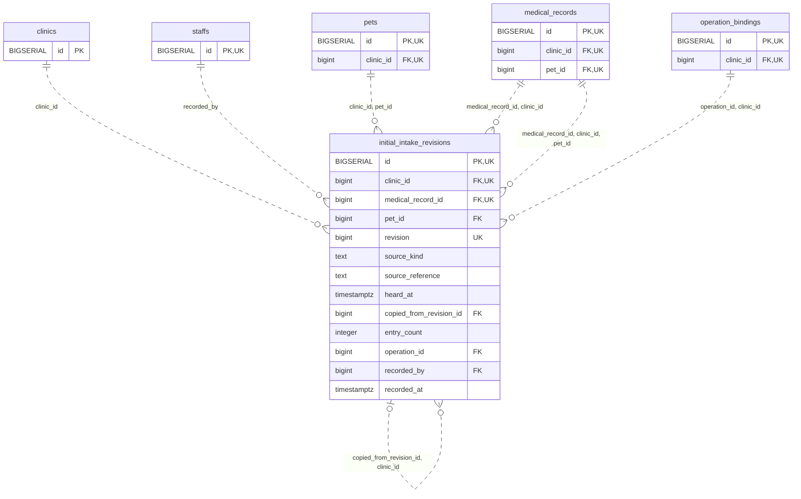

<!-- GENERATED: scripts/tools/generate-erd-detail.py; do not edit -->
# `initial_intake_revisions`

[詳細ERD一覧](index.md) · [概要ERD](../erd.md)

このページは、マイグレーションをファイル名順に静的解析した最終定義です。稼働DBの状態は未確認です。

## カラム

型・DEFAULTはDDLの宣言表記です。`bigserial` は採番宣言であり、DBカタログ上の型名ではありません。

| カラム | 型（DDL） | NULL | DEFAULT（DDL） | キー構成列 | 定義元 |
|:---|:---|:---|:---|:---|:---|
| `id` | `BIGSERIAL` | NOT NULL | — | PK, UK | [001_init.sql:9095](../../../backend/migrations/001_init.sql#L9095) |
| `clinic_id` | `bigint` | NOT NULL | — | FK, UK | [001_init.sql:9096](../../../backend/migrations/001_init.sql#L9096) |
| `medical_record_id` | `bigint` | NOT NULL | — | FK, UK | [001_init.sql:9097](../../../backend/migrations/001_init.sql#L9097) |
| `pet_id` | `bigint` | NOT NULL | — | FK | [001_init.sql:9098](../../../backend/migrations/001_init.sql#L9098) |
| `revision` | `bigint` | NOT NULL | — | UK | [001_init.sql:9099](../../../backend/migrations/001_init.sql#L9099) |
| `source_kind` | `text` | NOT NULL | — | — | [001_init.sql:9100](../../../backend/migrations/001_init.sql#L9100) |
| `source_reference` | `text` | NULL | — | — | [001_init.sql:9101](../../../backend/migrations/001_init.sql#L9101) |
| `heard_at` | `timestamptz` | NULL | — | — | [001_init.sql:9102](../../../backend/migrations/001_init.sql#L9102) |
| `copied_from_revision_id` | `bigint` | NULL | — | FK | [001_init.sql:9103](../../../backend/migrations/001_init.sql#L9103) |
| `entry_count` | `integer` | NOT NULL | — | — | [001_init.sql:9104](../../../backend/migrations/001_init.sql#L9104) |
| `operation_id` | `bigint` | NOT NULL | — | FK | [001_init.sql:9105](../../../backend/migrations/001_init.sql#L9105) |
| `recorded_by` | `bigint` | NOT NULL | — | FK | [001_init.sql:9106](../../../backend/migrations/001_init.sql#L9106) |
| `recorded_at` | `timestamptz` | NOT NULL | `clock_timestamp()` | — | [001_init.sql:9107](../../../backend/migrations/001_init.sql#L9107) |

PK/FK/UKはキーの構成列を示します。複合キーの各列が単独で一意という意味ではありません。部分uniqueは下記indexの述語を参照してください。

## ERD

このテーブルの全カラムと、すべての参照先を表示します。参照先はFKの対象列だけを表示し、全カラムは各テーブルのページに置きます。

親側の任意参照はFK列のNULL可否、子側の最大1件は無条件のPK/UNIQUEから導出します。部分uniqueによる条件付きの最大件数は図に反映せず、index一覧に記録します。実線はFK全列が子のPKに含まれる識別関係、破線はそれ以外です。

## 外部キー（全件）

| 制約 | 子の列（順序あり） | 参照先 | 親の列（順序あり） | 削除時の動作 | 定義元 |
|:---|:---|:---|:---|:---|:---|
| `initial_intake_revisions_clinic_id_fkey` | `clinic_id` | [clinics](clinics.md) | `id` | `ON DELETE RESTRICT` | [001_init.sql:9096](../../../backend/migrations/001_init.sql#L9096) |
| `initial_intake_revisions_recorded_by_fkey` | `recorded_by` | [staffs](staffs.md) | `id` | `ON DELETE RESTRICT` | [001_init.sql:9106](../../../backend/migrations/001_init.sql#L9106) |
| `initial_intake_revisions_medical_record_id_clinic_id_fkey` | `medical_record_id, clinic_id` | [medical_records](medical_records.md) | `id, clinic_id` | `ON DELETE RESTRICT` | [001_init.sql:9110](../../../backend/migrations/001_init.sql#L9110) |
| `initial_intake_revisions_clinic_id_pet_id_fkey` | `clinic_id, pet_id` | [pets](pets.md) | `clinic_id, id` | `ON DELETE RESTRICT` | [001_init.sql:9111](../../../backend/migrations/001_init.sql#L9111) |
| `initial_intake_revisions_copied_from_revision_id_clinic_id_fkey` | `copied_from_revision_id, clinic_id` | [initial_intake_revisions](initial_intake_revisions.md) | `id, clinic_id` | `ON DELETE RESTRICT` | [001_init.sql:9112](../../../backend/migrations/001_init.sql#L9112) |
| `initial_intake_revisions_operation_id_clinic_id_fkey` | `operation_id, clinic_id` | [operation_bindings](operation_bindings.md) | `id, clinic_id` | `ON DELETE RESTRICT` | [001_init.sql:9113](../../../backend/migrations/001_init.sql#L9113) |
| `fk_intake_record_patient` | `medical_record_id, clinic_id, pet_id` | [medical_records](medical_records.md) | `id, clinic_id, pet_id` | `ON DELETE RESTRICT` | [001_init.sql:10114](../../../backend/migrations/001_init.sql#L10114) |

正確なON UPDATE・MATCH・DEFERRABLE等を含む制約DDL:

- `initial_intake_revisions_clinic_id_fkey`: `REFERENCES clinics(id) ON DELETE RESTRICT`
- `initial_intake_revisions_recorded_by_fkey`: `REFERENCES staffs(id) ON DELETE RESTRICT`
- `initial_intake_revisions_medical_record_id_clinic_id_fkey`: `FOREIGN KEY (medical_record_id,clinic_id) REFERENCES medical_records(id,clinic_id) ON DELETE RESTRICT`
- `initial_intake_revisions_clinic_id_pet_id_fkey`: `FOREIGN KEY (clinic_id,pet_id) REFERENCES pets(clinic_id,id) ON DELETE RESTRICT`
- `initial_intake_revisions_copied_from_revision_id_clinic_id_fkey`: `FOREIGN KEY (copied_from_revision_id,clinic_id) REFERENCES initial_intake_revisions(id,clinic_id) ON DELETE RESTRICT`
- `initial_intake_revisions_operation_id_clinic_id_fkey`: `FOREIGN KEY (operation_id,clinic_id) REFERENCES operation_bindings(id,clinic_id) ON DELETE RESTRICT`
- `fk_intake_record_patient`: `CONSTRAINT fk_intake_record_patient  FOREIGN KEY(medical_record_id,clinic_id,pet_id) REFERENCES medical_records(id,clinic_id,pet_id) ON DELETE RESTRICT`

## その他の制約

| 制約 | 種別 | DDL | 定義元 |
|:---|:---|:---|:---|
| `initial_intake_revisions_pkey` | primary | `PRIMARY KEY` | [001_init.sql:9095](../../../backend/migrations/001_init.sql#L9095) |
| `initial_intake_revisions_revision_check` | check | `CHECK (revision > 0)` | [001_init.sql:9099](../../../backend/migrations/001_init.sql#L9099) |
| `initial_intake_revisions_source_kind_check` | check | `CHECK (source_kind IN ('owner_report','paper_transcription','record_reference','legacy_unknown'))` | [001_init.sql:9100](../../../backend/migrations/001_init.sql#L9100) |
| `initial_intake_revisions_entry_count_check` | check | `CHECK (entry_count >= 0)` | [001_init.sql:9104](../../../backend/migrations/001_init.sql#L9104) |
| `initial_intake_revisions_id_clinic_id_key` | unique | `UNIQUE (id,clinic_id)` | [001_init.sql:9108](../../../backend/migrations/001_init.sql#L9108) |
| `initial_intake_revisions_clinic_id_medical_record_id_revisi_key` | unique | `UNIQUE (clinic_id,medical_record_id,revision)` | [001_init.sql:9109](../../../backend/migrations/001_init.sql#L9109) |

## インデックス

明示的なCREATE INDEXなし。PK/UNIQUEに付随する暗黙のindexは制約欄を参照してください。
