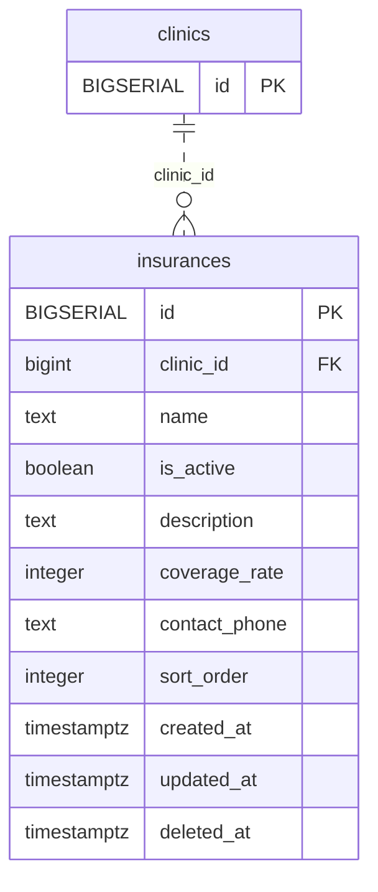

<!-- GENERATED: scripts/tools/generate-erd-detail.py; do not edit -->
# `insurances`

[詳細ERD一覧](index.md) · [概要ERD](../erd.md)

このページは、マイグレーションをファイル名順に静的解析した最終定義です。稼働DBの状態は未確認です。

## カラム

型・DEFAULTはDDLの宣言表記です。`bigserial` は採番宣言であり、DBカタログ上の型名ではありません。

| カラム | 型（DDL） | NULL | DEFAULT（DDL） | キー構成列 | 定義元 |
|:---|:---|:---|:---|:---|:---|
| `id` | `BIGSERIAL` | NOT NULL | — | PK | [001_init.sql:787](../../../backend/migrations/001_init.sql#L787) |
| `clinic_id` | `bigint` | NOT NULL | — | FK | [001_init.sql:788](../../../backend/migrations/001_init.sql#L788) |
| `name` | `text` | NOT NULL | — | — | [001_init.sql:789](../../../backend/migrations/001_init.sql#L789) |
| `is_active` | `boolean` | NOT NULL | `true` | — | [001_init.sql:790](../../../backend/migrations/001_init.sql#L790) |
| `description` | `text` | NOT NULL | `''` | — | [001_init.sql:791](../../../backend/migrations/001_init.sql#L791) |
| `coverage_rate` | `integer` | NOT NULL | `0` | — | [001_init.sql:792](../../../backend/migrations/001_init.sql#L792) |
| `contact_phone` | `text` | NOT NULL | `''` | — | [001_init.sql:793](../../../backend/migrations/001_init.sql#L793) |
| `sort_order` | `integer` | NULL | `0` | — | [001_init.sql:794](../../../backend/migrations/001_init.sql#L794) |
| `created_at` | `timestamptz` | NOT NULL | `now()` | — | [001_init.sql:795](../../../backend/migrations/001_init.sql#L795) |
| `updated_at` | `timestamptz` | NOT NULL | `now()` | — | [001_init.sql:796](../../../backend/migrations/001_init.sql#L796) |
| `deleted_at` | `timestamptz` | NULL | — | — | [001_init.sql:797](../../../backend/migrations/001_init.sql#L797) |

PK/FK/UKはキーの構成列を示します。複合キーの各列が単独で一意という意味ではありません。部分uniqueは下記indexの述語を参照してください。

## ERD

このテーブルの全カラムと、すべての参照先を表示します。参照先はFKの対象列だけを表示し、全カラムは各テーブルのページに置きます。

親側の任意参照はFK列のNULL可否、子側の最大1件は無条件のPK/UNIQUEから導出します。部分uniqueによる条件付きの最大件数は図に反映せず、index一覧に記録します。実線はFK全列が子のPKに含まれる識別関係、破線はそれ以外です。

## 外部キー（全件）

| 制約 | 子の列（順序あり） | 参照先 | 親の列（順序あり） | 削除時の動作 | 定義元 |
|:---|:---|:---|:---|:---|:---|
| `insurances_clinic_id_fkey` | `clinic_id` | [clinics](clinics.md) | `id` | `ON DELETE RESTRICT` | [001_init.sql:788](../../../backend/migrations/001_init.sql#L788) |

正確なON UPDATE・MATCH・DEFERRABLE等を含む制約DDL:

- `insurances_clinic_id_fkey`: `REFERENCES clinics(id) ON DELETE RESTRICT`

## その他の制約

| 制約 | 種別 | DDL | 定義元 |
|:---|:---|:---|:---|
| `insurances_pkey` | primary | `PRIMARY KEY` | [001_init.sql:787](../../../backend/migrations/001_init.sql#L787) |
| `insurances_coverage_rate_check` | check | `CHECK (coverage_rate >= 0 AND coverage_rate <= 100)` | [001_init.sql:792](../../../backend/migrations/001_init.sql#L792) |

## インデックス

| 名前 | UNIQUE | 述語 | DDL | 定義元 |
|:---|:---|:---|:---|:---|
| `idx_insurances_clinic_id` | NO | — | `CREATE INDEX idx_insurances_clinic_id ON insurances(clinic_id)` | [001_init.sql:2240](../../../backend/migrations/001_init.sql#L2240) |
| `idx_insurances_clinic_sort` | NO | `deleted_at IS NULL` | `CREATE INDEX idx_insurances_clinic_sort        ON insurances(clinic_id, sort_order)              WHERE deleted_at IS NULL` | [001_init.sql:2286](../../../backend/migrations/001_init.sql#L2286) |
| `idx_insurance_clinic_name` | YES | `deleted_at IS NULL` | `CREATE UNIQUE INDEX idx_insurance_clinic_name ON insurances(clinic_id, name) WHERE deleted_at IS NULL` | [001_init.sql:2482](../../../backend/migrations/001_init.sql#L2482) |
| `idx_insurances_active` | NO | `deleted_at IS NULL` | `CREATE INDEX idx_insurances_active ON insurances(id) WHERE deleted_at IS NULL` | [001_init.sql:2495](../../../backend/migrations/001_init.sql#L2495) |
