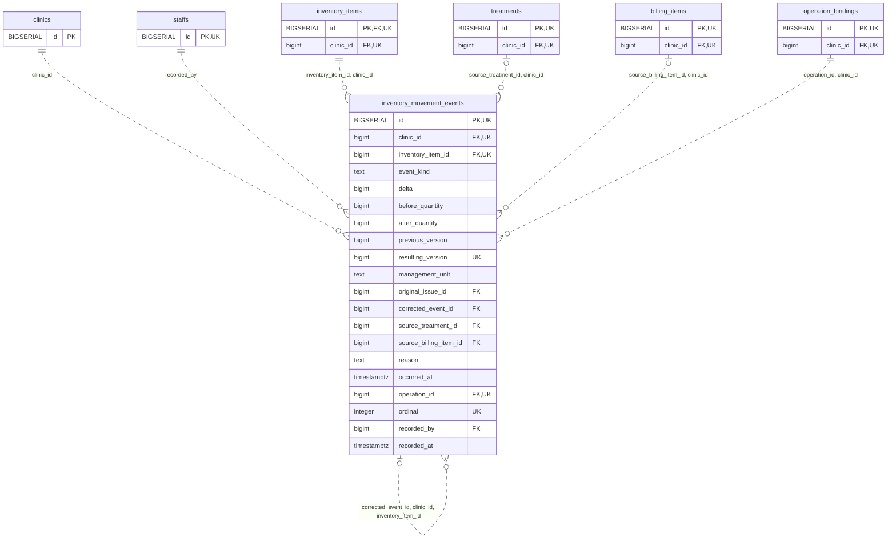

<!-- GENERATED: scripts/tools/generate-erd-detail.py; do not edit -->
# `inventory_movement_events`

[詳細ERD一覧](index.md) · [概要ERD](../erd.md)

このページは、マイグレーションをファイル名順に静的解析した最終定義です。稼働DBの状態は未確認です。

## カラム

型・DEFAULTはDDLの宣言表記です。`bigserial` は採番宣言であり、DBカタログ上の型名ではありません。

| カラム | 型（DDL） | NULL | DEFAULT（DDL） | キー構成列 | 定義元 |
|:---|:---|:---|:---|:---|:---|
| `id` | `BIGSERIAL` | NOT NULL | — | PK, UK | [001_init.sql:9753](../../../backend/migrations/001_init.sql#L9753) |
| `clinic_id` | `bigint` | NOT NULL | — | FK, UK | [001_init.sql:9754](../../../backend/migrations/001_init.sql#L9754) |
| `inventory_item_id` | `bigint` | NOT NULL | — | FK, UK | [001_init.sql:9755](../../../backend/migrations/001_init.sql#L9755) |
| `event_kind` | `text` | NOT NULL | — | — | [001_init.sql:9756](../../../backend/migrations/001_init.sql#L9756) |
| `delta` | `bigint` | NOT NULL | — | — | [001_init.sql:9757](../../../backend/migrations/001_init.sql#L9757) |
| `before_quantity` | `bigint` | NOT NULL | — | — | [001_init.sql:9758](../../../backend/migrations/001_init.sql#L9758) |
| `after_quantity` | `bigint` | NOT NULL | — | — | [001_init.sql:9759](../../../backend/migrations/001_init.sql#L9759) |
| `previous_version` | `bigint` | NOT NULL | — | — | [001_init.sql:9760](../../../backend/migrations/001_init.sql#L9760) |
| `resulting_version` | `bigint` | NOT NULL | — | UK | [001_init.sql:9761](../../../backend/migrations/001_init.sql#L9761) |
| `management_unit` | `text` | NOT NULL | — | — | [001_init.sql:9762](../../../backend/migrations/001_init.sql#L9762) |
| `original_issue_id` | `bigint` | NULL | — | FK | [001_init.sql:9763](../../../backend/migrations/001_init.sql#L9763) |
| `corrected_event_id` | `bigint` | NULL | — | FK | [001_init.sql:9764](../../../backend/migrations/001_init.sql#L9764) |
| `source_treatment_id` | `bigint` | NULL | — | FK | [001_init.sql:9765](../../../backend/migrations/001_init.sql#L9765) |
| `source_billing_item_id` | `bigint` | NULL | — | FK | [001_init.sql:9766](../../../backend/migrations/001_init.sql#L9766) |
| `reason` | `text` | NOT NULL | — | — | [001_init.sql:9767](../../../backend/migrations/001_init.sql#L9767) |
| `occurred_at` | `timestamptz` | NOT NULL | — | — | [001_init.sql:9768](../../../backend/migrations/001_init.sql#L9768) |
| `operation_id` | `bigint` | NOT NULL | — | FK, UK | [001_init.sql:9769](../../../backend/migrations/001_init.sql#L9769) |
| `ordinal` | `integer` | NOT NULL | — | UK | [001_init.sql:9770](../../../backend/migrations/001_init.sql#L9770) |
| `recorded_by` | `bigint` | NOT NULL | — | FK | [001_init.sql:9771](../../../backend/migrations/001_init.sql#L9771) |
| `recorded_at` | `timestamptz` | NOT NULL | `clock_timestamp()` | — | [001_init.sql:9772](../../../backend/migrations/001_init.sql#L9772) |

PK/FK/UKはキーの構成列を示します。複合キーの各列が単独で一意という意味ではありません。部分uniqueは下記indexの述語を参照してください。

## ERD

このテーブルの全カラムと、すべての参照先を表示します。参照先はFKの対象列だけを表示し、全カラムは各テーブルのページに置きます。

親側の任意参照はFK列のNULL可否、子側の最大1件は無条件のPK/UNIQUEから導出します。部分uniqueによる条件付きの最大件数は図に反映せず、index一覧に記録します。実線はFK全列が子のPKに含まれる識別関係、破線はそれ以外です。

## 外部キー（全件）

| 制約 | 子の列（順序あり） | 参照先 | 親の列（順序あり） | 削除時の動作 | 定義元 |
|:---|:---|:---|:---|:---|:---|
| `inventory_movement_events_clinic_id_fkey` | `clinic_id` | [clinics](clinics.md) | `id` | `ON DELETE RESTRICT` | [001_init.sql:9754](../../../backend/migrations/001_init.sql#L9754) |
| `inventory_movement_events_recorded_by_fkey` | `recorded_by` | [staffs](staffs.md) | `id` | `ON DELETE RESTRICT` | [001_init.sql:9771](../../../backend/migrations/001_init.sql#L9771) |
| `inventory_movement_events_inventory_item_id_clinic_id_fkey` | `inventory_item_id, clinic_id` | [inventory_items](inventory_items.md) | `id, clinic_id` | `ON DELETE RESTRICT` | [001_init.sql:9781](../../../backend/migrations/001_init.sql#L9781) |
| `inventory_movement_events_original_issue_id_clinic_id_inve_fkey` | `original_issue_id, clinic_id, inventory_item_id` | [inventory_movement_events](inventory_movement_events.md) | `id, clinic_id, inventory_item_id` | `ON DELETE RESTRICT` | [001_init.sql:9782](../../../backend/migrations/001_init.sql#L9782) |
| `inventory_movement_events_corrected_event_id_clinic_id_inv_fkey` | `corrected_event_id, clinic_id, inventory_item_id` | [inventory_movement_events](inventory_movement_events.md) | `id, clinic_id, inventory_item_id` | `ON DELETE RESTRICT` | [001_init.sql:9783](../../../backend/migrations/001_init.sql#L9783) |
| `inventory_movement_events_source_treatment_id_clinic_id_fkey` | `source_treatment_id, clinic_id` | [treatments](treatments.md) | `id, clinic_id` | `ON DELETE RESTRICT` | [001_init.sql:9784](../../../backend/migrations/001_init.sql#L9784) |
| `inventory_movement_events_source_billing_item_id_clinic_id_fkey` | `source_billing_item_id, clinic_id` | [billing_items](billing_items.md) | `id, clinic_id` | `ON DELETE RESTRICT` | [001_init.sql:9785](../../../backend/migrations/001_init.sql#L9785) |
| `inventory_movement_events_operation_id_clinic_id_fkey` | `operation_id, clinic_id` | [operation_bindings](operation_bindings.md) | `id, clinic_id` | `ON DELETE RESTRICT` | [001_init.sql:9786](../../../backend/migrations/001_init.sql#L9786) |

正確なON UPDATE・MATCH・DEFERRABLE等を含む制約DDL:

- `inventory_movement_events_clinic_id_fkey`: `REFERENCES clinics(id) ON DELETE RESTRICT`
- `inventory_movement_events_recorded_by_fkey`: `REFERENCES staffs(id) ON DELETE RESTRICT`
- `inventory_movement_events_inventory_item_id_clinic_id_fkey`: `FOREIGN KEY (inventory_item_id,clinic_id) REFERENCES inventory_items(id,clinic_id) ON DELETE RESTRICT`
- `inventory_movement_events_original_issue_id_clinic_id_inve_fkey`: `FOREIGN KEY (original_issue_id,clinic_id,inventory_item_id) REFERENCES inventory_movement_events(id,clinic_id,inventory_item_id) ON DELETE RESTRICT`
- `inventory_movement_events_corrected_event_id_clinic_id_inv_fkey`: `FOREIGN KEY (corrected_event_id,clinic_id,inventory_item_id) REFERENCES inventory_movement_events(id,clinic_id,inventory_item_id) ON DELETE RESTRICT`
- `inventory_movement_events_source_treatment_id_clinic_id_fkey`: `FOREIGN KEY (source_treatment_id,clinic_id) REFERENCES treatments(id,clinic_id) ON DELETE RESTRICT`
- `inventory_movement_events_source_billing_item_id_clinic_id_fkey`: `FOREIGN KEY (source_billing_item_id,clinic_id) REFERENCES billing_items(id,clinic_id) ON DELETE RESTRICT`
- `inventory_movement_events_operation_id_clinic_id_fkey`: `FOREIGN KEY (operation_id,clinic_id) REFERENCES operation_bindings(id,clinic_id) ON DELETE RESTRICT`

## その他の制約

| 制約 | 種別 | DDL | 定義元 |
|:---|:---|:---|:---|
| `inventory_movement_events_pkey` | primary | `PRIMARY KEY` | [001_init.sql:9753](../../../backend/migrations/001_init.sql#L9753) |
| `inventory_movement_events_event_kind_check` | check | `CHECK (event_kind IN ('restock','waste','issue','return','count','correction'))` | [001_init.sql:9756](../../../backend/migrations/001_init.sql#L9756) |
| `inventory_movement_events_before_quantity_check` | check | `CHECK (before_quantity >= 0)` | [001_init.sql:9758](../../../backend/migrations/001_init.sql#L9758) |
| `inventory_movement_events_after_quantity_check` | check | `CHECK (after_quantity >= 0)` | [001_init.sql:9759](../../../backend/migrations/001_init.sql#L9759) |
| `inventory_movement_events_previous_version_check` | check | `CHECK (previous_version > 0)` | [001_init.sql:9760](../../../backend/migrations/001_init.sql#L9760) |
| `inventory_movement_events_check` | check | `CHECK (resulting_version=previous_version+1)` | [001_init.sql:9761](../../../backend/migrations/001_init.sql#L9761) |
| `inventory_movement_events_reason_check` | check | `CHECK (btrim(reason)<>'')` | [001_init.sql:9767](../../../backend/migrations/001_init.sql#L9767) |
| `inventory_movement_events_ordinal_check` | check | `CHECK (ordinal > 0)` | [001_init.sql:9770](../../../backend/migrations/001_init.sql#L9770) |
| `inventory_movement_events_id_clinic_id_inventory_item_id_key` | unique | `UNIQUE (id,clinic_id,inventory_item_id)` | [001_init.sql:9773](../../../backend/migrations/001_init.sql#L9773) |
| `inventory_movement_events_clinic_id_inventory_item_id_resul_key` | unique | `UNIQUE (clinic_id,inventory_item_id,resulting_version)` | [001_init.sql:9774](../../../backend/migrations/001_init.sql#L9774) |
| `inventory_movement_events_clinic_id_operation_id_ordinal_key` | unique | `UNIQUE (clinic_id,operation_id,ordinal)` | [001_init.sql:9775](../../../backend/migrations/001_init.sql#L9775) |
| `inventory_movement_events_check1` | check | `CHECK (after_quantity=before_quantity+delta)` | [001_init.sql:9776](../../../backend/migrations/001_init.sql#L9776) |
| `inventory_movement_events_check2` | check | `CHECK ((event_kind IN ('restock','return') AND delta>0) OR (event_kind IN ('waste','issue') AND delta<0) OR event_kind IN ('count','correction'))` | [001_init.sql:9777](../../../backend/migrations/001_init.sql#L9777) |
| `inventory_movement_events_check3` | check | `CHECK (event_kind<>'return' OR original_issue_id IS NOT NULL)` | [001_init.sql:9778](../../../backend/migrations/001_init.sql#L9778) |
| `inventory_movement_events_check4` | check | `CHECK (event_kind<>'correction' OR corrected_event_id IS NOT NULL)` | [001_init.sql:9779](../../../backend/migrations/001_init.sql#L9779) |
| `inventory_movement_events_check5` | check | `CHECK (num_nonnulls(source_treatment_id,source_billing_item_id)<=1)` | [001_init.sql:9780](../../../backend/migrations/001_init.sql#L9780) |

## インデックス

明示的なCREATE INDEXなし。PK/UNIQUEに付随する暗黙のindexは制約欄を参照してください。
