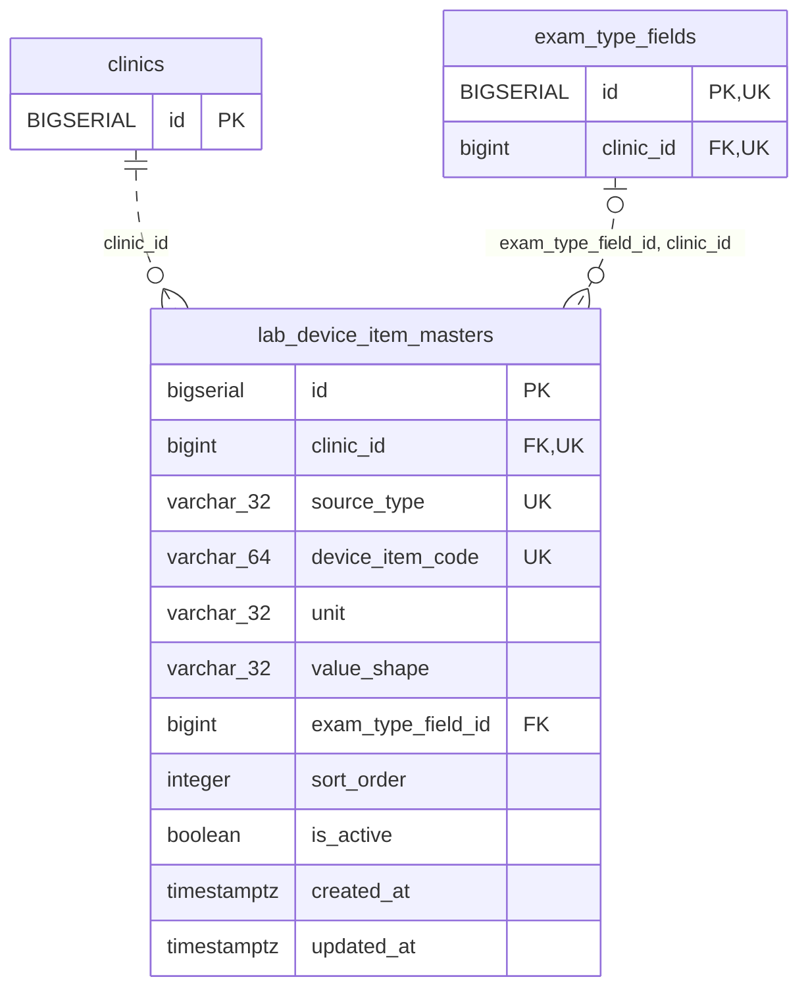

<!-- GENERATED: scripts/tools/generate-erd-detail.py; do not edit -->
# `lab_device_item_masters`

[詳細ERD一覧](index.md) · [概要ERD](../erd.md)

このページは、マイグレーションをファイル名順に静的解析した最終定義です。稼働DBの状態は未確認です。

## カラム

型・DEFAULTはDDLの宣言表記です。`bigserial` は採番宣言であり、DBカタログ上の型名ではありません。

| カラム | 型（DDL） | NULL | DEFAULT（DDL） | キー構成列 | 定義元 |
|:---|:---|:---|:---|:---|:---|
| `id` | `bigserial` | NOT NULL | — | PK | [001_init.sql:5931](../../../backend/migrations/001_init.sql#L5931) |
| `clinic_id` | `bigint` | NOT NULL | — | FK, UK | [001_init.sql:5932](../../../backend/migrations/001_init.sql#L5932) |
| `source_type` | `varchar(32)` | NOT NULL | — | UK | [001_init.sql:5933](../../../backend/migrations/001_init.sql#L5933) |
| `device_item_code` | `varchar(64)` | NOT NULL | — | UK | [001_init.sql:5934](../../../backend/migrations/001_init.sql#L5934) |
| `unit` | `varchar(32)` | NOT NULL | `''` | — | [001_init.sql:5935](../../../backend/migrations/001_init.sql#L5935) |
| `value_shape` | `varchar(32)` | NOT NULL | — | — | [001_init.sql:5936](../../../backend/migrations/001_init.sql#L5936) |
| `exam_type_field_id` | `bigint` | NULL | — | FK | [001_init.sql:5937](../../../backend/migrations/001_init.sql#L5937) |
| `sort_order` | `integer` | NOT NULL | `0` | — | [001_init.sql:5938](../../../backend/migrations/001_init.sql#L5938) |
| `is_active` | `boolean` | NOT NULL | `true` | — | [001_init.sql:5939](../../../backend/migrations/001_init.sql#L5939) |
| `created_at` | `timestamptz` | NOT NULL | `now()` | — | [001_init.sql:5940](../../../backend/migrations/001_init.sql#L5940) |
| `updated_at` | `timestamptz` | NOT NULL | `now()` | — | [001_init.sql:5941](../../../backend/migrations/001_init.sql#L5941) |

PK/FK/UKはキーの構成列を示します。複合キーの各列が単独で一意という意味ではありません。部分uniqueは下記indexの述語を参照してください。

## ERD

このテーブルの全カラムと、すべての参照先を表示します。参照先はFKの対象列だけを表示し、全カラムは各テーブルのページに置きます。

親側の任意参照はFK列のNULL可否、子側の最大1件は無条件のPK/UNIQUEから導出します。部分uniqueによる条件付きの最大件数は図に反映せず、index一覧に記録します。実線はFK全列が子のPKに含まれる識別関係、破線はそれ以外です。

## 外部キー（全件）

| 制約 | 子の列（順序あり） | 参照先 | 親の列（順序あり） | 削除時の動作 | 定義元 |
|:---|:---|:---|:---|:---|:---|
| `lab_device_item_masters_clinic_id_fkey` | `clinic_id` | [clinics](clinics.md) | `id` | `ON DELETE RESTRICT` | [001_init.sql:5932](../../../backend/migrations/001_init.sql#L5932) |
| `fk_lab_device_item_masters_field_clinic` | `exam_type_field_id, clinic_id` | [exam_type_fields](exam_type_fields.md) | `id, clinic_id` | `ON DELETE RESTRICT` | [001_init.sql:5951](../../../backend/migrations/001_init.sql#L5951) |

正確なON UPDATE・MATCH・DEFERRABLE等を含む制約DDL:

- `lab_device_item_masters_clinic_id_fkey`: `REFERENCES clinics(id) ON DELETE RESTRICT`
- `fk_lab_device_item_masters_field_clinic`: `CONSTRAINT fk_lab_device_item_masters_field_clinic     FOREIGN KEY (exam_type_field_id, clinic_id)     REFERENCES exam_type_fields (id, clinic_id)     ON DELETE RESTRICT`

## その他の制約

| 制約 | 種別 | DDL | 定義元 |
|:---|:---|:---|:---|
| `lab_device_item_masters_pkey` | primary | `PRIMARY KEY` | [001_init.sql:5931](../../../backend/migrations/001_init.sql#L5931) |
| `chk_lab_device_item_masters_source_type` | check | `CONSTRAINT chk_lab_device_item_masters_source_type         CHECK (source_type IN ('fuji_nx600', 'fuji_au10v', 'arkray_pu4010', 'idexx_vetlab'))` | [001_init.sql:5942](../../../backend/migrations/001_init.sql#L5942) |
| `chk_lab_device_item_masters_value_shape` | check | `CONSTRAINT chk_lab_device_item_masters_value_shape         CHECK (value_shape IN ('numeric', 'inequality', 'qual_and_num', 'dash', 'text'))` | [001_init.sql:5944](../../../backend/migrations/001_init.sql#L5944) |
| `uq_lab_device_item_masters_clinic_source_code` | unique | `CONSTRAINT uq_lab_device_item_masters_clinic_source_code         UNIQUE (clinic_id, source_type, device_item_code)` | [001_init.sql:5946](../../../backend/migrations/001_init.sql#L5946) |

## インデックス

| 名前 | UNIQUE | 述語 | DDL | 定義元 |
|:---|:---|:---|:---|:---|
| `idx_lab_device_item_masters_clinic_source` | NO | — | `CREATE INDEX idx_lab_device_item_masters_clinic_source     ON lab_device_item_masters (clinic_id, source_type, sort_order)` | [001_init.sql:5956](../../../backend/migrations/001_init.sql#L5956) |
