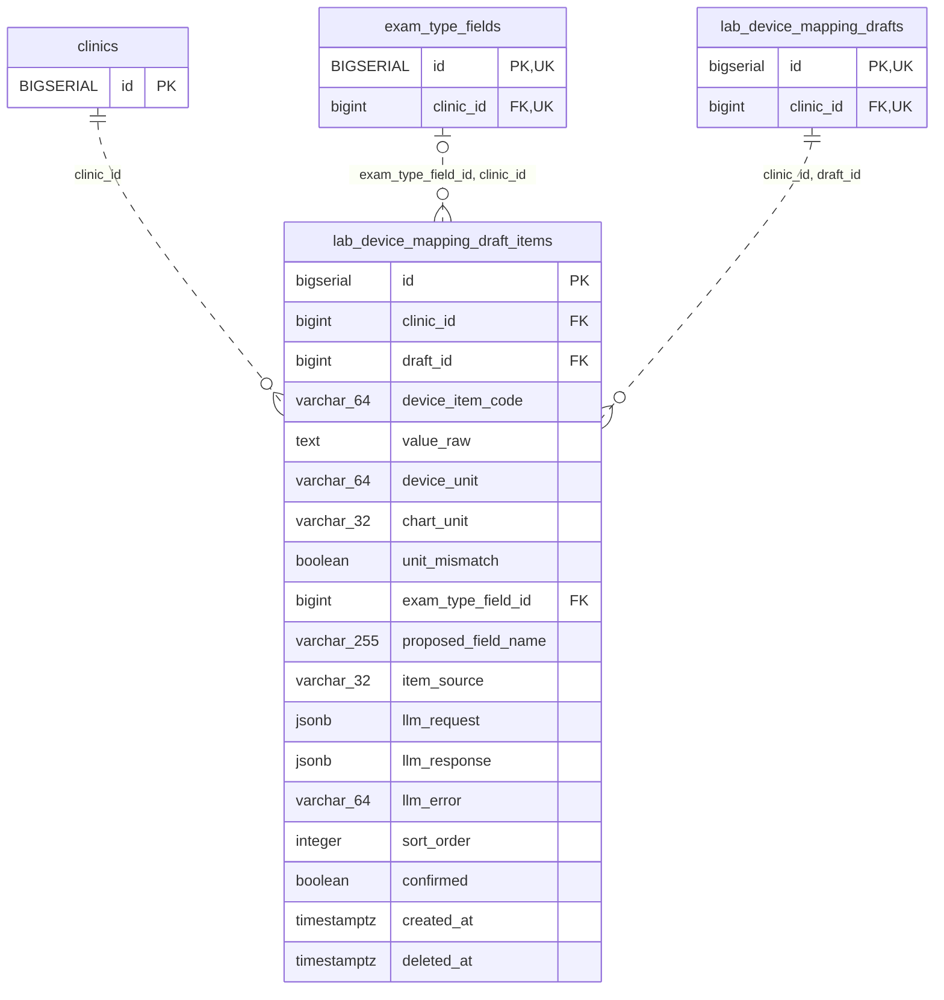

<!-- GENERATED: scripts/tools/generate-erd-detail.py; do not edit -->
# `lab_device_mapping_draft_items`

[詳細ERD一覧](index.md) · [概要ERD](../erd.md)

このページは、マイグレーションをファイル名順に静的解析した最終定義です。稼働DBの状態は未確認です。

## カラム

型・DEFAULTはDDLの宣言表記です。`bigserial` は採番宣言であり、DBカタログ上の型名ではありません。

| カラム | 型（DDL） | NULL | DEFAULT（DDL） | キー構成列 | 定義元 |
|:---|:---|:---|:---|:---|:---|
| `id` | `bigserial` | NOT NULL | — | PK | [001_init.sql:7020](../../../backend/migrations/001_init.sql#L7020) |
| `clinic_id` | `bigint` | NOT NULL | — | FK | [001_init.sql:7021](../../../backend/migrations/001_init.sql#L7021) |
| `draft_id` | `bigint` | NOT NULL | — | FK | [001_init.sql:7022](../../../backend/migrations/001_init.sql#L7022) |
| `device_item_code` | `varchar(64)` | NOT NULL | `''` | — | [001_init.sql:7023](../../../backend/migrations/001_init.sql#L7023) |
| `value_raw` | `text` | NOT NULL | `''` | — | [001_init.sql:7024](../../../backend/migrations/001_init.sql#L7024) |
| `device_unit` | `varchar(64)` | NOT NULL | `''` | — | [001_init.sql:7025](../../../backend/migrations/001_init.sql#L7025) |
| `chart_unit` | `varchar(32)` | NOT NULL | `''` | — | [001_init.sql:7026](../../../backend/migrations/001_init.sql#L7026) |
| `unit_mismatch` | `boolean` | NOT NULL | `false` | — | [001_init.sql:7027](../../../backend/migrations/001_init.sql#L7027) |
| `exam_type_field_id` | `bigint` | NULL | — | FK | [001_init.sql:7028](../../../backend/migrations/001_init.sql#L7028) |
| `proposed_field_name` | `varchar(255)` | NOT NULL | `''` | — | [001_init.sql:7029](../../../backend/migrations/001_init.sql#L7029) |
| `item_source` | `varchar(32)` | NOT NULL | — | — | [001_init.sql:7030](../../../backend/migrations/001_init.sql#L7030) |
| `llm_request` | `jsonb` | NULL | — | — | [001_init.sql:7031](../../../backend/migrations/001_init.sql#L7031) |
| `llm_response` | `jsonb` | NULL | — | — | [001_init.sql:7032](../../../backend/migrations/001_init.sql#L7032) |
| `llm_error` | `varchar(64)` | NOT NULL | `''` | — | [001_init.sql:7033](../../../backend/migrations/001_init.sql#L7033) |
| `sort_order` | `integer` | NOT NULL | `0` | — | [001_init.sql:7034](../../../backend/migrations/001_init.sql#L7034) |
| `confirmed` | `boolean` | NOT NULL | `false` | — | [001_init.sql:7035](../../../backend/migrations/001_init.sql#L7035) |
| `created_at` | `timestamptz` | NOT NULL | `now()` | — | [001_init.sql:7036](../../../backend/migrations/001_init.sql#L7036) |
| `deleted_at` | `timestamptz` | NULL | — | — | [001_init.sql:7037](../../../backend/migrations/001_init.sql#L7037) |

PK/FK/UKはキーの構成列を示します。複合キーの各列が単独で一意という意味ではありません。部分uniqueは下記indexの述語を参照してください。

## ERD

このテーブルの全カラムと、すべての参照先を表示します。参照先はFKの対象列だけを表示し、全カラムは各テーブルのページに置きます。

親側の任意参照はFK列のNULL可否、子側の最大1件は無条件のPK/UNIQUEから導出します。部分uniqueによる条件付きの最大件数は図に反映せず、index一覧に記録します。実線はFK全列が子のPKに含まれる識別関係、破線はそれ以外です。

## 外部キー（全件）

| 制約 | 子の列（順序あり） | 参照先 | 親の列（順序あり） | 削除時の動作 | 定義元 |
|:---|:---|:---|:---|:---|:---|
| `lab_device_mapping_draft_items_clinic_id_fkey` | `clinic_id` | [clinics](clinics.md) | `id` | `ON DELETE RESTRICT` | [001_init.sql:7021](../../../backend/migrations/001_init.sql#L7021) |
| `fk_lab_device_mapping_draft_items_field_clinic` | `exam_type_field_id, clinic_id` | [exam_type_fields](exam_type_fields.md) | `id, clinic_id` | `ON DELETE RESTRICT` | [001_init.sql:7047](../../../backend/migrations/001_init.sql#L7047) |
| `fk_lab_device_mapping_draft_items_draft_clinic` | `clinic_id, draft_id` | [lab_device_mapping_drafts](lab_device_mapping_drafts.md) | `clinic_id, id` | `ON DELETE RESTRICT` | [001_init.sql:7151](../../../backend/migrations/001_init.sql#L7151) |

正確なON UPDATE・MATCH・DEFERRABLE等を含む制約DDL:

- `lab_device_mapping_draft_items_clinic_id_fkey`: `REFERENCES clinics(id) ON DELETE RESTRICT`
- `fk_lab_device_mapping_draft_items_field_clinic`: `CONSTRAINT fk_lab_device_mapping_draft_items_field_clinic     FOREIGN KEY (exam_type_field_id, clinic_id)     REFERENCES exam_type_fields (id, clinic_id)     ON DELETE RESTRICT`
- `fk_lab_device_mapping_draft_items_draft_clinic`: `CONSTRAINT fk_lab_device_mapping_draft_items_draft_clinic     FOREIGN KEY (clinic_id, draft_id)     REFERENCES lab_device_mapping_drafts (clinic_id, id)     ON DELETE RESTRICT`

## その他の制約

| 制約 | 種別 | DDL | 定義元 |
|:---|:---|:---|:---|
| `lab_device_mapping_draft_items_pkey` | primary | `PRIMARY KEY` | [001_init.sql:7020](../../../backend/migrations/001_init.sql#L7020) |
| `chk_lab_device_mapping_draft_items_source` | check | `CONSTRAINT chk_lab_device_mapping_draft_items_source         CHECK (item_source IN ('dictionary', 'llm', 'blank', 'comment'))` | [001_init.sql:7042](../../../backend/migrations/001_init.sql#L7042) |

## インデックス

| 名前 | UNIQUE | 述語 | DDL | 定義元 |
|:---|:---|:---|:---|:---|
| `idx_lab_device_mapping_draft_items_clinic_draft` | NO | — | `CREATE INDEX idx_lab_device_mapping_draft_items_clinic_draft     ON lab_device_mapping_draft_items (clinic_id, draft_id, sort_order)` | [001_init.sql:7052](../../../backend/migrations/001_init.sql#L7052) |
