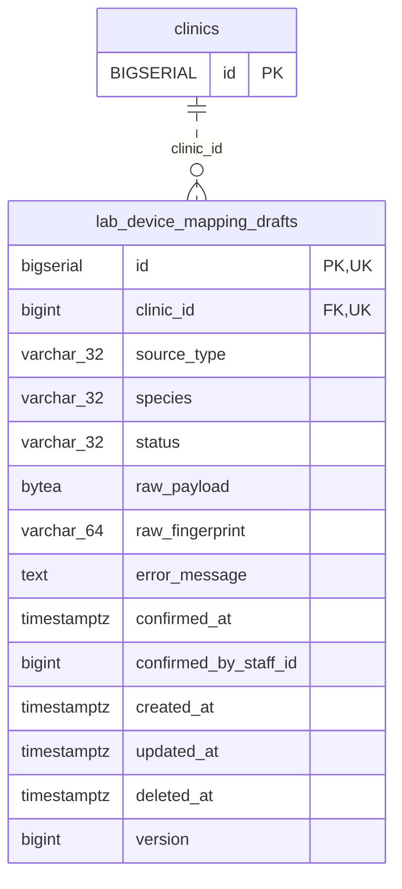

<!-- GENERATED: scripts/tools/generate-erd-detail.py; do not edit -->
# `lab_device_mapping_drafts`

[詳細ERD一覧](index.md) · [概要ERD](../erd.md)

このページは、マイグレーションをファイル名順に静的解析した最終定義です。稼働DBの状態は未確認です。

## カラム

型・DEFAULTはDDLの宣言表記です。`bigserial` は採番宣言であり、DBカタログ上の型名ではありません。

| カラム | 型（DDL） | NULL | DEFAULT（DDL） | キー構成列 | 定義元 |
|:---|:---|:---|:---|:---|:---|
| `id` | `bigserial` | NOT NULL | — | PK, UK | [001_init.sql:6991](../../../backend/migrations/001_init.sql#L6991) |
| `clinic_id` | `bigint` | NOT NULL | — | FK, UK | [001_init.sql:6992](../../../backend/migrations/001_init.sql#L6992) |
| `source_type` | `varchar(32)` | NOT NULL | `''` | — | [001_init.sql:6993](../../../backend/migrations/001_init.sql#L6993) |
| `species` | `varchar(32)` | NOT NULL | `''` | — | [001_init.sql:6994](../../../backend/migrations/001_init.sql#L6994) |
| `status` | `varchar(32)` | NOT NULL | — | — | [001_init.sql:6995](../../../backend/migrations/001_init.sql#L6995) |
| `raw_payload` | `bytea` | NOT NULL | — | — | [001_init.sql:6996](../../../backend/migrations/001_init.sql#L6996) |
| `raw_fingerprint` | `varchar(64)` | NOT NULL | `''` | — | [001_init.sql:6997](../../../backend/migrations/001_init.sql#L6997) |
| `error_message` | `text` | NOT NULL | `''` | — | [001_init.sql:6998](../../../backend/migrations/001_init.sql#L6998) |
| `confirmed_at` | `timestamptz` | NULL | — | — | [001_init.sql:6999](../../../backend/migrations/001_init.sql#L6999) |
| `confirmed_by_staff_id` | `bigint` | NULL | — | — | [001_init.sql:7000](../../../backend/migrations/001_init.sql#L7000) |
| `created_at` | `timestamptz` | NOT NULL | `now()` | — | [001_init.sql:7001](../../../backend/migrations/001_init.sql#L7001) |
| `updated_at` | `timestamptz` | NOT NULL | `now()` | — | [001_init.sql:7002](../../../backend/migrations/001_init.sql#L7002) |
| `deleted_at` | `timestamptz` | NULL | — | — | [001_init.sql:7003](../../../backend/migrations/001_init.sql#L7003) |
| `version` | `bigint` | NOT NULL | `1` | — | [001_init.sql:11598](../../../backend/migrations/001_init.sql#L11598) |

PK/FK/UKはキーの構成列を示します。複合キーの各列が単独で一意という意味ではありません。部分uniqueは下記indexの述語を参照してください。

## ERD

このテーブルの全カラムと、すべての参照先を表示します。参照先はFKの対象列だけを表示し、全カラムは各テーブルのページに置きます。

親側の任意参照はFK列のNULL可否、子側の最大1件は無条件のPK/UNIQUEから導出します。部分uniqueによる条件付きの最大件数は図に反映せず、index一覧に記録します。実線はFK全列が子のPKに含まれる識別関係、破線はそれ以外です。

## 外部キー（全件）

| 制約 | 子の列（順序あり） | 参照先 | 親の列（順序あり） | 削除時の動作 | 定義元 |
|:---|:---|:---|:---|:---|:---|
| `lab_device_mapping_drafts_clinic_id_fkey` | `clinic_id` | [clinics](clinics.md) | `id` | `ON DELETE RESTRICT` | [001_init.sql:6992](../../../backend/migrations/001_init.sql#L6992) |

正確なON UPDATE・MATCH・DEFERRABLE等を含む制約DDL:

- `lab_device_mapping_drafts_clinic_id_fkey`: `REFERENCES clinics(id) ON DELETE RESTRICT`

## その他の制約

| 制約 | 種別 | DDL | 定義元 |
|:---|:---|:---|:---|
| `lab_device_mapping_drafts_pkey` | primary | `PRIMARY KEY` | [001_init.sql:6991](../../../backend/migrations/001_init.sql#L6991) |
| `chk_lab_device_mapping_drafts_source_type` | check | `CONSTRAINT chk_lab_device_mapping_drafts_source_type         CHECK (source_type IN ('', 'fuji_nx600', 'fuji_au10v', 'arkray_pu4010', 'idexx_vetlab'))` | [001_init.sql:7005](../../../backend/migrations/001_init.sql#L7005) |
| `chk_lab_device_mapping_drafts_species` | check | `CONSTRAINT chk_lab_device_mapping_drafts_species         CHECK (species IN ('', 'canine', 'feline'))` | [001_init.sql:7007](../../../backend/migrations/001_init.sql#L7007) |
| `chk_lab_device_mapping_drafts_status` | check | `CONSTRAINT chk_lab_device_mapping_drafts_status         CHECK (status IN ('unconfirmed', 'confirmed', 'failed'))` | [001_init.sql:7009](../../../backend/migrations/001_init.sql#L7009) |
| `uq_lab_device_mapping_drafts_id_clinic` | unique | `CONSTRAINT uq_lab_device_mapping_drafts_id_clinic     UNIQUE (clinic_id, id)` | [001_init.sql:7147](../../../backend/migrations/001_init.sql#L7147) |
| `lab_device_mapping_drafts_version_check` | check | `CHECK (version > 0)` | [001_init.sql:11598](../../../backend/migrations/001_init.sql#L11598) |

## インデックス

| 名前 | UNIQUE | 述語 | DDL | 定義元 |
|:---|:---|:---|:---|:---|
| `idx_lab_device_mapping_drafts_clinic_source` | NO | — | `CREATE INDEX idx_lab_device_mapping_drafts_clinic_source     ON lab_device_mapping_drafts (clinic_id, source_type, species, created_at)` | [001_init.sql:7013](../../../backend/migrations/001_init.sql#L7013) |
