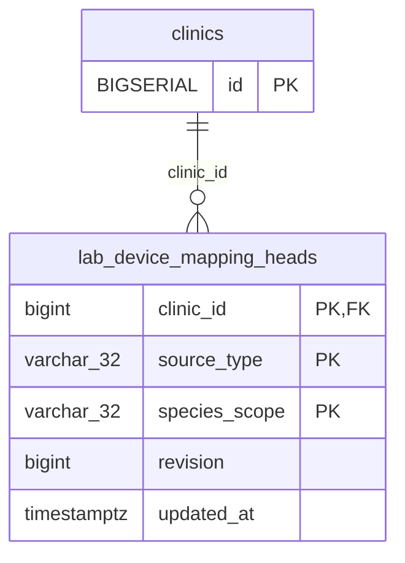

<!-- GENERATED: scripts/tools/generate-erd-detail.py; do not edit -->
# `lab_device_mapping_heads`

[詳細ERD一覧](index.md) · [概要ERD](../erd.md)

このページは、マイグレーションをファイル名順に静的解析した最終定義です。稼働DBの状態は未確認です。

## カラム

型・DEFAULTはDDLの宣言表記です。`bigserial` は採番宣言であり、DBカタログ上の型名ではありません。

| カラム | 型（DDL） | NULL | DEFAULT（DDL） | キー構成列 | 定義元 |
|:---|:---|:---|:---|:---|:---|
| `clinic_id` | `bigint` | NOT NULL | — | PK, FK | [001_init.sql:11481](../../../backend/migrations/001_init.sql#L11481) |
| `source_type` | `varchar(32)` | NOT NULL | — | PK | [001_init.sql:11482](../../../backend/migrations/001_init.sql#L11482) |
| `species_scope` | `varchar(32)` | NOT NULL | — | PK | [001_init.sql:11483](../../../backend/migrations/001_init.sql#L11483) |
| `revision` | `bigint` | NOT NULL | — | — | [001_init.sql:11484](../../../backend/migrations/001_init.sql#L11484) |
| `updated_at` | `timestamptz` | NOT NULL | `clock_timestamp()` | — | [001_init.sql:11485](../../../backend/migrations/001_init.sql#L11485) |

PK/FK/UKはキーの構成列を示します。複合キーの各列が単独で一意という意味ではありません。部分uniqueは下記indexの述語を参照してください。

## ERD

このテーブルの全カラムと、すべての参照先を表示します。参照先はFKの対象列だけを表示し、全カラムは各テーブルのページに置きます。

親側の任意参照はFK列のNULL可否、子側の最大1件は無条件のPK/UNIQUEから導出します。部分uniqueによる条件付きの最大件数は図に反映せず、index一覧に記録します。実線はFK全列が子のPKに含まれる識別関係、破線はそれ以外です。

## 外部キー（全件）

| 制約 | 子の列（順序あり） | 参照先 | 親の列（順序あり） | 削除時の動作 | 定義元 |
|:---|:---|:---|:---|:---|:---|
| `lab_device_mapping_heads_clinic_id_fkey` | `clinic_id` | [clinics](clinics.md) | `id` | `ON DELETE RESTRICT` | [001_init.sql:11481](../../../backend/migrations/001_init.sql#L11481) |

正確なON UPDATE・MATCH・DEFERRABLE等を含む制約DDL:

- `lab_device_mapping_heads_clinic_id_fkey`: `REFERENCES clinics(id) ON DELETE RESTRICT`

## その他の制約

| 制約 | 種別 | DDL | 定義元 |
|:---|:---|:---|:---|
| `lab_device_mapping_heads_revision_check` | check | `CHECK (revision > 0)` | [001_init.sql:11484](../../../backend/migrations/001_init.sql#L11484) |
| `lab_device_mapping_heads_pkey` | primary | `PRIMARY KEY (clinic_id, source_type, species_scope)` | [001_init.sql:11486](../../../backend/migrations/001_init.sql#L11486) |
| `lab_device_mapping_heads_source_type_check` | check | `CHECK (source_type IN ('fuji_nx600', 'fuji_au10v', 'arkray_pu4010', 'idexx_vetlab'))` | [001_init.sql:11487](../../../backend/migrations/001_init.sql#L11487) |
| `lab_device_mapping_heads_species_scope_check` | check | `CHECK (species_scope IN ('', 'canine', 'feline'))` | [001_init.sql:11488](../../../backend/migrations/001_init.sql#L11488) |

## インデックス

明示的なCREATE INDEXなし。PK/UNIQUEに付随する暗黙のindexは制約欄を参照してください。
