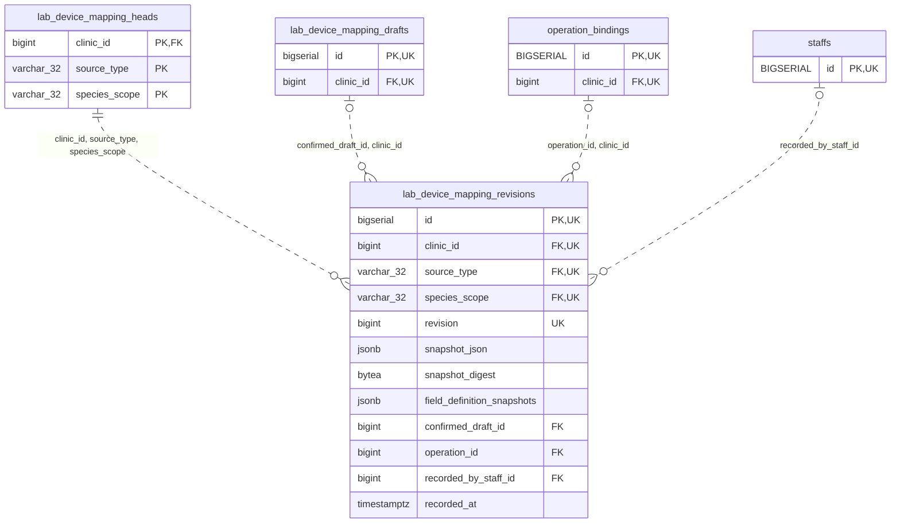

<!-- GENERATED: scripts/tools/generate-erd-detail.py; do not edit -->
# `lab_device_mapping_revisions`

[詳細ERD一覧](index.md) · [概要ERD](../erd.md)

このページは、マイグレーションをファイル名順に静的解析した最終定義です。稼働DBの状態は未確認です。

## カラム

型・DEFAULTはDDLの宣言表記です。`bigserial` は採番宣言であり、DBカタログ上の型名ではありません。

| カラム | 型（DDL） | NULL | DEFAULT（DDL） | キー構成列 | 定義元 |
|:---|:---|:---|:---|:---|:---|
| `id` | `bigserial` | NOT NULL | — | PK, UK | [001_init.sql:11504](../../../backend/migrations/001_init.sql#L11504) |
| `clinic_id` | `bigint` | NOT NULL | — | FK, UK | [001_init.sql:11505](../../../backend/migrations/001_init.sql#L11505) |
| `source_type` | `varchar(32)` | NOT NULL | — | FK, UK | [001_init.sql:11506](../../../backend/migrations/001_init.sql#L11506) |
| `species_scope` | `varchar(32)` | NOT NULL | — | FK, UK | [001_init.sql:11507](../../../backend/migrations/001_init.sql#L11507) |
| `revision` | `bigint` | NOT NULL | — | UK | [001_init.sql:11508](../../../backend/migrations/001_init.sql#L11508) |
| `snapshot_json` | `jsonb` | NOT NULL | — | — | [001_init.sql:11509](../../../backend/migrations/001_init.sql#L11509) |
| `snapshot_digest` | `bytea` | NOT NULL | — | — | [001_init.sql:11510](../../../backend/migrations/001_init.sql#L11510) |
| `field_definition_snapshots` | `jsonb` | NOT NULL | — | — | [001_init.sql:11511](../../../backend/migrations/001_init.sql#L11511) |
| `confirmed_draft_id` | `bigint` | NULL | — | FK | [001_init.sql:11512](../../../backend/migrations/001_init.sql#L11512) |
| `operation_id` | `bigint` | NULL | — | FK | [001_init.sql:11513](../../../backend/migrations/001_init.sql#L11513) |
| `recorded_by_staff_id` | `bigint` | NULL | — | FK | [001_init.sql:11514](../../../backend/migrations/001_init.sql#L11514) |
| `recorded_at` | `timestamptz` | NOT NULL | `clock_timestamp()` | — | [001_init.sql:11515](../../../backend/migrations/001_init.sql#L11515) |

PK/FK/UKはキーの構成列を示します。複合キーの各列が単独で一意という意味ではありません。部分uniqueは下記indexの述語を参照してください。

## ERD

このテーブルの全カラムと、すべての参照先を表示します。参照先はFKの対象列だけを表示し、全カラムは各テーブルのページに置きます。

親側の任意参照はFK列のNULL可否、子側の最大1件は無条件のPK/UNIQUEから導出します。部分uniqueによる条件付きの最大件数は図に反映せず、index一覧に記録します。実線はFK全列が子のPKに含まれる識別関係、破線はそれ以外です。

## 外部キー（全件）

| 制約 | 子の列（順序あり） | 参照先 | 親の列（順序あり） | 削除時の動作 | 定義元 |
|:---|:---|:---|:---|:---|:---|
| `lab_device_mapping_revisions_clinic_id_source_type_species_fkey` | `clinic_id, source_type, species_scope` | [lab_device_mapping_heads](lab_device_mapping_heads.md) | `clinic_id, source_type, species_scope` | `ON DELETE RESTRICT` | [001_init.sql:11518](../../../backend/migrations/001_init.sql#L11518) |
| `lab_device_mapping_revisions_confirmed_draft_id_clinic_id_fkey` | `confirmed_draft_id, clinic_id` | [lab_device_mapping_drafts](lab_device_mapping_drafts.md) | `id, clinic_id` | `ON DELETE RESTRICT` | [001_init.sql:11519](../../../backend/migrations/001_init.sql#L11519) |
| `lab_device_mapping_revisions_operation_id_clinic_id_fkey` | `operation_id, clinic_id` | [operation_bindings](operation_bindings.md) | `id, clinic_id` | `ON DELETE RESTRICT` | [001_init.sql:11520](../../../backend/migrations/001_init.sql#L11520) |
| `lab_device_mapping_revisions_recorded_by_staff_id_fkey` | `recorded_by_staff_id` | [staffs](staffs.md) | `id` | `ON DELETE RESTRICT` | [001_init.sql:11521](../../../backend/migrations/001_init.sql#L11521) |

正確なON UPDATE・MATCH・DEFERRABLE等を含む制約DDL:

- `lab_device_mapping_revisions_clinic_id_source_type_species_fkey`: `FOREIGN KEY (clinic_id, source_type, species_scope) REFERENCES lab_device_mapping_heads (clinic_id, source_type, species_scope) ON DELETE RESTRICT`
- `lab_device_mapping_revisions_confirmed_draft_id_clinic_id_fkey`: `FOREIGN KEY (confirmed_draft_id, clinic_id) REFERENCES lab_device_mapping_drafts (id, clinic_id) ON DELETE RESTRICT`
- `lab_device_mapping_revisions_operation_id_clinic_id_fkey`: `FOREIGN KEY (operation_id, clinic_id) REFERENCES operation_bindings (id, clinic_id) ON DELETE RESTRICT`
- `lab_device_mapping_revisions_recorded_by_staff_id_fkey`: `FOREIGN KEY (recorded_by_staff_id) REFERENCES staffs (id) ON DELETE RESTRICT`

## その他の制約

| 制約 | 種別 | DDL | 定義元 |
|:---|:---|:---|:---|
| `lab_device_mapping_revisions_pkey` | primary | `PRIMARY KEY` | [001_init.sql:11504](../../../backend/migrations/001_init.sql#L11504) |
| `lab_device_mapping_revisions_revision_check` | check | `CHECK (revision > 0)` | [001_init.sql:11508](../../../backend/migrations/001_init.sql#L11508) |
| `lab_device_mapping_revisions_snapshot_json_check` | check | `CHECK (jsonb_typeof(snapshot_json) = 'object')` | [001_init.sql:11509](../../../backend/migrations/001_init.sql#L11509) |
| `lab_device_mapping_revisions_snapshot_digest_check` | check | `CHECK (octet_length(snapshot_digest) = 32)` | [001_init.sql:11510](../../../backend/migrations/001_init.sql#L11510) |
| `lab_device_mapping_revisions_field_definition_snapshots_check` | check | `CHECK (jsonb_typeof(field_definition_snapshots) = 'array')` | [001_init.sql:11511](../../../backend/migrations/001_init.sql#L11511) |
| `lab_device_mapping_revisions_clinic_id_source_type_species__key` | unique | `UNIQUE (clinic_id, source_type, species_scope, revision)` | [001_init.sql:11516](../../../backend/migrations/001_init.sql#L11516) |
| `lab_device_mapping_revisions_id_clinic_id_key` | unique | `UNIQUE (id, clinic_id)` | [001_init.sql:11517](../../../backend/migrations/001_init.sql#L11517) |

## インデックス

明示的なCREATE INDEXなし。PK/UNIQUEに付随する暗黙のindexは制約欄を参照してください。
