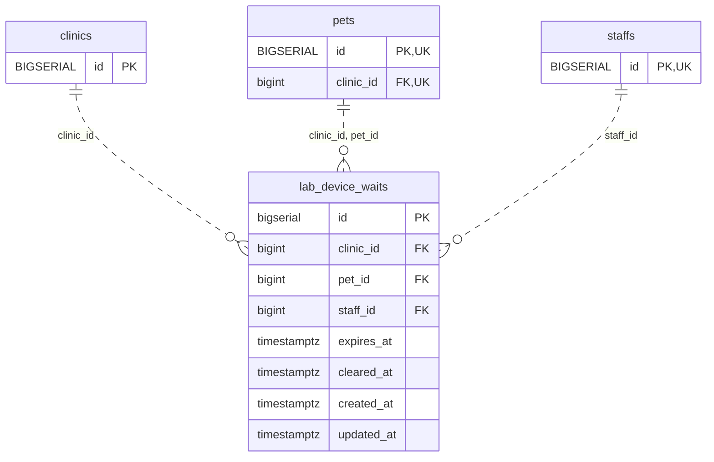

<!-- GENERATED: scripts/tools/generate-erd-detail.py; do not edit -->
# `lab_device_waits`

[詳細ERD一覧](index.md) · [概要ERD](../erd.md)

このページは、マイグレーションをファイル名順に静的解析した最終定義です。稼働DBの状態は未確認です。

## カラム

型・DEFAULTはDDLの宣言表記です。`bigserial` は採番宣言であり、DBカタログ上の型名ではありません。

| カラム | 型（DDL） | NULL | DEFAULT（DDL） | キー構成列 | 定義元 |
|:---|:---|:---|:---|:---|:---|
| `id` | `bigserial` | NOT NULL | — | PK | [001_init.sql:6032](../../../backend/migrations/001_init.sql#L6032) |
| `clinic_id` | `bigint` | NOT NULL | — | FK | [001_init.sql:6033](../../../backend/migrations/001_init.sql#L6033) |
| `pet_id` | `bigint` | NOT NULL | — | FK | [001_init.sql:6034](../../../backend/migrations/001_init.sql#L6034) |
| `staff_id` | `bigint` | NOT NULL | — | FK | [001_init.sql:6035](../../../backend/migrations/001_init.sql#L6035) |
| `expires_at` | `timestamptz` | NOT NULL | — | — | [001_init.sql:6036](../../../backend/migrations/001_init.sql#L6036) |
| `cleared_at` | `timestamptz` | NULL | — | — | [001_init.sql:6037](../../../backend/migrations/001_init.sql#L6037) |
| `created_at` | `timestamptz` | NOT NULL | `now()` | — | [001_init.sql:6038](../../../backend/migrations/001_init.sql#L6038) |
| `updated_at` | `timestamptz` | NOT NULL | `now()` | — | [001_init.sql:6039](../../../backend/migrations/001_init.sql#L6039) |

PK/FK/UKはキーの構成列を示します。複合キーの各列が単独で一意という意味ではありません。部分uniqueは下記indexの述語を参照してください。

## ERD

このテーブルの全カラムと、すべての参照先を表示します。参照先はFKの対象列だけを表示し、全カラムは各テーブルのページに置きます。

親側の任意参照はFK列のNULL可否、子側の最大1件は無条件のPK/UNIQUEから導出します。部分uniqueによる条件付きの最大件数は図に反映せず、index一覧に記録します。実線はFK全列が子のPKに含まれる識別関係、破線はそれ以外です。

## 外部キー（全件）

| 制約 | 子の列（順序あり） | 参照先 | 親の列（順序あり） | 削除時の動作 | 定義元 |
|:---|:---|:---|:---|:---|:---|
| `lab_device_waits_clinic_id_fkey` | `clinic_id` | [clinics](clinics.md) | `id` | `ON DELETE RESTRICT` | [001_init.sql:6033](../../../backend/migrations/001_init.sql#L6033) |
| `fk_lab_device_waits_pet_clinic` | `clinic_id, pet_id` | [pets](pets.md) | `clinic_id, id` | `ON DELETE RESTRICT` | [001_init.sql:6040](../../../backend/migrations/001_init.sql#L6040) |
| `fk_lab_device_waits_staff` | `staff_id` | [staffs](staffs.md) | `id` | `ON DELETE RESTRICT` | [001_init.sql:6800](../../../backend/migrations/001_init.sql#L6800) |

正確なON UPDATE・MATCH・DEFERRABLE等を含む制約DDL:

- `lab_device_waits_clinic_id_fkey`: `REFERENCES clinics(id) ON DELETE RESTRICT`
- `fk_lab_device_waits_pet_clinic`: `CONSTRAINT fk_lab_device_waits_pet_clinic         FOREIGN KEY (clinic_id, pet_id)         REFERENCES pets (clinic_id, id)         ON DELETE RESTRICT`
- `fk_lab_device_waits_staff`: `CONSTRAINT fk_lab_device_waits_staff         FOREIGN KEY (staff_id) REFERENCES staffs (id) ON DELETE RESTRICT`

## その他の制約

| 制約 | 種別 | DDL | 定義元 |
|:---|:---|:---|:---|
| `lab_device_waits_pkey` | primary | `PRIMARY KEY` | [001_init.sql:6032](../../../backend/migrations/001_init.sql#L6032) |

## インデックス

| 名前 | UNIQUE | 述語 | DDL | 定義元 |
|:---|:---|:---|:---|:---|
| `uq_lab_device_waits_clinic_active` | YES | `cleared_at IS NULL` | `CREATE UNIQUE INDEX uq_lab_device_waits_clinic_active     ON lab_device_waits (clinic_id)     WHERE cleared_at IS NULL` | [001_init.sql:6050](../../../backend/migrations/001_init.sql#L6050) |
| `idx_lab_device_waits_clinic_expires` | NO | — | `CREATE INDEX idx_lab_device_waits_clinic_expires     ON lab_device_waits (clinic_id, expires_at)` | [001_init.sql:6054](../../../backend/migrations/001_init.sql#L6054) |
