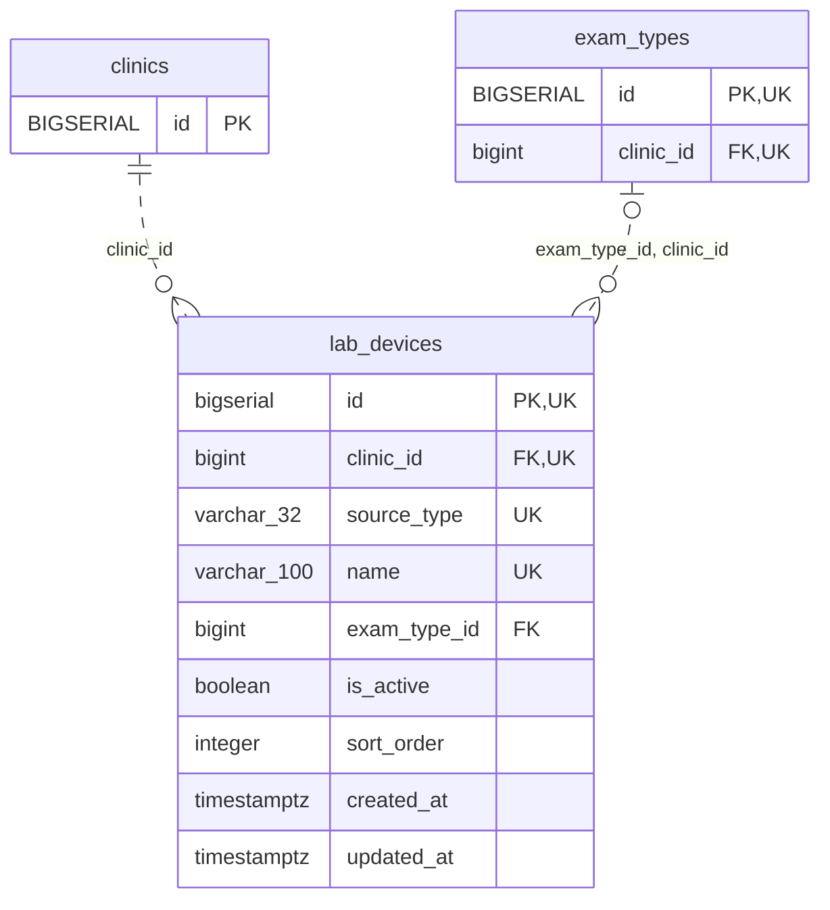

<!-- GENERATED: scripts/tools/generate-erd-detail.py; do not edit -->
# `lab_devices`

[詳細ERD一覧](index.md) · [概要ERD](../erd.md)

このページは、マイグレーションをファイル名順に静的解析した最終定義です。稼働DBの状態は未確認です。

## カラム

型・DEFAULTはDDLの宣言表記です。`bigserial` は採番宣言であり、DBカタログ上の型名ではありません。

| カラム | 型（DDL） | NULL | DEFAULT（DDL） | キー構成列 | 定義元 |
|:---|:---|:---|:---|:---|:---|
| `id` | `bigserial` | NOT NULL | — | PK, UK | [001_init.sql:6107](../../../backend/migrations/001_init.sql#L6107) |
| `clinic_id` | `bigint` | NOT NULL | — | FK, UK | [001_init.sql:6108](../../../backend/migrations/001_init.sql#L6108) |
| `source_type` | `varchar(32)` | NOT NULL | — | UK | [001_init.sql:6109](../../../backend/migrations/001_init.sql#L6109) |
| `name` | `varchar(100)` | NOT NULL | — | UK | [001_init.sql:6110](../../../backend/migrations/001_init.sql#L6110) |
| `exam_type_id` | `bigint` | NULL | — | FK | [001_init.sql:6111](../../../backend/migrations/001_init.sql#L6111) |
| `is_active` | `boolean` | NOT NULL | `true` | — | [001_init.sql:6112](../../../backend/migrations/001_init.sql#L6112) |
| `sort_order` | `integer` | NOT NULL | `0` | — | [001_init.sql:6113](../../../backend/migrations/001_init.sql#L6113) |
| `created_at` | `timestamptz` | NOT NULL | `now()` | — | [001_init.sql:6114](../../../backend/migrations/001_init.sql#L6114) |
| `updated_at` | `timestamptz` | NOT NULL | `now()` | — | [001_init.sql:6115](../../../backend/migrations/001_init.sql#L6115) |

PK/FK/UKはキーの構成列を示します。複合キーの各列が単独で一意という意味ではありません。部分uniqueは下記indexの述語を参照してください。

## ERD

このテーブルの全カラムと、すべての参照先を表示します。参照先はFKの対象列だけを表示し、全カラムは各テーブルのページに置きます。

親側の任意参照はFK列のNULL可否、子側の最大1件は無条件のPK/UNIQUEから導出します。部分uniqueによる条件付きの最大件数は図に反映せず、index一覧に記録します。実線はFK全列が子のPKに含まれる識別関係、破線はそれ以外です。

## 外部キー（全件）

| 制約 | 子の列（順序あり） | 参照先 | 親の列（順序あり） | 削除時の動作 | 定義元 |
|:---|:---|:---|:---|:---|:---|
| `lab_devices_clinic_id_fkey` | `clinic_id` | [clinics](clinics.md) | `id` | `ON DELETE RESTRICT` | [001_init.sql:6108](../../../backend/migrations/001_init.sql#L6108) |
| `fk_lab_devices_exam_type_clinic` | `exam_type_id, clinic_id` | [exam_types](exam_types.md) | `id, clinic_id` | `ON DELETE RESTRICT` | [001_init.sql:6128](../../../backend/migrations/001_init.sql#L6128) |

正確なON UPDATE・MATCH・DEFERRABLE等を含む制約DDL:

- `lab_devices_clinic_id_fkey`: `REFERENCES clinics(id) ON DELETE RESTRICT`
- `fk_lab_devices_exam_type_clinic`: `CONSTRAINT fk_lab_devices_exam_type_clinic     FOREIGN KEY (exam_type_id, clinic_id)     REFERENCES exam_types (id, clinic_id)     ON DELETE RESTRICT`

## その他の制約

| 制約 | 種別 | DDL | 定義元 |
|:---|:---|:---|:---|
| `lab_devices_pkey` | primary | `PRIMARY KEY` | [001_init.sql:6107](../../../backend/migrations/001_init.sql#L6107) |
| `chk_lab_devices_source_type` | check | `CONSTRAINT chk_lab_devices_source_type         CHECK (source_type IN ('fuji_nx600', 'fuji_au10v', 'arkray_pu4010', 'idexx_vetlab'))` | [001_init.sql:6116](../../../backend/migrations/001_init.sql#L6116) |
| `uq_lab_devices_clinic_source` | unique | `CONSTRAINT uq_lab_devices_clinic_source         UNIQUE (clinic_id, source_type)` | [001_init.sql:6118](../../../backend/migrations/001_init.sql#L6118) |
| `uq_lab_devices_clinic_name` | unique | `CONSTRAINT uq_lab_devices_clinic_name         UNIQUE (clinic_id, name)` | [001_init.sql:6120](../../../backend/migrations/001_init.sql#L6120) |
| `uq_lab_devices_id_clinic` | unique | `CONSTRAINT uq_lab_devices_id_clinic UNIQUE (id, clinic_id)` | [001_init.sql:6125](../../../backend/migrations/001_init.sql#L6125) |

## インデックス

| 名前 | UNIQUE | 述語 | DDL | 定義元 |
|:---|:---|:---|:---|:---|
| `idx_lab_devices_clinic_sort` | NO | — | `CREATE INDEX idx_lab_devices_clinic_sort     ON lab_devices (clinic_id, sort_order)` | [001_init.sql:6140](../../../backend/migrations/001_init.sql#L6140) |
