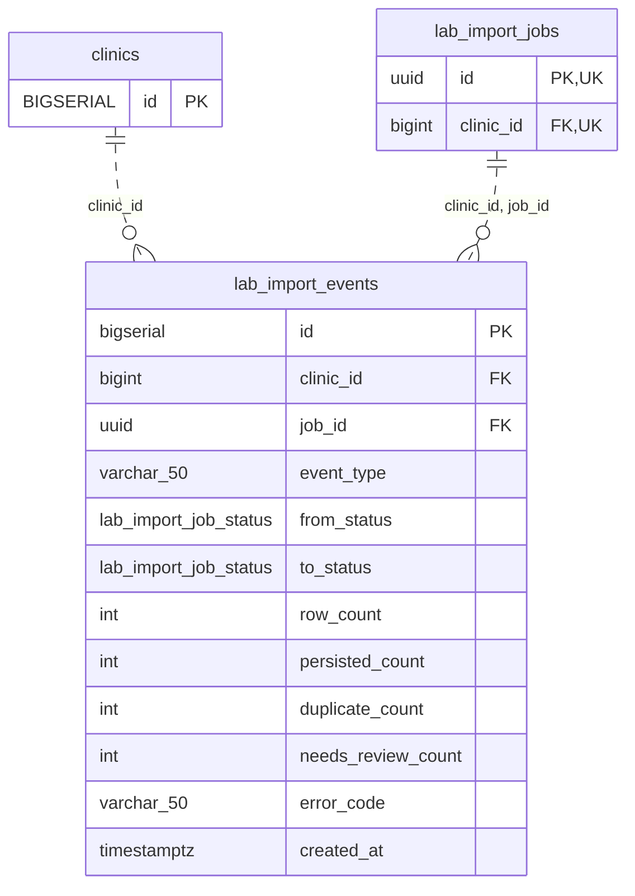

<!-- GENERATED: scripts/tools/generate-erd-detail.py; do not edit -->
# `lab_import_events`

[詳細ERD一覧](index.md) · [概要ERD](../erd.md)

このページは、マイグレーションをファイル名順に静的解析した最終定義です。稼働DBの状態は未確認です。

## カラム

型・DEFAULTはDDLの宣言表記です。`bigserial` は採番宣言であり、DBカタログ上の型名ではありません。

| カラム | 型（DDL） | NULL | DEFAULT（DDL） | キー構成列 | 定義元 |
|:---|:---|:---|:---|:---|:---|
| `id` | `bigserial` | NOT NULL | — | PK | [001_init.sql:3325](../../../backend/migrations/001_init.sql#L3325) |
| `clinic_id` | `bigint` | NOT NULL | — | FK | [001_init.sql:3326](../../../backend/migrations/001_init.sql#L3326) |
| `job_id` | `uuid` | NOT NULL | — | FK | [001_init.sql:3327](../../../backend/migrations/001_init.sql#L3327) |
| `event_type` | `varchar(50)` | NOT NULL | — | — | [001_init.sql:3328](../../../backend/migrations/001_init.sql#L3328) |
| `from_status` | `lab_import_job_status` | NULL | — | — | [001_init.sql:3329](../../../backend/migrations/001_init.sql#L3329) |
| `to_status` | `lab_import_job_status` | NULL | — | — | [001_init.sql:3330](../../../backend/migrations/001_init.sql#L3330) |
| `row_count` | `int` | NOT NULL | `0` | — | [001_init.sql:3331](../../../backend/migrations/001_init.sql#L3331) |
| `persisted_count` | `int` | NOT NULL | `0` | — | [001_init.sql:3332](../../../backend/migrations/001_init.sql#L3332) |
| `duplicate_count` | `int` | NOT NULL | `0` | — | [001_init.sql:3333](../../../backend/migrations/001_init.sql#L3333) |
| `needs_review_count` | `int` | NOT NULL | `0` | — | [001_init.sql:3334](../../../backend/migrations/001_init.sql#L3334) |
| `error_code` | `varchar(50)` | NULL | — | — | [001_init.sql:3335](../../../backend/migrations/001_init.sql#L3335) |
| `created_at` | `timestamptz` | NOT NULL | `now()` | — | [001_init.sql:3336](../../../backend/migrations/001_init.sql#L3336) |

PK/FK/UKはキーの構成列を示します。複合キーの各列が単独で一意という意味ではありません。部分uniqueは下記indexの述語を参照してください。

## ERD

このテーブルの全カラムと、すべての参照先を表示します。参照先はFKの対象列だけを表示し、全カラムは各テーブルのページに置きます。

親側の任意参照はFK列のNULL可否、子側の最大1件は無条件のPK/UNIQUEから導出します。部分uniqueによる条件付きの最大件数は図に反映せず、index一覧に記録します。実線はFK全列が子のPKに含まれる識別関係、破線はそれ以外です。

## 外部キー（全件）

| 制約 | 子の列（順序あり） | 参照先 | 親の列（順序あり） | 削除時の動作 | 定義元 |
|:---|:---|:---|:---|:---|:---|
| `lab_import_events_clinic_id_fkey` | `clinic_id` | [clinics](clinics.md) | `id` | `ON DELETE RESTRICT` | [001_init.sql:3326](../../../backend/migrations/001_init.sql#L3326) |
| `fk_lab_import_events_clinic_job` | `clinic_id, job_id` | [lab_import_jobs](lab_import_jobs.md) | `clinic_id, id` | `ON DELETE RESTRICT` | [001_init.sql:5453](../../../backend/migrations/001_init.sql#L5453) |

正確なON UPDATE・MATCH・DEFERRABLE等を含む制約DDL:

- `lab_import_events_clinic_id_fkey`: `REFERENCES clinics(id)         ON DELETE RESTRICT`
- `fk_lab_import_events_clinic_job`: `CONSTRAINT fk_lab_import_events_clinic_job     FOREIGN KEY (clinic_id, job_id)     REFERENCES lab_import_jobs (clinic_id, id)     ON DELETE RESTRICT`

## その他の制約

| 制約 | 種別 | DDL | 定義元 |
|:---|:---|:---|:---|
| `lab_import_events_pkey` | primary | `PRIMARY KEY` | [001_init.sql:3325](../../../backend/migrations/001_init.sql#L3325) |

## インデックス

| 名前 | UNIQUE | 述語 | DDL | 定義元 |
|:---|:---|:---|:---|:---|
| `idx_lab_import_events_job` | NO | — | `CREATE INDEX idx_lab_import_events_job     ON lab_import_events (job_id, created_at ASC)` | [001_init.sql:3339](../../../backend/migrations/001_init.sql#L3339) |
| `idx_lab_import_events_clinic_created` | NO | — | `CREATE INDEX idx_lab_import_events_clinic_created     ON lab_import_events (clinic_id, created_at DESC)` | [001_init.sql:3342](../../../backend/migrations/001_init.sql#L3342) |
| `idx_lab_import_events_clinic_job_created` | NO | — | `CREATE INDEX IF NOT EXISTS idx_lab_import_events_clinic_job_created     ON lab_import_events (clinic_id, job_id, created_at, id)` | [001_init.sql:5449](../../../backend/migrations/001_init.sql#L5449) |
