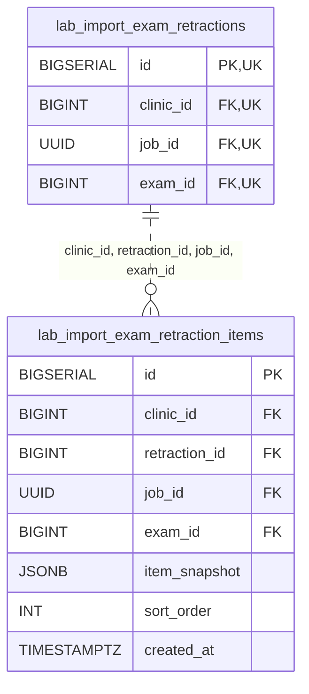

<!-- GENERATED: scripts/tools/generate-erd-detail.py; do not edit -->
# `lab_import_exam_retraction_items`

[詳細ERD一覧](index.md) · [概要ERD](../erd.md)

このページは、マイグレーションをファイル名順に静的解析した最終定義です。稼働DBの状態は未確認です。

## カラム

型・DEFAULTはDDLの宣言表記です。`bigserial` は採番宣言であり、DBカタログ上の型名ではありません。

| カラム | 型（DDL） | NULL | DEFAULT（DDL） | キー構成列 | 定義元 |
|:---|:---|:---|:---|:---|:---|
| `id` | `BIGSERIAL` | NOT NULL | — | PK | [001_init.sql:5479](../../../backend/migrations/001_init.sql#L5479) |
| `clinic_id` | `BIGINT` | NOT NULL | — | FK | [001_init.sql:5480](../../../backend/migrations/001_init.sql#L5480) |
| `retraction_id` | `BIGINT` | NOT NULL | — | FK | [001_init.sql:5481](../../../backend/migrations/001_init.sql#L5481) |
| `job_id` | `UUID` | NOT NULL | — | FK | [001_init.sql:5482](../../../backend/migrations/001_init.sql#L5482) |
| `exam_id` | `BIGINT` | NOT NULL | — | FK | [001_init.sql:5483](../../../backend/migrations/001_init.sql#L5483) |
| `item_snapshot` | `JSONB` | NOT NULL | — | — | [001_init.sql:5484](../../../backend/migrations/001_init.sql#L5484) |
| `sort_order` | `INT` | NOT NULL | `0` | — | [001_init.sql:5485](../../../backend/migrations/001_init.sql#L5485) |
| `created_at` | `TIMESTAMPTZ` | NOT NULL | `now()` | — | [001_init.sql:5486](../../../backend/migrations/001_init.sql#L5486) |

PK/FK/UKはキーの構成列を示します。複合キーの各列が単独で一意という意味ではありません。部分uniqueは下記indexの述語を参照してください。

## ERD

このテーブルの全カラムと、すべての参照先を表示します。参照先はFKの対象列だけを表示し、全カラムは各テーブルのページに置きます。

親側の任意参照はFK列のNULL可否、子側の最大1件は無条件のPK/UNIQUEから導出します。部分uniqueによる条件付きの最大件数は図に反映せず、index一覧に記録します。実線はFK全列が子のPKに含まれる識別関係、破線はそれ以外です。

## 外部キー（全件）

| 制約 | 子の列（順序あり） | 参照先 | 親の列（順序あり） | 削除時の動作 | 定義元 |
|:---|:---|:---|:---|:---|:---|
| `fk_lab_import_exam_retraction_items_parent` | `clinic_id, retraction_id, job_id, exam_id` | [lab_import_exam_retractions](lab_import_exam_retractions.md) | `clinic_id, id, job_id, exam_id` | `ON DELETE RESTRICT` | [001_init.sql:5497](../../../backend/migrations/001_init.sql#L5497) |

正確なON UPDATE・MATCH・DEFERRABLE等を含む制約DDL:

- `fk_lab_import_exam_retraction_items_parent`: `CONSTRAINT fk_lab_import_exam_retraction_items_parent     FOREIGN KEY (clinic_id, retraction_id, job_id, exam_id)     REFERENCES lab_import_exam_retractions (clinic_id, id, job_id, exam_id)     ON DELETE RESTRICT`

## その他の制約

| 制約 | 種別 | DDL | 定義元 |
|:---|:---|:---|:---|
| `lab_import_exam_retraction_items_pkey` | primary | `PRIMARY KEY` | [001_init.sql:5479](../../../backend/migrations/001_init.sql#L5479) |

## インデックス

| 名前 | UNIQUE | 述語 | DDL | 定義元 |
|:---|:---|:---|:---|:---|
| `idx_lab_import_exam_retraction_items_fk` | NO | — | `CREATE INDEX idx_lab_import_exam_retraction_items_fk     ON lab_import_exam_retraction_items (clinic_id, retraction_id, job_id, exam_id)` | [001_init.sql:5490](../../../backend/migrations/001_init.sql#L5490) |
| `idx_lab_import_exam_retraction_items_list` | NO | — | `CREATE INDEX idx_lab_import_exam_retraction_items_list     ON lab_import_exam_retraction_items (clinic_id, retraction_id, id)` | [001_init.sql:5493](../../../backend/migrations/001_init.sql#L5493) |
