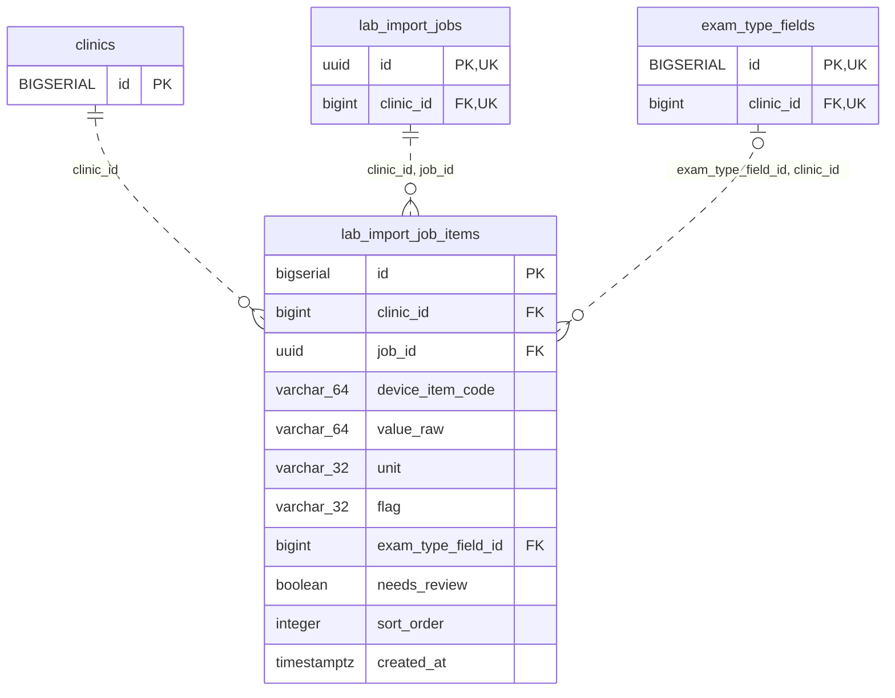

<!-- GENERATED: scripts/tools/generate-erd-detail.py; do not edit -->
# `lab_import_job_items`

[詳細ERD一覧](index.md) · [概要ERD](../erd.md)

このページは、マイグレーションをファイル名順に静的解析した最終定義です。稼働DBの状態は未確認です。

## カラム

型・DEFAULTはDDLの宣言表記です。`bigserial` は採番宣言であり、DBカタログ上の型名ではありません。

| カラム | 型（DDL） | NULL | DEFAULT（DDL） | キー構成列 | 定義元 |
|:---|:---|:---|:---|:---|:---|
| `id` | `bigserial` | NOT NULL | — | PK | [001_init.sql:6004](../../../backend/migrations/001_init.sql#L6004) |
| `clinic_id` | `bigint` | NOT NULL | — | FK | [001_init.sql:6005](../../../backend/migrations/001_init.sql#L6005) |
| `job_id` | `uuid` | NOT NULL | — | FK | [001_init.sql:6006](../../../backend/migrations/001_init.sql#L6006) |
| `device_item_code` | `varchar(64)` | NOT NULL | — | — | [001_init.sql:6007](../../../backend/migrations/001_init.sql#L6007) |
| `value_raw` | `varchar(64)` | NOT NULL | `''` | — | [001_init.sql:6008](../../../backend/migrations/001_init.sql#L6008) |
| `unit` | `varchar(32)` | NOT NULL | `''` | — | [001_init.sql:6009](../../../backend/migrations/001_init.sql#L6009) |
| `flag` | `varchar(32)` | NOT NULL | `''` | — | [001_init.sql:6010](../../../backend/migrations/001_init.sql#L6010) |
| `exam_type_field_id` | `bigint` | NULL | — | FK | [001_init.sql:6011](../../../backend/migrations/001_init.sql#L6011) |
| `needs_review` | `boolean` | NOT NULL | `false` | — | [001_init.sql:6012](../../../backend/migrations/001_init.sql#L6012) |
| `sort_order` | `integer` | NOT NULL | `0` | — | [001_init.sql:6013](../../../backend/migrations/001_init.sql#L6013) |
| `created_at` | `timestamptz` | NOT NULL | `now()` | — | [001_init.sql:6014](../../../backend/migrations/001_init.sql#L6014) |

PK/FK/UKはキーの構成列を示します。複合キーの各列が単独で一意という意味ではありません。部分uniqueは下記indexの述語を参照してください。

## ERD

このテーブルの全カラムと、すべての参照先を表示します。参照先はFKの対象列だけを表示し、全カラムは各テーブルのページに置きます。

親側の任意参照はFK列のNULL可否、子側の最大1件は無条件のPK/UNIQUEから導出します。部分uniqueによる条件付きの最大件数は図に反映せず、index一覧に記録します。実線はFK全列が子のPKに含まれる識別関係、破線はそれ以外です。

## 外部キー（全件）

| 制約 | 子の列（順序あり） | 参照先 | 親の列（順序あり） | 削除時の動作 | 定義元 |
|:---|:---|:---|:---|:---|:---|
| `lab_import_job_items_clinic_id_fkey` | `clinic_id` | [clinics](clinics.md) | `id` | `ON DELETE RESTRICT` | [001_init.sql:6005](../../../backend/migrations/001_init.sql#L6005) |
| `fk_lab_import_job_items_job_clinic` | `clinic_id, job_id` | [lab_import_jobs](lab_import_jobs.md) | `clinic_id, id` | `ON DELETE RESTRICT` | [001_init.sql:6015](../../../backend/migrations/001_init.sql#L6015) |
| `fk_lab_import_job_items_field_clinic` | `exam_type_field_id, clinic_id` | [exam_type_fields](exam_type_fields.md) | `id, clinic_id` | `ON DELETE RESTRICT` | [001_init.sql:6019](../../../backend/migrations/001_init.sql#L6019) |

正確なON UPDATE・MATCH・DEFERRABLE等を含む制約DDL:

- `lab_import_job_items_clinic_id_fkey`: `REFERENCES clinics(id) ON DELETE RESTRICT`
- `fk_lab_import_job_items_job_clinic`: `CONSTRAINT fk_lab_import_job_items_job_clinic         FOREIGN KEY (clinic_id, job_id)         REFERENCES lab_import_jobs (clinic_id, id)         ON DELETE RESTRICT`
- `fk_lab_import_job_items_field_clinic`: `CONSTRAINT fk_lab_import_job_items_field_clinic         FOREIGN KEY (exam_type_field_id, clinic_id)         REFERENCES exam_type_fields (id, clinic_id)         ON DELETE RESTRICT`

## その他の制約

| 制約 | 種別 | DDL | 定義元 |
|:---|:---|:---|:---|
| `lab_import_job_items_pkey` | primary | `PRIMARY KEY` | [001_init.sql:6004](../../../backend/migrations/001_init.sql#L6004) |

## インデックス

| 名前 | UNIQUE | 述語 | DDL | 定義元 |
|:---|:---|:---|:---|:---|
| `idx_lab_import_job_items_clinic_job` | NO | — | `CREATE INDEX idx_lab_import_job_items_clinic_job     ON lab_import_job_items (clinic_id, job_id, sort_order)` | [001_init.sql:6025](../../../backend/migrations/001_init.sql#L6025) |
