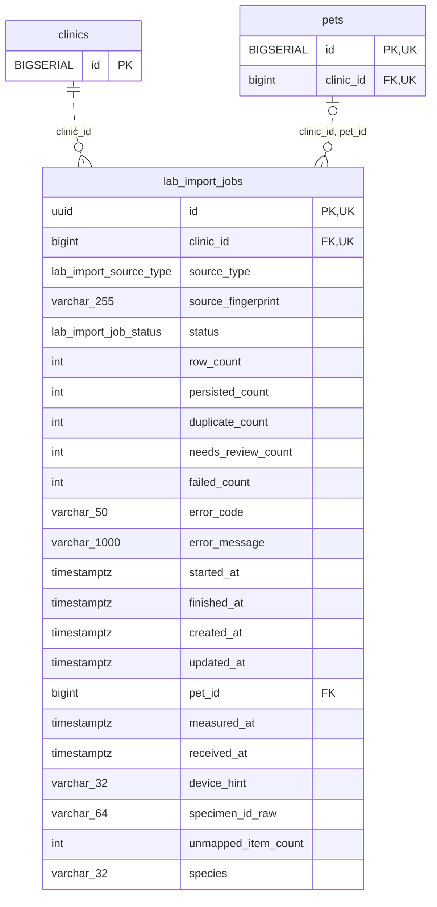

<!-- GENERATED: scripts/tools/generate-erd-detail.py; do not edit -->
# `lab_import_jobs`

[詳細ERD一覧](index.md) · [概要ERD](../erd.md)

このページは、マイグレーションをファイル名順に静的解析した最終定義です。稼働DBの状態は未確認です。

## カラム

型・DEFAULTはDDLの宣言表記です。`bigserial` は採番宣言であり、DBカタログ上の型名ではありません。

| カラム | 型（DDL） | NULL | DEFAULT（DDL） | キー構成列 | 定義元 |
|:---|:---|:---|:---|:---|:---|
| `id` | `uuid` | NOT NULL | `gen_random_uuid()` | PK, UK | [001_init.sql:3290](../../../backend/migrations/001_init.sql#L3290) |
| `clinic_id` | `bigint` | NOT NULL | — | FK, UK | [001_init.sql:3291](../../../backend/migrations/001_init.sql#L3291) |
| `source_type` | `lab_import_source_type` | NOT NULL | `'fixture'` | — | [001_init.sql:3292](../../../backend/migrations/001_init.sql#L3292) |
| `source_fingerprint` | `varchar(255)` | NOT NULL | `''` | — | [001_init.sql:3293](../../../backend/migrations/001_init.sql#L3293) |
| `status` | `lab_import_job_status` | NOT NULL | `'received'` | — | [001_init.sql:3294](../../../backend/migrations/001_init.sql#L3294) |
| `row_count` | `int` | NOT NULL | `0` | — | [001_init.sql:3295](../../../backend/migrations/001_init.sql#L3295) |
| `persisted_count` | `int` | NOT NULL | `0` | — | [001_init.sql:3296](../../../backend/migrations/001_init.sql#L3296) |
| `duplicate_count` | `int` | NOT NULL | `0` | — | [001_init.sql:3297](../../../backend/migrations/001_init.sql#L3297) |
| `needs_review_count` | `int` | NOT NULL | `0` | — | [001_init.sql:3298](../../../backend/migrations/001_init.sql#L3298) |
| `failed_count` | `int` | NOT NULL | `0` | — | [001_init.sql:3299](../../../backend/migrations/001_init.sql#L3299) |
| `error_code` | `varchar(50)` | NULL | — | — | [001_init.sql:3300](../../../backend/migrations/001_init.sql#L3300) |
| `error_message` | `varchar(1000)` | NULL | — | — | [001_init.sql:3301](../../../backend/migrations/001_init.sql#L3301) |
| `started_at` | `timestamptz` | NULL | — | — | [001_init.sql:3302](../../../backend/migrations/001_init.sql#L3302) |
| `finished_at` | `timestamptz` | NULL | — | — | [001_init.sql:3303](../../../backend/migrations/001_init.sql#L3303) |
| `created_at` | `timestamptz` | NOT NULL | `now()` | — | [001_init.sql:3304](../../../backend/migrations/001_init.sql#L3304) |
| `updated_at` | `timestamptz` | NOT NULL | `now()` | — | [001_init.sql:3305](../../../backend/migrations/001_init.sql#L3305) |
| `pet_id` | `bigint` | NULL | — | FK | [001_init.sql:5988](../../../backend/migrations/001_init.sql#L5988) |
| `measured_at` | `timestamptz` | NULL | — | — | [001_init.sql:5989](../../../backend/migrations/001_init.sql#L5989) |
| `received_at` | `timestamptz` | NULL | — | — | [001_init.sql:5990](../../../backend/migrations/001_init.sql#L5990) |
| `device_hint` | `varchar(32)` | NOT NULL | `''` | — | [001_init.sql:5991](../../../backend/migrations/001_init.sql#L5991) |
| `specimen_id_raw` | `varchar(64)` | NOT NULL | `''` | — | [001_init.sql:5992](../../../backend/migrations/001_init.sql#L5992) |
| `unmapped_item_count` | `int` | NOT NULL | `0` | — | [001_init.sql:5993](../../../backend/migrations/001_init.sql#L5993) |
| `species` | `varchar(32)` | NOT NULL | `''` | — | [001_init.sql:6983](../../../backend/migrations/001_init.sql#L6983) |

PK/FK/UKはキーの構成列を示します。複合キーの各列が単独で一意という意味ではありません。部分uniqueは下記indexの述語を参照してください。

## ERD

このテーブルの全カラムと、すべての参照先を表示します。参照先はFKの対象列だけを表示し、全カラムは各テーブルのページに置きます。

親側の任意参照はFK列のNULL可否、子側の最大1件は無条件のPK/UNIQUEから導出します。部分uniqueによる条件付きの最大件数は図に反映せず、index一覧に記録します。実線はFK全列が子のPKに含まれる識別関係、破線はそれ以外です。

## 外部キー（全件）

| 制約 | 子の列（順序あり） | 参照先 | 親の列（順序あり） | 削除時の動作 | 定義元 |
|:---|:---|:---|:---|:---|:---|
| `lab_import_jobs_clinic_id_fkey` | `clinic_id` | [clinics](clinics.md) | `id` | `ON DELETE RESTRICT` | [001_init.sql:3291](../../../backend/migrations/001_init.sql#L3291) |
| `fk_lab_import_jobs_pet_clinic` | `clinic_id, pet_id` | [pets](pets.md) | `clinic_id, id` | `ON DELETE RESTRICT` | [001_init.sql:5996](../../../backend/migrations/001_init.sql#L5996) |

正確なON UPDATE・MATCH・DEFERRABLE等を含む制約DDL:

- `lab_import_jobs_clinic_id_fkey`: `REFERENCES clinics(id)     ON DELETE RESTRICT`
- `fk_lab_import_jobs_pet_clinic`: `CONSTRAINT fk_lab_import_jobs_pet_clinic     FOREIGN KEY (clinic_id, pet_id)     REFERENCES pets (clinic_id, id)     ON DELETE RESTRICT`

## その他の制約

| 制約 | 種別 | DDL | 定義元 |
|:---|:---|:---|:---|
| `lab_import_jobs_pkey` | primary | `PRIMARY KEY` | [001_init.sql:3290](../../../backend/migrations/001_init.sql#L3290) |

## インデックス

| 名前 | UNIQUE | 述語 | DDL | 定義元 |
|:---|:---|:---|:---|:---|
| `idx_lab_import_jobs_clinic_created` | NO | — | `CREATE INDEX idx_lab_import_jobs_clinic_created     ON lab_import_jobs (clinic_id, created_at DESC)` | [001_init.sql:3308](../../../backend/migrations/001_init.sql#L3308) |
| `idx_lab_import_jobs_clinic_status` | NO | — | `CREATE INDEX idx_lab_import_jobs_clinic_status     ON lab_import_jobs (clinic_id, status)` | [001_init.sql:3311](../../../backend/migrations/001_init.sql#L3311) |
| `uq_lab_import_jobs_clinic_id` | YES | — | `CREATE UNIQUE INDEX IF NOT EXISTS uq_lab_import_jobs_clinic_id     ON lab_import_jobs (clinic_id, id)` | [001_init.sql:5406](../../../backend/migrations/001_init.sql#L5406) |
| `uq_lab_import_jobs_clinic_source_fingerprint` | YES | `source_fingerprint <> ''` | `CREATE UNIQUE INDEX IF NOT EXISTS uq_lab_import_jobs_clinic_source_fingerprint     ON lab_import_jobs (clinic_id, source_type, source_fingerprint)     WHERE source_fingerprint <> ''` | [001_init.sql:6001](../../../backend/migrations/001_init.sql#L6001) |
| `idx_lab_import_jobs_clinic_unlinked` | NO | `pet_id IS NULL       AND source_type IN ('fuji_nx600', 'fuji_au10v', 'arkray_pu4010', 'idexx_vetlab')` | `CREATE INDEX IF NOT EXISTS idx_lab_import_jobs_clinic_unlinked     ON lab_import_jobs (clinic_id, received_at DESC)     WHERE pet_id IS NULL       AND source_type IN ('fuji_nx600', 'fuji_au10v', 'arkray_pu4010', 'idexx_vetlab')` | [001_init.sql:6005](../../../backend/migrations/001_init.sql#L6005) |
