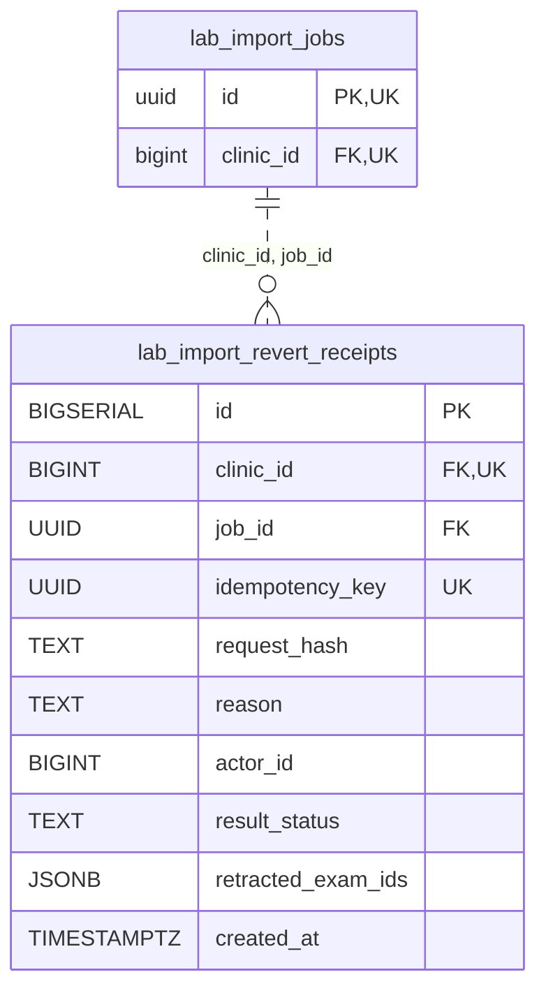

<!-- GENERATED: scripts/tools/generate-erd-detail.py; do not edit -->
# `lab_import_revert_receipts`

[詳細ERD一覧](index.md) · [概要ERD](../erd.md)

このページは、マイグレーションをファイル名順に静的解析した最終定義です。稼働DBの状態は未確認です。

## カラム

型・DEFAULTはDDLの宣言表記です。`bigserial` は採番宣言であり、DBカタログ上の型名ではありません。

| カラム | 型（DDL） | NULL | DEFAULT（DDL） | キー構成列 | 定義元 |
|:---|:---|:---|:---|:---|:---|
| `id` | `BIGSERIAL` | NOT NULL | — | PK | [001_init.sql:5545](../../../backend/migrations/001_init.sql#L5545) |
| `clinic_id` | `BIGINT` | NOT NULL | — | FK, UK | [001_init.sql:5546](../../../backend/migrations/001_init.sql#L5546) |
| `job_id` | `UUID` | NOT NULL | — | FK | [001_init.sql:5547](../../../backend/migrations/001_init.sql#L5547) |
| `idempotency_key` | `UUID` | NOT NULL | — | UK | [001_init.sql:5548](../../../backend/migrations/001_init.sql#L5548) |
| `request_hash` | `TEXT` | NOT NULL | — | — | [001_init.sql:5549](../../../backend/migrations/001_init.sql#L5549) |
| `reason` | `TEXT` | NOT NULL | — | — | [001_init.sql:5550](../../../backend/migrations/001_init.sql#L5550) |
| `actor_id` | `BIGINT` | NULL | — | — | [001_init.sql:5551](../../../backend/migrations/001_init.sql#L5551) |
| `result_status` | `TEXT` | NOT NULL | — | — | [001_init.sql:5552](../../../backend/migrations/001_init.sql#L5552) |
| `retracted_exam_ids` | `JSONB` | NOT NULL | `'[]'::jsonb` | — | [001_init.sql:5553](../../../backend/migrations/001_init.sql#L5553) |
| `created_at` | `TIMESTAMPTZ` | NOT NULL | `now()` | — | [001_init.sql:5554](../../../backend/migrations/001_init.sql#L5554) |

PK/FK/UKはキーの構成列を示します。複合キーの各列が単独で一意という意味ではありません。部分uniqueは下記indexの述語を参照してください。

## ERD

このテーブルの全カラムと、すべての参照先を表示します。参照先はFKの対象列だけを表示し、全カラムは各テーブルのページに置きます。

親側の任意参照はFK列のNULL可否、子側の最大1件は無条件のPK/UNIQUEから導出します。部分uniqueによる条件付きの最大件数は図に反映せず、index一覧に記録します。実線はFK全列が子のPKに含まれる識別関係、破線はそれ以外です。

## 外部キー（全件）

| 制約 | 子の列（順序あり） | 参照先 | 親の列（順序あり） | 削除時の動作 | 定義元 |
|:---|:---|:---|:---|:---|:---|
| `fk_lab_import_revert_receipts_clinic_job` | `clinic_id, job_id` | [lab_import_jobs](lab_import_jobs.md) | `clinic_id, id` | `ON DELETE RESTRICT` | [001_init.sql:5564](../../../backend/migrations/001_init.sql#L5564) |

正確なON UPDATE・MATCH・DEFERRABLE等を含む制約DDL:

- `fk_lab_import_revert_receipts_clinic_job`: `CONSTRAINT fk_lab_import_revert_receipts_clinic_job     FOREIGN KEY (clinic_id, job_id)     REFERENCES lab_import_jobs (clinic_id, id)     ON DELETE RESTRICT`

## その他の制約

| 制約 | 種別 | DDL | 定義元 |
|:---|:---|:---|:---|
| `lab_import_revert_receipts_pkey` | primary | `PRIMARY KEY` | [001_init.sql:5545](../../../backend/migrations/001_init.sql#L5545) |
| `uq_lab_import_revert_receipts_clinic_idempotency` | unique | `CONSTRAINT uq_lab_import_revert_receipts_clinic_idempotency         UNIQUE (clinic_id, idempotency_key)` | [001_init.sql:5555](../../../backend/migrations/001_init.sql#L5555) |

## インデックス

| 名前 | UNIQUE | 述語 | DDL | 定義元 |
|:---|:---|:---|:---|:---|
| `idx_lab_import_revert_receipts_clinic_job` | NO | — | `CREATE INDEX idx_lab_import_revert_receipts_clinic_job     ON lab_import_revert_receipts (clinic_id, job_id, created_at, id)` | [001_init.sql:5560](../../../backend/migrations/001_init.sql#L5560) |
