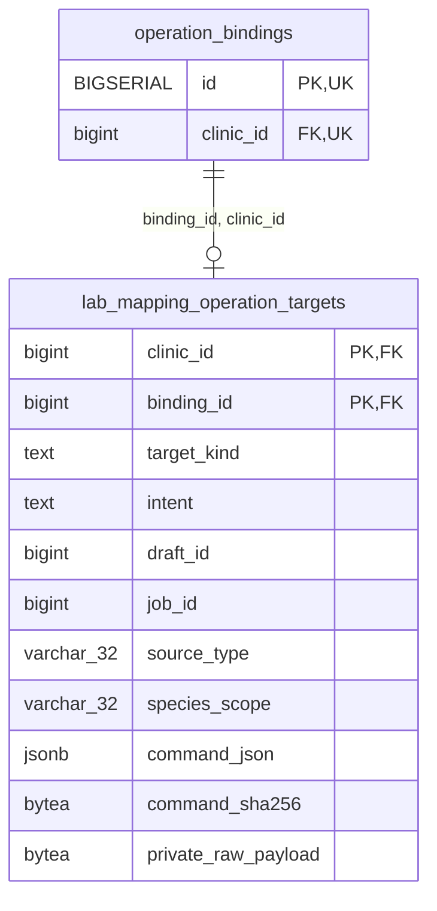

<!-- GENERATED: scripts/tools/generate-erd-detail.py; do not edit -->
# `lab_mapping_operation_targets`

[詳細ERD一覧](index.md) · [概要ERD](../erd.md)

このページは、マイグレーションをファイル名順に静的解析した最終定義です。稼働DBの状態は未確認です。

## カラム

型・DEFAULTはDDLの宣言表記です。`bigserial` は採番宣言であり、DBカタログ上の型名ではありません。

| カラム | 型（DDL） | NULL | DEFAULT（DDL） | キー構成列 | 定義元 |
|:---|:---|:---|:---|:---|:---|
| `clinic_id` | `bigint` | NOT NULL | — | PK, FK | [001_init.sql:11544](../../../backend/migrations/001_init.sql#L11544) |
| `binding_id` | `bigint` | NOT NULL | — | PK, FK | [001_init.sql:11545](../../../backend/migrations/001_init.sql#L11545) |
| `target_kind` | `text` | NOT NULL | — | — | [001_init.sql:11546](../../../backend/migrations/001_init.sql#L11546) |
| `intent` | `text` | NOT NULL | — | — | [001_init.sql:11547](../../../backend/migrations/001_init.sql#L11547) |
| `draft_id` | `bigint` | NULL | — | — | [001_init.sql:11548](../../../backend/migrations/001_init.sql#L11548) |
| `job_id` | `bigint` | NULL | — | — | [001_init.sql:11549](../../../backend/migrations/001_init.sql#L11549) |
| `source_type` | `varchar(32)` | NULL | — | — | [001_init.sql:11550](../../../backend/migrations/001_init.sql#L11550) |
| `species_scope` | `varchar(32)` | NULL | — | — | [001_init.sql:11551](../../../backend/migrations/001_init.sql#L11551) |
| `command_json` | `jsonb` | NOT NULL | — | — | [001_init.sql:11552](../../../backend/migrations/001_init.sql#L11552) |
| `command_sha256` | `bytea` | NOT NULL | — | — | [001_init.sql:11553](../../../backend/migrations/001_init.sql#L11553) |
| `private_raw_payload` | `bytea` | NULL | — | — | [001_init.sql:11554](../../../backend/migrations/001_init.sql#L11554) |

PK/FK/UKはキーの構成列を示します。複合キーの各列が単独で一意という意味ではありません。部分uniqueは下記indexの述語を参照してください。

## ERD

このテーブルの全カラムと、すべての参照先を表示します。参照先はFKの対象列だけを表示し、全カラムは各テーブルのページに置きます。

親側の任意参照はFK列のNULL可否、子側の最大1件は無条件のPK/UNIQUEから導出します。部分uniqueによる条件付きの最大件数は図に反映せず、index一覧に記録します。実線はFK全列が子のPKに含まれる識別関係、破線はそれ以外です。

## 外部キー（全件）

| 制約 | 子の列（順序あり） | 参照先 | 親の列（順序あり） | 削除時の動作 | 定義元 |
|:---|:---|:---|:---|:---|:---|
| `lab_mapping_operation_targets_binding_id_clinic_id_fkey` | `binding_id, clinic_id` | [operation_bindings](operation_bindings.md) | `id, clinic_id` | `ON DELETE RESTRICT` | [001_init.sql:11556](../../../backend/migrations/001_init.sql#L11556) |

正確なON UPDATE・MATCH・DEFERRABLE等を含む制約DDL:

- `lab_mapping_operation_targets_binding_id_clinic_id_fkey`: `FOREIGN KEY (binding_id, clinic_id) REFERENCES operation_bindings (id, clinic_id) ON DELETE RESTRICT`

## その他の制約

| 制約 | 種別 | DDL | 定義元 |
|:---|:---|:---|:---|
| `lab_mapping_operation_targets_clinic_id_check` | check | `CHECK (clinic_id > 0)` | [001_init.sql:11544](../../../backend/migrations/001_init.sql#L11544) |
| `lab_mapping_operation_targets_binding_id_check` | check | `CHECK (binding_id > 0)` | [001_init.sql:11545](../../../backend/migrations/001_init.sql#L11545) |
| `lab_mapping_operation_targets_target_kind_check` | check | `CHECK (target_kind IN ('sample_registration', 'draft', 'job'))` | [001_init.sql:11546](../../../backend/migrations/001_init.sql#L11546) |
| `lab_mapping_operation_targets_intent_check` | check | `CHECK (intent IN ('lab_mapping.sample_register', 'lab_mapping.confirm', 'lab_mapping.resolve'))` | [001_init.sql:11547](../../../backend/migrations/001_init.sql#L11547) |
| `lab_mapping_operation_targets_draft_id_check` | check | `CHECK (draft_id IS NULL OR draft_id > 0)` | [001_init.sql:11548](../../../backend/migrations/001_init.sql#L11548) |
| `lab_mapping_operation_targets_job_id_check` | check | `CHECK (job_id IS NULL OR job_id > 0)` | [001_init.sql:11549](../../../backend/migrations/001_init.sql#L11549) |
| `lab_mapping_operation_targets_command_json_check` | check | `CHECK (jsonb_typeof(command_json) = 'object')` | [001_init.sql:11552](../../../backend/migrations/001_init.sql#L11552) |
| `lab_mapping_operation_targets_command_sha256_check` | check | `CHECK (octet_length(command_sha256) = 32)` | [001_init.sql:11553](../../../backend/migrations/001_init.sql#L11553) |
| `lab_mapping_operation_targets_pkey` | primary | `PRIMARY KEY (clinic_id, binding_id)` | [001_init.sql:11555](../../../backend/migrations/001_init.sql#L11555) |
| `lab_mapping_operation_targets_source_type_check` | check | `CHECK (source_type IS NULL OR source_type IN ('fuji_nx600', 'fuji_au10v', 'arkray_pu4010', 'idexx_vetlab'))` | [001_init.sql:11557](../../../backend/migrations/001_init.sql#L11557) |
| `lab_mapping_operation_targets_species_scope_check` | check | `CHECK (species_scope IS NULL OR species_scope IN ('', 'canine', 'feline'))` | [001_init.sql:11558](../../../backend/migrations/001_init.sql#L11558) |
| `lab_mapping_operation_targets_check` | check | `CHECK (         (intent = 'lab_mapping.sample_register' AND target_kind = 'sample_registration'             AND draft_id IS NULL AND job_id IS NULL             AND private_raw_payload IS NOT NULL AND octet_length(private_raw_payload) <= 8192)         OR (intent = 'lab_mapping.confirm' AND target_kind = 'draft'             AND draft_id IS NOT NULL AND job_id IS NULL             AND private_raw_payload IS NULL)         OR (intent = 'lab_mapping.resolve' AND target_kind = 'job'             AND job_id IS NOT NULL AND draft_id IS NULL             AND private_raw_payload IS NULL)     )` | [001_init.sql:11559](../../../backend/migrations/001_init.sql#L11559) |

## インデックス

明示的なCREATE INDEXなし。PK/UNIQUEに付随する暗黙のindexは制約欄を参照してください。
