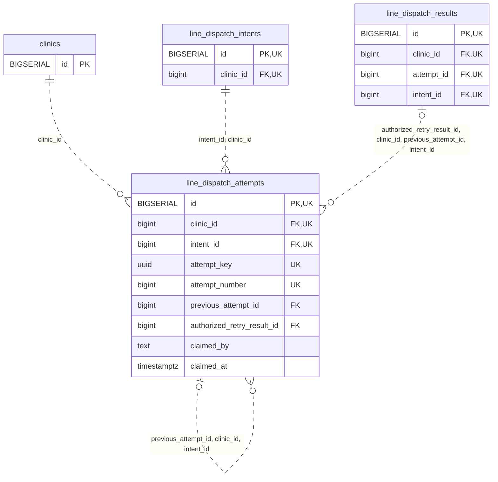

<!-- GENERATED: scripts/tools/generate-erd-detail.py; do not edit -->
# `line_dispatch_attempts`

[詳細ERD一覧](index.md) · [概要ERD](../erd.md)

このページは、マイグレーションをファイル名順に静的解析した最終定義です。稼働DBの状態は未確認です。

## カラム

型・DEFAULTはDDLの宣言表記です。`bigserial` は採番宣言であり、DBカタログ上の型名ではありません。

| カラム | 型（DDL） | NULL | DEFAULT（DDL） | キー構成列 | 定義元 |
|:---|:---|:---|:---|:---|:---|
| `id` | `BIGSERIAL` | NOT NULL | — | PK, UK | [001_init.sql:10195](../../../backend/migrations/001_init.sql#L10195) |
| `clinic_id` | `bigint` | NOT NULL | — | FK, UK | [001_init.sql:10195](../../../backend/migrations/001_init.sql#L10195) |
| `intent_id` | `bigint` | NOT NULL | — | FK, UK | [001_init.sql:10195](../../../backend/migrations/001_init.sql#L10195) |
| `attempt_key` | `uuid` | NOT NULL | — | UK | [001_init.sql:10196](../../../backend/migrations/001_init.sql#L10196) |
| `attempt_number` | `bigint` | NOT NULL | — | UK | [001_init.sql:10196](../../../backend/migrations/001_init.sql#L10196) |
| `previous_attempt_id` | `bigint` | NULL | — | FK | [001_init.sql:10197](../../../backend/migrations/001_init.sql#L10197) |
| `authorized_retry_result_id` | `bigint` | NULL | — | FK | [001_init.sql:10197](../../../backend/migrations/001_init.sql#L10197) |
| `claimed_by` | `text` | NOT NULL | — | — | [001_init.sql:10198](../../../backend/migrations/001_init.sql#L10198) |
| `claimed_at` | `timestamptz` | NOT NULL | — | — | [001_init.sql:10198](../../../backend/migrations/001_init.sql#L10198) |

PK/FK/UKはキーの構成列を示します。複合キーの各列が単独で一意という意味ではありません。部分uniqueは下記indexの述語を参照してください。

## ERD

このテーブルの全カラムと、すべての参照先を表示します。参照先はFKの対象列だけを表示し、全カラムは各テーブルのページに置きます。

親側の任意参照はFK列のNULL可否、子側の最大1件は無条件のPK/UNIQUEから導出します。部分uniqueによる条件付きの最大件数は図に反映せず、index一覧に記録します。実線はFK全列が子のPKに含まれる識別関係、破線はそれ以外です。

## 外部キー（全件）

| 制約 | 子の列（順序あり） | 参照先 | 親の列（順序あり） | 削除時の動作 | 定義元 |
|:---|:---|:---|:---|:---|:---|
| `line_dispatch_attempts_clinic_id_fkey` | `clinic_id` | [clinics](clinics.md) | `id` | `ON DELETE RESTRICT` | [001_init.sql:10195](../../../backend/migrations/001_init.sql#L10195) |
| `line_dispatch_attempts_intent_id_clinic_id_fkey` | `intent_id, clinic_id` | [line_dispatch_intents](line_dispatch_intents.md) | `id, clinic_id` | `ON DELETE RESTRICT` | [001_init.sql:10202](../../../backend/migrations/001_init.sql#L10202) |
| `line_dispatch_attempts_previous_attempt_id_clinic_id_inten_fkey` | `previous_attempt_id, clinic_id, intent_id` | [line_dispatch_attempts](line_dispatch_attempts.md) | `id, clinic_id, intent_id` | `ON DELETE RESTRICT` | [001_init.sql:10203](../../../backend/migrations/001_init.sql#L10203) |
| `fk_line_retry_evidence` | `authorized_retry_result_id, clinic_id, previous_attempt_id, intent_id` | [line_dispatch_results](line_dispatch_results.md) | `id, clinic_id, attempt_id, intent_id` | `ON DELETE RESTRICT` | [001_init.sql:10213](../../../backend/migrations/001_init.sql#L10213) |

正確なON UPDATE・MATCH・DEFERRABLE等を含む制約DDL:

- `line_dispatch_attempts_clinic_id_fkey`: `REFERENCES clinics(id) ON DELETE RESTRICT`
- `line_dispatch_attempts_intent_id_clinic_id_fkey`: `FOREIGN KEY(intent_id,clinic_id) REFERENCES line_dispatch_intents(id,clinic_id) ON DELETE RESTRICT`
- `line_dispatch_attempts_previous_attempt_id_clinic_id_inten_fkey`: `FOREIGN KEY(previous_attempt_id,clinic_id,intent_id) REFERENCES line_dispatch_attempts(id,clinic_id,intent_id) ON DELETE RESTRICT`
- `fk_line_retry_evidence`: `CONSTRAINT fk_line_retry_evidence  FOREIGN KEY(authorized_retry_result_id,clinic_id,previous_attempt_id,intent_id)  REFERENCES line_dispatch_results(id,clinic_id,attempt_id,intent_id) ON DELETE RESTRICT`

## その他の制約

| 制約 | 種別 | DDL | 定義元 |
|:---|:---|:---|:---|
| `line_dispatch_attempts_pkey` | primary | `PRIMARY KEY` | [001_init.sql:10195](../../../backend/migrations/001_init.sql#L10195) |
| `line_dispatch_attempts_attempt_number_check` | check | `CHECK(attempt_number>0)` | [001_init.sql:10196](../../../backend/migrations/001_init.sql#L10196) |
| `line_dispatch_attempts_id_clinic_id_intent_id_key` | unique | `UNIQUE(id,clinic_id,intent_id)` | [001_init.sql:10198](../../../backend/migrations/001_init.sql#L10198) |
| `line_dispatch_attempts_clinic_id_attempt_key_key` | unique | `UNIQUE(clinic_id,attempt_key)` | [001_init.sql:10199](../../../backend/migrations/001_init.sql#L10199) |
| `line_dispatch_attempts_clinic_id_intent_id_attempt_number_key` | unique | `UNIQUE(clinic_id,intent_id,attempt_number)` | [001_init.sql:10199](../../../backend/migrations/001_init.sql#L10199) |
| `line_dispatch_attempts_check` | check | `CHECK((attempt_number=1 AND previous_attempt_id IS NULL AND authorized_retry_result_id IS NULL)  OR(attempt_number>1 AND previous_attempt_id IS NOT NULL AND authorized_retry_result_id IS NOT NULL))` | [001_init.sql:10200](../../../backend/migrations/001_init.sql#L10200) |

## インデックス

明示的なCREATE INDEXなし。PK/UNIQUEに付随する暗黙のindexは制約欄を参照してください。
