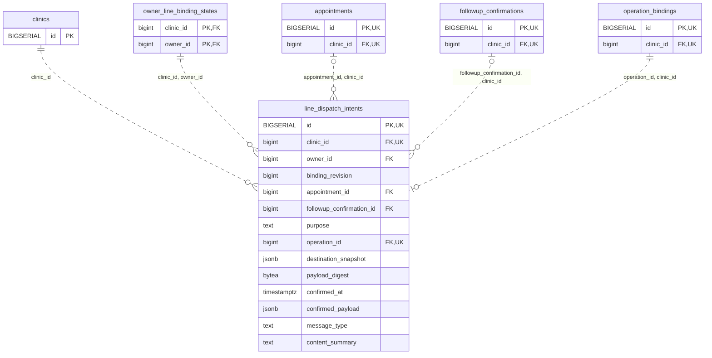

<!-- GENERATED: scripts/tools/generate-erd-detail.py; do not edit -->
# `line_dispatch_intents`

[詳細ERD一覧](index.md) · [概要ERD](../erd.md)

このページは、マイグレーションをファイル名順に静的解析した最終定義です。稼働DBの状態は未確認です。

## カラム

型・DEFAULTはDDLの宣言表記です。`bigserial` は採番宣言であり、DBカタログ上の型名ではありません。

| カラム | 型（DDL） | NULL | DEFAULT（DDL） | キー構成列 | 定義元 |
|:---|:---|:---|:---|:---|:---|
| `id` | `BIGSERIAL` | NOT NULL | — | PK, UK | [001_init.sql:10184](../../../backend/migrations/001_init.sql#L10184) |
| `clinic_id` | `bigint` | NOT NULL | — | FK, UK | [001_init.sql:10184](../../../backend/migrations/001_init.sql#L10184) |
| `owner_id` | `bigint` | NOT NULL | — | FK | [001_init.sql:10185](../../../backend/migrations/001_init.sql#L10185) |
| `binding_revision` | `bigint` | NOT NULL | — | — | [001_init.sql:10185](../../../backend/migrations/001_init.sql#L10185) |
| `appointment_id` | `bigint` | NULL | — | FK | [001_init.sql:10186](../../../backend/migrations/001_init.sql#L10186) |
| `followup_confirmation_id` | `bigint` | NULL | — | FK | [001_init.sql:10186](../../../backend/migrations/001_init.sql#L10186) |
| `purpose` | `text` | NOT NULL | — | — | [001_init.sql:10187](../../../backend/migrations/001_init.sql#L10187) |
| `operation_id` | `bigint` | NOT NULL | — | FK, UK | [001_init.sql:10188](../../../backend/migrations/001_init.sql#L10188) |
| `destination_snapshot` | `jsonb` | NOT NULL | — | — | [001_init.sql:10188](../../../backend/migrations/001_init.sql#L10188) |
| `payload_digest` | `bytea` | NOT NULL | — | — | [001_init.sql:10189](../../../backend/migrations/001_init.sql#L10189) |
| `confirmed_at` | `timestamptz` | NOT NULL | — | — | [001_init.sql:10189](../../../backend/migrations/001_init.sql#L10189) |
| `confirmed_payload` | `jsonb` | NOT NULL | — | — | [001_init.sql:10952](../../../backend/migrations/001_init.sql#L10952) |
| `message_type` | `text` | NULL | — | — | [001_init.sql:10952](../../../backend/migrations/001_init.sql#L10952) |
| `content_summary` | `text` | NULL | — | — | [001_init.sql:10952](../../../backend/migrations/001_init.sql#L10952) |

PK/FK/UKはキーの構成列を示します。複合キーの各列が単独で一意という意味ではありません。部分uniqueは下記indexの述語を参照してください。

## ERD

このテーブルの全カラムと、すべての参照先を表示します。参照先はFKの対象列だけを表示し、全カラムは各テーブルのページに置きます。

親側の任意参照はFK列のNULL可否、子側の最大1件は無条件のPK/UNIQUEから導出します。部分uniqueによる条件付きの最大件数は図に反映せず、index一覧に記録します。実線はFK全列が子のPKに含まれる識別関係、破線はそれ以外です。

## 外部キー（全件）

| 制約 | 子の列（順序あり） | 参照先 | 親の列（順序あり） | 削除時の動作 | 定義元 |
|:---|:---|:---|:---|:---|:---|
| `line_dispatch_intents_clinic_id_fkey` | `clinic_id` | [clinics](clinics.md) | `id` | `ON DELETE RESTRICT` | [001_init.sql:10184](../../../backend/migrations/001_init.sql#L10184) |
| `line_dispatch_intents_clinic_id_owner_id_fkey` | `clinic_id, owner_id` | [owner_line_binding_states](owner_line_binding_states.md) | `clinic_id, owner_id` | `ON DELETE RESTRICT` | [001_init.sql:10191](../../../backend/migrations/001_init.sql#L10191) |
| `line_dispatch_intents_appointment_id_clinic_id_fkey` | `appointment_id, clinic_id` | [appointments](appointments.md) | `id, clinic_id` | `ON DELETE RESTRICT` | [001_init.sql:10192](../../../backend/migrations/001_init.sql#L10192) |
| `line_dispatch_intents_followup_confirmation_id_clinic_id_fkey` | `followup_confirmation_id, clinic_id` | [followup_confirmations](followup_confirmations.md) | `id, clinic_id` | `ON DELETE RESTRICT` | [001_init.sql:10193](../../../backend/migrations/001_init.sql#L10193) |
| `line_dispatch_intents_operation_id_clinic_id_fkey` | `operation_id, clinic_id` | [operation_bindings](operation_bindings.md) | `id, clinic_id` | `ON DELETE RESTRICT` | [001_init.sql:10194](../../../backend/migrations/001_init.sql#L10194) |

正確なON UPDATE・MATCH・DEFERRABLE等を含む制約DDL:

- `line_dispatch_intents_clinic_id_fkey`: `REFERENCES clinics(id) ON DELETE RESTRICT`
- `line_dispatch_intents_clinic_id_owner_id_fkey`: `FOREIGN KEY(clinic_id,owner_id) REFERENCES owner_line_binding_states(clinic_id,owner_id) ON DELETE RESTRICT`
- `line_dispatch_intents_appointment_id_clinic_id_fkey`: `FOREIGN KEY(appointment_id,clinic_id) REFERENCES appointments(id,clinic_id) ON DELETE RESTRICT`
- `line_dispatch_intents_followup_confirmation_id_clinic_id_fkey`: `FOREIGN KEY(followup_confirmation_id,clinic_id) REFERENCES followup_confirmations(id,clinic_id) ON DELETE RESTRICT`
- `line_dispatch_intents_operation_id_clinic_id_fkey`: `FOREIGN KEY(operation_id,clinic_id) REFERENCES operation_bindings(id,clinic_id) ON DELETE RESTRICT`

## その他の制約

| 制約 | 種別 | DDL | 定義元 |
|:---|:---|:---|:---|
| `line_dispatch_intents_pkey` | primary | `PRIMARY KEY` | [001_init.sql:10184](../../../backend/migrations/001_init.sql#L10184) |
| `line_dispatch_intents_binding_revision_check` | check | `CHECK(binding_revision>0)` | [001_init.sql:10185](../../../backend/migrations/001_init.sql#L10185) |
| `line_dispatch_intents_purpose_check` | check | `CHECK(purpose IN('reservation_confirmation','reservation_change','reservation_reminder','guidance','promotion','medical_followup'))` | [001_init.sql:10187](../../../backend/migrations/001_init.sql#L10187) |
| `line_dispatch_intents_destination_snapshot_check` | check | `CHECK(jsonb_typeof(destination_snapshot)='object')` | [001_init.sql:10188](../../../backend/migrations/001_init.sql#L10188) |
| `line_dispatch_intents_payload_digest_check` | check | `CHECK(octet_length(payload_digest)=32)` | [001_init.sql:10189](../../../backend/migrations/001_init.sql#L10189) |
| `line_dispatch_intents_id_clinic_id_key` | unique | `UNIQUE(id,clinic_id)` | [001_init.sql:10190](../../../backend/migrations/001_init.sql#L10190) |
| `line_dispatch_intents_clinic_id_operation_id_key` | unique | `UNIQUE(clinic_id,operation_id)` | [001_init.sql:10190](../../../backend/migrations/001_init.sql#L10190) |
| `line_dispatch_intents_confirmed_payload_check` | check | `CHECK(jsonb_typeof(confirmed_payload)='object')` | [001_init.sql:10952](../../../backend/migrations/001_init.sql#L10952) |

## インデックス

明示的なCREATE INDEXなし。PK/UNIQUEに付随する暗黙のindexは制約欄を参照してください。
