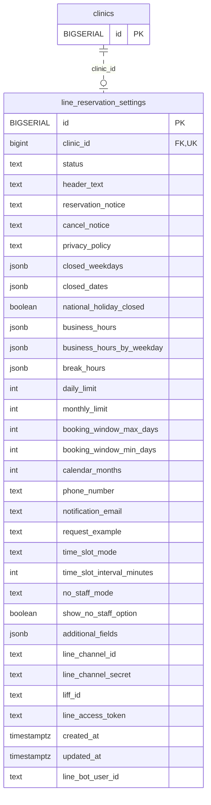

<!-- GENERATED: scripts/tools/generate-erd-detail.py; do not edit -->
# `line_reservation_settings`

[詳細ERD一覧](index.md) · [概要ERD](../erd.md)

このページは、マイグレーションをファイル名順に静的解析した最終定義です。稼働DBの状態は未確認です。

## カラム

型・DEFAULTはDDLの宣言表記です。`bigserial` は採番宣言であり、DBカタログ上の型名ではありません。

| カラム | 型（DDL） | NULL | DEFAULT（DDL） | キー構成列 | 定義元 |
|:---|:---|:---|:---|:---|:---|
| `id` | `BIGSERIAL` | NOT NULL | — | PK | [001_init.sql:2624](../../../backend/migrations/001_init.sql#L2624) |
| `clinic_id` | `bigint` | NOT NULL | — | FK, UK | [001_init.sql:2625](../../../backend/migrations/001_init.sql#L2625) |
| `status` | `text` | NOT NULL | `'stopped'` | — | [001_init.sql:2626](../../../backend/migrations/001_init.sql#L2626) |
| `header_text` | `text` | NOT NULL | `''` | — | [001_init.sql:2629](../../../backend/migrations/001_init.sql#L2629) |
| `reservation_notice` | `text` | NOT NULL | `''` | — | [001_init.sql:2630](../../../backend/migrations/001_init.sql#L2630) |
| `cancel_notice` | `text` | NOT NULL | `''` | — | [001_init.sql:2631](../../../backend/migrations/001_init.sql#L2631) |
| `privacy_policy` | `text` | NOT NULL | `''` | — | [001_init.sql:2632](../../../backend/migrations/001_init.sql#L2632) |
| `closed_weekdays` | `jsonb` | NOT NULL | `'[]'` | — | [001_init.sql:2635](../../../backend/migrations/001_init.sql#L2635) |
| `closed_dates` | `jsonb` | NOT NULL | `'[]'` | — | [001_init.sql:2636](../../../backend/migrations/001_init.sql#L2636) |
| `national_holiday_closed` | `boolean` | NOT NULL | `false` | — | [001_init.sql:2637](../../../backend/migrations/001_init.sql#L2637) |
| `business_hours` | `jsonb` | NOT NULL | `'{"start":"0900","end":"1900"}'` | — | [001_init.sql:2638](../../../backend/migrations/001_init.sql#L2638) |
| `business_hours_by_weekday` | `jsonb` | NULL | — | — | [001_init.sql:2639](../../../backend/migrations/001_init.sql#L2639) |
| `break_hours` | `jsonb` | NOT NULL | `'[{"start":"1200","end":"1300"}]'` | — | [001_init.sql:2640](../../../backend/migrations/001_init.sql#L2640) |
| `daily_limit` | `int` | NULL | `1` | — | [001_init.sql:2641](../../../backend/migrations/001_init.sql#L2641) |
| `monthly_limit` | `int` | NULL | — | — | [001_init.sql:2642](../../../backend/migrations/001_init.sql#L2642) |
| `booking_window_max_days` | `int` | NOT NULL | `30` | — | [001_init.sql:2643](../../../backend/migrations/001_init.sql#L2643) |
| `booking_window_min_days` | `int` | NOT NULL | `2` | — | [001_init.sql:2644](../../../backend/migrations/001_init.sql#L2644) |
| `calendar_months` | `int` | NOT NULL | `2` | — | [001_init.sql:2645](../../../backend/migrations/001_init.sql#L2645) |
| `phone_number` | `text` | NOT NULL | `''` | — | [001_init.sql:2646](../../../backend/migrations/001_init.sql#L2646) |
| `notification_email` | `text` | NOT NULL | `''` | — | [001_init.sql:2647](../../../backend/migrations/001_init.sql#L2647) |
| `request_example` | `text` | NOT NULL | `''` | — | [001_init.sql:2648](../../../backend/migrations/001_init.sql#L2648) |
| `time_slot_mode` | `text` | NOT NULL | `'minimize_gaps'` | — | [001_init.sql:2649](../../../backend/migrations/001_init.sql#L2649) |
| `time_slot_interval_minutes` | `int` | NOT NULL | `15` | — | [001_init.sql:2650](../../../backend/migrations/001_init.sql#L2650) |
| `no_staff_mode` | `text` | NOT NULL | `'first_available'` | — | [001_init.sql:2651](../../../backend/migrations/001_init.sql#L2651) |
| `show_no_staff_option` | `boolean` | NOT NULL | `true` | — | [001_init.sql:2652](../../../backend/migrations/001_init.sql#L2652) |
| `additional_fields` | `jsonb` | NOT NULL | `'[         {"key":"phone","label":"電話番号","required":true,"placeholder":"例) 090-1234-5678"},         {"key":"owner_name","label":"飼い主名","required":true,"placeholder":""},         {"key":"pet_info","label":"ペットの名前と種類","required":true,"placeholder":"例) ポチ（柴犬）"},         {"key":"symptoms","label":"診察内容","required":false,"placeholder":""}     ]'` | — | [001_init.sql:2655](../../../backend/migrations/001_init.sql#L2655) |
| `line_channel_id` | `text` | NOT NULL | `''` | — | [001_init.sql:2663](../../../backend/migrations/001_init.sql#L2663) |
| `line_channel_secret` | `text` | NOT NULL | `''` | — | [001_init.sql:2664](../../../backend/migrations/001_init.sql#L2664) |
| `liff_id` | `text` | NOT NULL | `''` | — | [001_init.sql:2665](../../../backend/migrations/001_init.sql#L2665) |
| `line_access_token` | `text` | NOT NULL | `''` | — | [001_init.sql:2666](../../../backend/migrations/001_init.sql#L2666) |
| `created_at` | `timestamptz` | NOT NULL | `now()` | — | [001_init.sql:2668](../../../backend/migrations/001_init.sql#L2668) |
| `updated_at` | `timestamptz` | NOT NULL | `now()` | — | [001_init.sql:2669](../../../backend/migrations/001_init.sql#L2669) |
| `line_bot_user_id` | `text` | NOT NULL | `''` | — | [001_init.sql:4763](../../../backend/migrations/001_init.sql#L4763) |

PK/FK/UKはキーの構成列を示します。複合キーの各列が単独で一意という意味ではありません。部分uniqueは下記indexの述語を参照してください。

## ERD

このテーブルの全カラムと、すべての参照先を表示します。参照先はFKの対象列だけを表示し、全カラムは各テーブルのページに置きます。

親側の任意参照はFK列のNULL可否、子側の最大1件は無条件のPK/UNIQUEから導出します。部分uniqueによる条件付きの最大件数は図に反映せず、index一覧に記録します。実線はFK全列が子のPKに含まれる識別関係、破線はそれ以外です。

## 外部キー（全件）

| 制約 | 子の列（順序あり） | 参照先 | 親の列（順序あり） | 削除時の動作 | 定義元 |
|:---|:---|:---|:---|:---|:---|
| `line_reservation_settings_clinic_id_fkey` | `clinic_id` | [clinics](clinics.md) | `id` | `ON DELETE NO ACTION` | [001_init.sql:2625](../../../backend/migrations/001_init.sql#L2625) |

正確なON UPDATE・MATCH・DEFERRABLE等を含む制約DDL:

- `line_reservation_settings_clinic_id_fkey`: `REFERENCES clinics(id)`

## その他の制約

| 制約 | 種別 | DDL | 定義元 |
|:---|:---|:---|:---|
| `line_reservation_settings_pkey` | primary | `PRIMARY KEY` | [001_init.sql:2624](../../../backend/migrations/001_init.sql#L2624) |
| `line_reservation_settings_clinic_id_key` | unique | `UNIQUE` | [001_init.sql:2625](../../../backend/migrations/001_init.sql#L2625) |

## インデックス

| 名前 | UNIQUE | 述語 | DDL | 定義元 |
|:---|:---|:---|:---|:---|
| `uq_line_reservation_settings_line_bot_user_id` | YES | `line_bot_user_id <> ''` | `CREATE UNIQUE INDEX uq_line_reservation_settings_line_bot_user_id     ON line_reservation_settings (line_bot_user_id)     WHERE line_bot_user_id <> ''` | [001_init.sql:4766](../../../backend/migrations/001_init.sql#L4766) |
