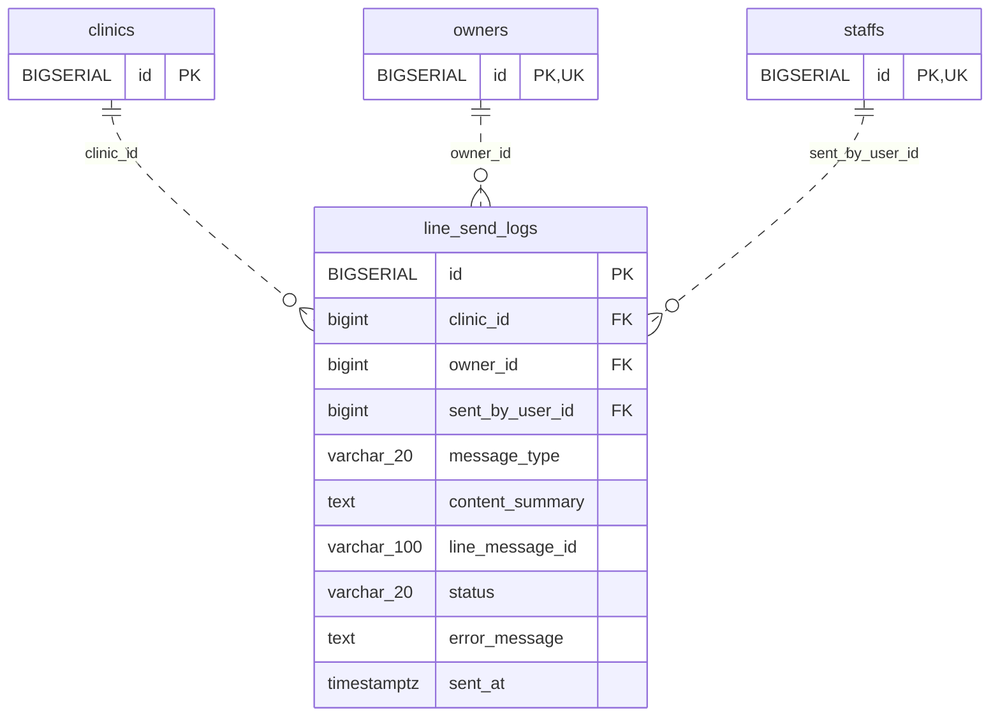

<!-- GENERATED: scripts/tools/generate-erd-detail.py; do not edit -->
# `line_send_logs`

[詳細ERD一覧](index.md) · [概要ERD](../erd.md)

このページは、マイグレーションをファイル名順に静的解析した最終定義です。稼働DBの状態は未確認です。

## カラム

型・DEFAULTはDDLの宣言表記です。`bigserial` は採番宣言であり、DBカタログ上の型名ではありません。

| カラム | 型（DDL） | NULL | DEFAULT（DDL） | キー構成列 | 定義元 |
|:---|:---|:---|:---|:---|:---|
| `id` | `BIGSERIAL` | NOT NULL | — | PK | [001_init.sql:1297](../../../backend/migrations/001_init.sql#L1297) |
| `clinic_id` | `bigint` | NOT NULL | — | FK | [001_init.sql:1298](../../../backend/migrations/001_init.sql#L1298) |
| `owner_id` | `bigint` | NOT NULL | — | FK | [001_init.sql:1299](../../../backend/migrations/001_init.sql#L1299) |
| `sent_by_user_id` | `bigint` | NOT NULL | — | FK | [001_init.sql:1300](../../../backend/migrations/001_init.sql#L1300) |
| `message_type` | `varchar(20)` | NOT NULL | — | — | [001_init.sql:1301](../../../backend/migrations/001_init.sql#L1301) |
| `content_summary` | `text` | NOT NULL | — | — | [001_init.sql:1302](../../../backend/migrations/001_init.sql#L1302) |
| `line_message_id` | `varchar(100)` | NULL | — | — | [001_init.sql:1303](../../../backend/migrations/001_init.sql#L1303) |
| `status` | `varchar(20)` | NOT NULL | — | — | [001_init.sql:1304](../../../backend/migrations/001_init.sql#L1304) |
| `error_message` | `text` | NULL | — | — | [001_init.sql:1305](../../../backend/migrations/001_init.sql#L1305) |
| `sent_at` | `timestamptz` | NOT NULL | `now()` | — | [001_init.sql:1306](../../../backend/migrations/001_init.sql#L1306) |

PK/FK/UKはキーの構成列を示します。複合キーの各列が単独で一意という意味ではありません。部分uniqueは下記indexの述語を参照してください。

## ERD

このテーブルの全カラムと、すべての参照先を表示します。参照先はFKの対象列だけを表示し、全カラムは各テーブルのページに置きます。

親側の任意参照はFK列のNULL可否、子側の最大1件は無条件のPK/UNIQUEから導出します。部分uniqueによる条件付きの最大件数は図に反映せず、index一覧に記録します。実線はFK全列が子のPKに含まれる識別関係、破線はそれ以外です。

## 外部キー（全件）

| 制約 | 子の列（順序あり） | 参照先 | 親の列（順序あり） | 削除時の動作 | 定義元 |
|:---|:---|:---|:---|:---|:---|
| `line_send_logs_clinic_id_fkey` | `clinic_id` | [clinics](clinics.md) | `id` | `ON DELETE NO ACTION` | [001_init.sql:1298](../../../backend/migrations/001_init.sql#L1298) |
| `line_send_logs_owner_id_fkey` | `owner_id` | [owners](owners.md) | `id` | `ON DELETE NO ACTION` | [001_init.sql:1299](../../../backend/migrations/001_init.sql#L1299) |
| `line_send_logs_sent_by_user_id_fkey` | `sent_by_user_id` | [staffs](staffs.md) | `id` | `ON DELETE NO ACTION` | [001_init.sql:1300](../../../backend/migrations/001_init.sql#L1300) |

正確なON UPDATE・MATCH・DEFERRABLE等を含む制約DDL:

- `line_send_logs_clinic_id_fkey`: `REFERENCES clinics(id)`
- `line_send_logs_owner_id_fkey`: `REFERENCES owners(id)`
- `line_send_logs_sent_by_user_id_fkey`: `REFERENCES staffs(id)`

## その他の制約

| 制約 | 種別 | DDL | 定義元 |
|:---|:---|:---|:---|
| `line_send_logs_pkey` | primary | `PRIMARY KEY` | [001_init.sql:1297](../../../backend/migrations/001_init.sql#L1297) |

## インデックス

| 名前 | UNIQUE | 述語 | DDL | 定義元 |
|:---|:---|:---|:---|:---|
| `idx_line_send_logs_clinic_owner` | NO | — | `CREATE INDEX idx_line_send_logs_clinic_owner ON line_send_logs (clinic_id, owner_id, sent_at DESC)` | [001_init.sql:1309](../../../backend/migrations/001_init.sql#L1309) |
