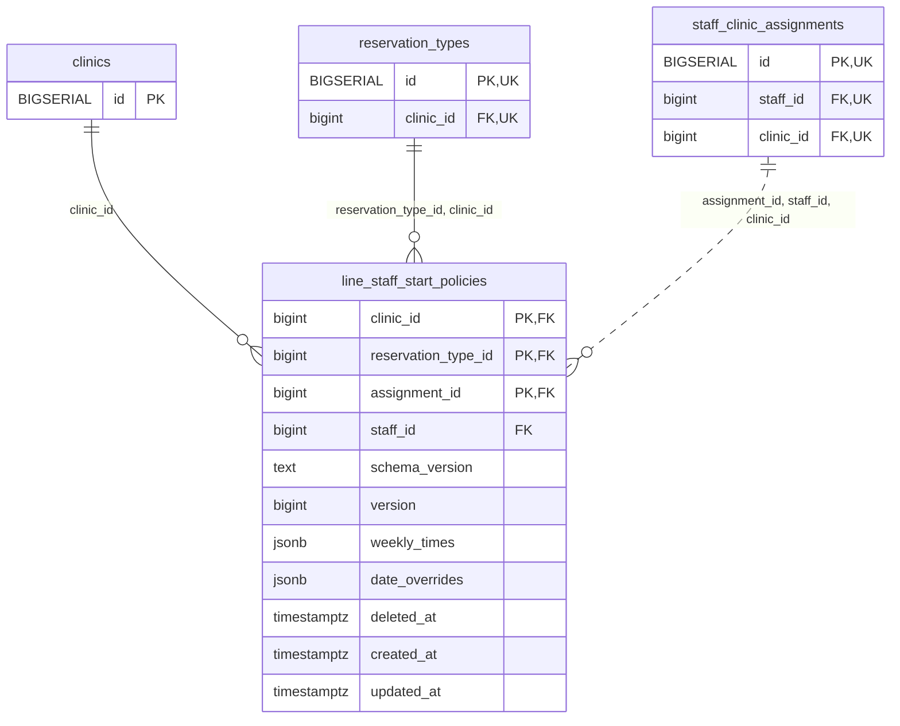

<!-- GENERATED: scripts/tools/generate-erd-detail.py; do not edit -->
# `line_staff_start_policies`

[詳細ERD一覧](index.md) · [概要ERD](../erd.md)

このページは、マイグレーションをファイル名順に静的解析した最終定義です。稼働DBの状態は未確認です。

## カラム

型・DEFAULTはDDLの宣言表記です。`bigserial` は採番宣言であり、DBカタログ上の型名ではありません。

| カラム | 型（DDL） | NULL | DEFAULT（DDL） | キー構成列 | 定義元 |
|:---|:---|:---|:---|:---|:---|
| `clinic_id` | `bigint` | NOT NULL | — | PK, FK | [001_init.sql:11800](../../../backend/migrations/001_init.sql#L11800) |
| `reservation_type_id` | `bigint` | NOT NULL | — | PK, FK | [001_init.sql:11801](../../../backend/migrations/001_init.sql#L11801) |
| `assignment_id` | `bigint` | NOT NULL | — | PK, FK | [001_init.sql:11802](../../../backend/migrations/001_init.sql#L11802) |
| `staff_id` | `bigint` | NOT NULL | — | FK | [001_init.sql:11803](../../../backend/migrations/001_init.sql#L11803) |
| `schema_version` | `text` | NOT NULL | — | — | [001_init.sql:11804](../../../backend/migrations/001_init.sql#L11804) |
| `version` | `bigint` | NOT NULL | `1` | — | [001_init.sql:11805](../../../backend/migrations/001_init.sql#L11805) |
| `weekly_times` | `jsonb` | NOT NULL | — | — | [001_init.sql:11806](../../../backend/migrations/001_init.sql#L11806) |
| `date_overrides` | `jsonb` | NOT NULL | — | — | [001_init.sql:11807](../../../backend/migrations/001_init.sql#L11807) |
| `deleted_at` | `timestamptz` | NULL | — | — | [001_init.sql:11808](../../../backend/migrations/001_init.sql#L11808) |
| `created_at` | `timestamptz` | NOT NULL | `clock_timestamp()` | — | [001_init.sql:11809](../../../backend/migrations/001_init.sql#L11809) |
| `updated_at` | `timestamptz` | NOT NULL | `clock_timestamp()` | — | [001_init.sql:11810](../../../backend/migrations/001_init.sql#L11810) |

PK/FK/UKはキーの構成列を示します。複合キーの各列が単独で一意という意味ではありません。部分uniqueは下記indexの述語を参照してください。

## ERD

このテーブルの全カラムと、すべての参照先を表示します。参照先はFKの対象列だけを表示し、全カラムは各テーブルのページに置きます。

親側の任意参照はFK列のNULL可否、子側の最大1件は無条件のPK/UNIQUEから導出します。部分uniqueによる条件付きの最大件数は図に反映せず、index一覧に記録します。実線はFK全列が子のPKに含まれる識別関係、破線はそれ以外です。

## 外部キー（全件）

| 制約 | 子の列（順序あり） | 参照先 | 親の列（順序あり） | 削除時の動作 | 定義元 |
|:---|:---|:---|:---|:---|:---|
| `line_staff_start_policies_clinic_id_fkey` | `clinic_id` | [clinics](clinics.md) | `id` | `ON DELETE RESTRICT` | [001_init.sql:11800](../../../backend/migrations/001_init.sql#L11800) |
| `line_staff_start_policies_reservation_type_id_clinic_id_fkey` | `reservation_type_id, clinic_id` | [reservation_types](reservation_types.md) | `id, clinic_id` | `ON DELETE RESTRICT` | [001_init.sql:11812](../../../backend/migrations/001_init.sql#L11812) |
| `line_staff_start_policies_assignment_id_staff_id_clinic_id_fkey` | `assignment_id, staff_id, clinic_id` | [staff_clinic_assignments](staff_clinic_assignments.md) | `id, staff_id, clinic_id` | `ON DELETE RESTRICT` | [001_init.sql:11813](../../../backend/migrations/001_init.sql#L11813) |

正確なON UPDATE・MATCH・DEFERRABLE等を含む制約DDL:

- `line_staff_start_policies_clinic_id_fkey`: `REFERENCES clinics(id) ON DELETE RESTRICT`
- `line_staff_start_policies_reservation_type_id_clinic_id_fkey`: `FOREIGN KEY (reservation_type_id, clinic_id) REFERENCES reservation_types(id, clinic_id) ON DELETE RESTRICT`
- `line_staff_start_policies_assignment_id_staff_id_clinic_id_fkey`: `FOREIGN KEY (assignment_id, staff_id, clinic_id) REFERENCES staff_clinic_assignments(id, staff_id, clinic_id) ON DELETE RESTRICT`

## その他の制約

| 制約 | 種別 | DDL | 定義元 |
|:---|:---|:---|:---|
| `line_staff_start_policies_schema_version_check` | check | `CHECK (schema_version = 'trimming-registered-starts/v1')` | [001_init.sql:11804](../../../backend/migrations/001_init.sql#L11804) |
| `line_staff_start_policies_version_check` | check | `CHECK (version > 0)` | [001_init.sql:11805](../../../backend/migrations/001_init.sql#L11805) |
| `line_staff_start_policies_weekly_times_check` | check | `CHECK (jsonb_typeof(weekly_times) = 'array' AND jsonb_array_length(weekly_times) = 7)` | [001_init.sql:11806](../../../backend/migrations/001_init.sql#L11806) |
| `line_staff_start_policies_date_overrides_check` | check | `CHECK (jsonb_typeof(date_overrides) = 'array')` | [001_init.sql:11807](../../../backend/migrations/001_init.sql#L11807) |
| `line_staff_start_policies_pkey` | primary | `PRIMARY KEY (clinic_id, reservation_type_id, assignment_id)` | [001_init.sql:11811](../../../backend/migrations/001_init.sql#L11811) |

## インデックス

| 名前 | UNIQUE | 述語 | DDL | 定義元 |
|:---|:---|:---|:---|:---|
| `idx_line_staff_start_policies_clinic_staff` | NO | — | `CREATE INDEX idx_line_staff_start_policies_clinic_staff ON line_staff_start_policies (clinic_id, staff_id)` | [001_init.sql:11815](../../../backend/migrations/001_init.sql#L11815) |
