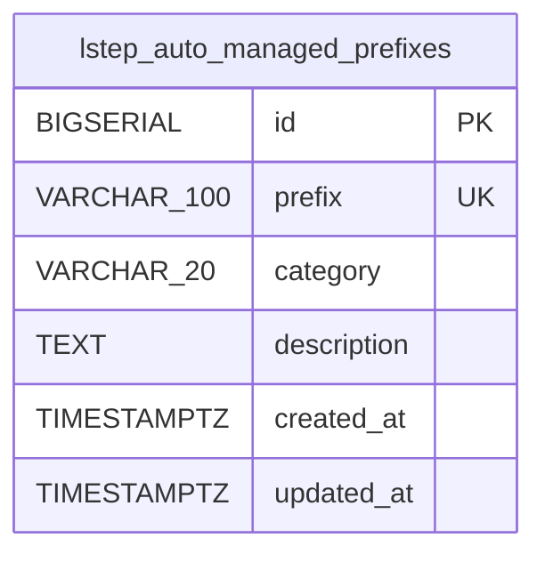

<!-- GENERATED: scripts/tools/generate-erd-detail.py; do not edit -->
# `lstep_auto_managed_prefixes`

[詳細ERD一覧](index.md) · [概要ERD](../erd.md)

このページは、マイグレーションをファイル名順に静的解析した最終定義です。稼働DBの状態は未確認です。

## カラム

型・DEFAULTはDDLの宣言表記です。`bigserial` は採番宣言であり、DBカタログ上の型名ではありません。

| カラム | 型（DDL） | NULL | DEFAULT（DDL） | キー構成列 | 定義元 |
|:---|:---|:---|:---|:---|:---|
| `id` | `BIGSERIAL` | NOT NULL | — | PK | [001_init.sql:628](../../../backend/migrations/001_init.sql#L628) |
| `prefix` | `VARCHAR(100)` | NOT NULL | — | UK | [001_init.sql:629](../../../backend/migrations/001_init.sql#L629) |
| `category` | `VARCHAR(20)` | NOT NULL | — | — | [001_init.sql:630](../../../backend/migrations/001_init.sql#L630) |
| `description` | `TEXT` | NULL | — | — | [001_init.sql:631](../../../backend/migrations/001_init.sql#L631) |
| `created_at` | `TIMESTAMPTZ` | NOT NULL | `NOW()` | — | [001_init.sql:632](../../../backend/migrations/001_init.sql#L632) |
| `updated_at` | `TIMESTAMPTZ` | NOT NULL | `NOW()` | — | [001_init.sql:633](../../../backend/migrations/001_init.sql#L633) |

PK/FK/UKはキーの構成列を示します。複合キーの各列が単独で一意という意味ではありません。部分uniqueは下記indexの述語を参照してください。

## ERD

このテーブルの全カラムと、すべての参照先を表示します。参照先はFKの対象列だけを表示し、全カラムは各テーブルのページに置きます。

親側の任意参照はFK列のNULL可否、子側の最大1件は無条件のPK/UNIQUEから導出します。部分uniqueによる条件付きの最大件数は図に反映せず、index一覧に記録します。実線はFK全列が子のPKに含まれる識別関係、破線はそれ以外です。

## 外部キー（全件）

外部キーなし。

## その他の制約

| 制約 | 種別 | DDL | 定義元 |
|:---|:---|:---|:---|
| `lstep_auto_managed_prefixes_pkey` | primary | `PRIMARY KEY` | [001_init.sql:628](../../../backend/migrations/001_init.sql#L628) |
| `lstep_auto_managed_prefixes_prefix_key` | unique | `UNIQUE` | [001_init.sql:629](../../../backend/migrations/001_init.sql#L629) |

## インデックス

| 名前 | UNIQUE | 述語 | DDL | 定義元 |
|:---|:---|:---|:---|:---|
| `idx_lstep_auto_managed_prefixes_category` | NO | — | `CREATE INDEX idx_lstep_auto_managed_prefixes_category ON lstep_auto_managed_prefixes (category)` | [001_init.sql:636](../../../backend/migrations/001_init.sql#L636) |
