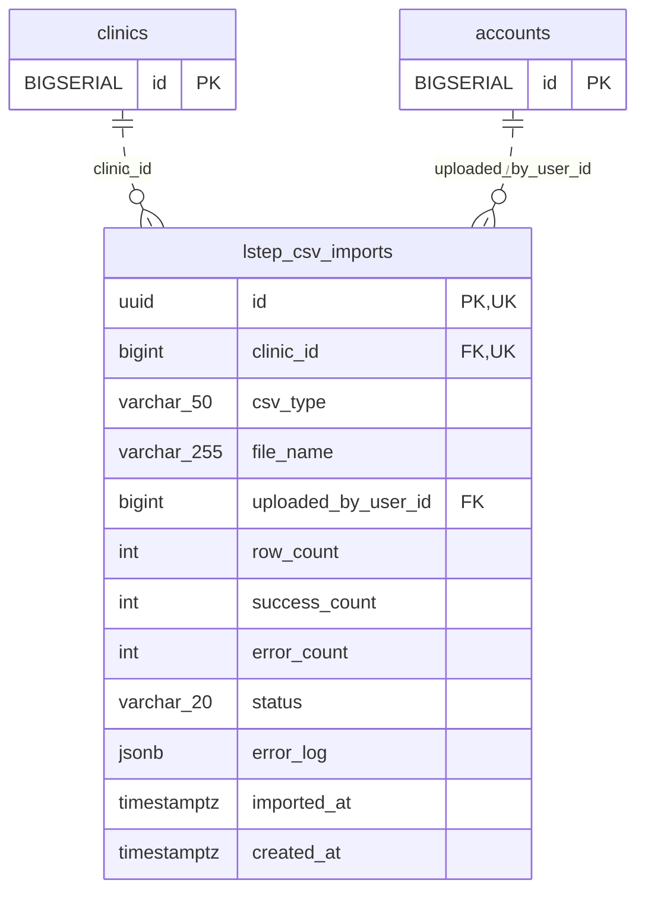

<!-- GENERATED: scripts/tools/generate-erd-detail.py; do not edit -->
# `lstep_csv_imports`

[詳細ERD一覧](index.md) · [概要ERD](../erd.md)

このページは、マイグレーションをファイル名順に静的解析した最終定義です。稼働DBの状態は未確認です。

## カラム

型・DEFAULTはDDLの宣言表記です。`bigserial` は採番宣言であり、DBカタログ上の型名ではありません。

| カラム | 型（DDL） | NULL | DEFAULT（DDL） | キー構成列 | 定義元 |
|:---|:---|:---|:---|:---|:---|
| `id` | `uuid` | NOT NULL | `gen_random_uuid()` | PK, UK | [001_init.sql:588](../../../backend/migrations/001_init.sql#L588) |
| `clinic_id` | `bigint` | NOT NULL | — | FK, UK | [001_init.sql:589](../../../backend/migrations/001_init.sql#L589) |
| `csv_type` | `varchar(50)` | NOT NULL | — | — | [001_init.sql:590](../../../backend/migrations/001_init.sql#L590) |
| `file_name` | `varchar(255)` | NOT NULL | — | — | [001_init.sql:591](../../../backend/migrations/001_init.sql#L591) |
| `uploaded_by_user_id` | `bigint` | NOT NULL | — | FK | [001_init.sql:592](../../../backend/migrations/001_init.sql#L592) |
| `row_count` | `int` | NOT NULL | `0` | — | [001_init.sql:593](../../../backend/migrations/001_init.sql#L593) |
| `success_count` | `int` | NOT NULL | `0` | — | [001_init.sql:594](../../../backend/migrations/001_init.sql#L594) |
| `error_count` | `int` | NOT NULL | `0` | — | [001_init.sql:595](../../../backend/migrations/001_init.sql#L595) |
| `status` | `varchar(20)` | NOT NULL | `'pending'` | — | [001_init.sql:596](../../../backend/migrations/001_init.sql#L596) |
| `error_log` | `jsonb` | NULL | — | — | [001_init.sql:597](../../../backend/migrations/001_init.sql#L597) |
| `imported_at` | `timestamptz` | NULL | — | — | [001_init.sql:598](../../../backend/migrations/001_init.sql#L598) |
| `created_at` | `timestamptz` | NOT NULL | `now()` | — | [001_init.sql:599](../../../backend/migrations/001_init.sql#L599) |

PK/FK/UKはキーの構成列を示します。複合キーの各列が単独で一意という意味ではありません。部分uniqueは下記indexの述語を参照してください。

## ERD

このテーブルの全カラムと、すべての参照先を表示します。参照先はFKの対象列だけを表示し、全カラムは各テーブルのページに置きます。

親側の任意参照はFK列のNULL可否、子側の最大1件は無条件のPK/UNIQUEから導出します。部分uniqueによる条件付きの最大件数は図に反映せず、index一覧に記録します。実線はFK全列が子のPKに含まれる識別関係、破線はそれ以外です。

## 外部キー（全件）

| 制約 | 子の列（順序あり） | 参照先 | 親の列（順序あり） | 削除時の動作 | 定義元 |
|:---|:---|:---|:---|:---|:---|
| `lstep_csv_imports_clinic_id_fkey` | `clinic_id` | [clinics](clinics.md) | `id` | `ON DELETE RESTRICT` | [001_init.sql:589](../../../backend/migrations/001_init.sql#L589) |
| `lstep_csv_imports_uploaded_by_user_id_fkey` | `uploaded_by_user_id` | [accounts](accounts.md) | `id` | `ON DELETE RESTRICT` | [001_init.sql:592](../../../backend/migrations/001_init.sql#L592) |

正確なON UPDATE・MATCH・DEFERRABLE等を含む制約DDL:

- `lstep_csv_imports_clinic_id_fkey`: `REFERENCES clinics(id)    ON DELETE RESTRICT`
- `lstep_csv_imports_uploaded_by_user_id_fkey`: `REFERENCES accounts(id)   ON DELETE RESTRICT`

## その他の制約

| 制約 | 種別 | DDL | 定義元 |
|:---|:---|:---|:---|
| `lstep_csv_imports_pkey` | primary | `PRIMARY KEY` | [001_init.sql:588](../../../backend/migrations/001_init.sql#L588) |
| `uq_lstep_csv_imports_clinic_id_id` | unique | `CONSTRAINT uq_lstep_csv_imports_clinic_id_id     UNIQUE (clinic_id, id)` | [001_init.sql:3880](../../../backend/migrations/001_init.sql#L3880) |

## インデックス

| 名前 | UNIQUE | 述語 | DDL | 定義元 |
|:---|:---|:---|:---|:---|
| `idx_lstep_csv_imports_clinic_imported` | NO | — | `CREATE INDEX idx_lstep_csv_imports_clinic_imported     ON lstep_csv_imports (clinic_id, imported_at DESC)` | [001_init.sql:602](../../../backend/migrations/001_init.sql#L602) |
