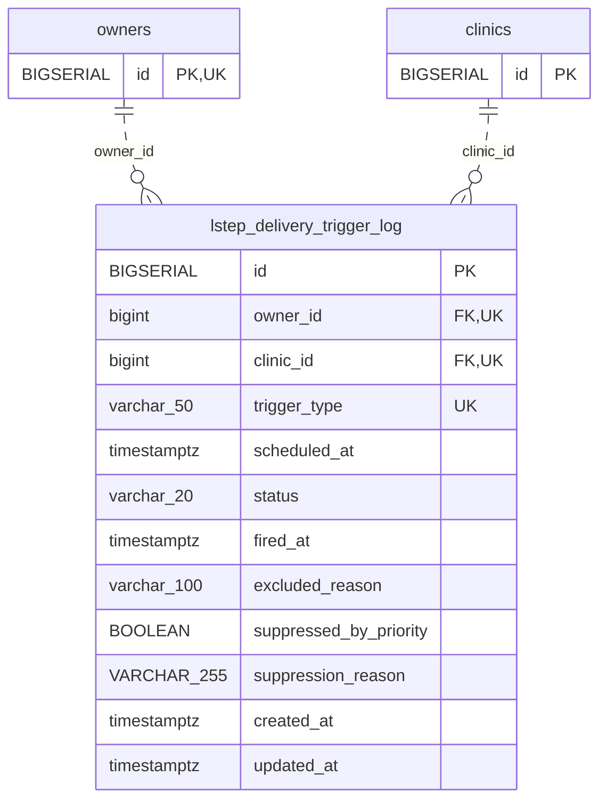

<!-- GENERATED: scripts/tools/generate-erd-detail.py; do not edit -->
# `lstep_delivery_trigger_log`

[詳細ERD一覧](index.md) · [概要ERD](../erd.md)

このページは、マイグレーションをファイル名順に静的解析した最終定義です。稼働DBの状態は未確認です。

## カラム

型・DEFAULTはDDLの宣言表記です。`bigserial` は採番宣言であり、DBカタログ上の型名ではありません。

| カラム | 型（DDL） | NULL | DEFAULT（DDL） | キー構成列 | 定義元 |
|:---|:---|:---|:---|:---|:---|
| `id` | `BIGSERIAL` | NOT NULL | — | PK | [001_init.sql:546](../../../backend/migrations/001_init.sql#L546) |
| `owner_id` | `bigint` | NOT NULL | — | FK, UK | [001_init.sql:547](../../../backend/migrations/001_init.sql#L547) |
| `clinic_id` | `bigint` | NOT NULL | — | FK, UK | [001_init.sql:548](../../../backend/migrations/001_init.sql#L548) |
| `trigger_type` | `varchar(50)` | NOT NULL | — | UK | [001_init.sql:549](../../../backend/migrations/001_init.sql#L549) |
| `scheduled_at` | `timestamptz` | NOT NULL | — | — | [001_init.sql:550](../../../backend/migrations/001_init.sql#L550) |
| `status` | `varchar(20)` | NOT NULL | `'scheduled'` | — | [001_init.sql:551](../../../backend/migrations/001_init.sql#L551) |
| `fired_at` | `timestamptz` | NULL | — | — | [001_init.sql:552](../../../backend/migrations/001_init.sql#L552) |
| `excluded_reason` | `varchar(100)` | NULL | — | — | [001_init.sql:553](../../../backend/migrations/001_init.sql#L553) |
| `suppressed_by_priority` | `BOOLEAN` | NOT NULL | `FALSE` | — | [001_init.sql:554](../../../backend/migrations/001_init.sql#L554) |
| `suppression_reason` | `VARCHAR(255)` | NULL | — | — | [001_init.sql:555](../../../backend/migrations/001_init.sql#L555) |
| `created_at` | `timestamptz` | NOT NULL | `now()` | — | [001_init.sql:556](../../../backend/migrations/001_init.sql#L556) |
| `updated_at` | `timestamptz` | NOT NULL | `now()` | — | [001_init.sql:557](../../../backend/migrations/001_init.sql#L557) |

PK/FK/UKはキーの構成列を示します。複合キーの各列が単独で一意という意味ではありません。部分uniqueは下記indexの述語を参照してください。

## ERD

このテーブルの全カラムと、すべての参照先を表示します。参照先はFKの対象列だけを表示し、全カラムは各テーブルのページに置きます。

親側の任意参照はFK列のNULL可否、子側の最大1件は無条件のPK/UNIQUEから導出します。部分uniqueによる条件付きの最大件数は図に反映せず、index一覧に記録します。実線はFK全列が子のPKに含まれる識別関係、破線はそれ以外です。

## 外部キー（全件）

| 制約 | 子の列（順序あり） | 参照先 | 親の列（順序あり） | 削除時の動作 | 定義元 |
|:---|:---|:---|:---|:---|:---|
| `lstep_delivery_trigger_log_owner_id_fkey` | `owner_id` | [owners](owners.md) | `id` | `ON DELETE RESTRICT` | [001_init.sql:547](../../../backend/migrations/001_init.sql#L547) |
| `lstep_delivery_trigger_log_clinic_id_fkey` | `clinic_id` | [clinics](clinics.md) | `id` | `ON DELETE RESTRICT` | [001_init.sql:548](../../../backend/migrations/001_init.sql#L548) |

正確なON UPDATE・MATCH・DEFERRABLE等を含む制約DDL:

- `lstep_delivery_trigger_log_owner_id_fkey`: `REFERENCES owners(id)   ON DELETE RESTRICT`
- `lstep_delivery_trigger_log_clinic_id_fkey`: `REFERENCES clinics(id)  ON DELETE RESTRICT`

## その他の制約

| 制約 | 種別 | DDL | 定義元 |
|:---|:---|:---|:---|
| `lstep_delivery_trigger_log_pkey` | primary | `PRIMARY KEY` | [001_init.sql:546](../../../backend/migrations/001_init.sql#L546) |

## インデックス

| 名前 | UNIQUE | 述語 | DDL | 定義元 |
|:---|:---|:---|:---|:---|
| `idx_lstep_delivery_trigger_log_lookup` | NO | — | `CREATE INDEX idx_lstep_delivery_trigger_log_lookup     ON lstep_delivery_trigger_log (clinic_id, owner_id, trigger_type, scheduled_at)` | [001_init.sql:560](../../../backend/migrations/001_init.sql#L560) |
| `idx_lstep_delivery_trigger_log_clinic_date` | NO | — | `CREATE INDEX idx_lstep_delivery_trigger_log_clinic_date     ON lstep_delivery_trigger_log (clinic_id, scheduled_at)` | [001_init.sql:562](../../../backend/migrations/001_init.sql#L562) |
| `idx_lstep_delivery_trigger_log_suppressed` | NO | `suppressed_by_priority = TRUE` | `CREATE INDEX idx_lstep_delivery_trigger_log_suppressed     ON lstep_delivery_trigger_log(clinic_id, suppressed_by_priority)     WHERE suppressed_by_priority = TRUE` | [001_init.sql:564](../../../backend/migrations/001_init.sql#L564) |
| `uk_lstep_delivery_trigger_log_clinic_owner_type_day` | YES | — | `CREATE UNIQUE INDEX IF NOT EXISTS uk_lstep_delivery_trigger_log_clinic_owner_type_day     ON lstep_delivery_trigger_log (         clinic_id,         owner_id,         trigger_type,         ((scheduled_at AT TIME ZONE 'Asia/Tokyo')::date)     )` | [001_init.sql:4560](../../../backend/migrations/001_init.sql#L4560) |
