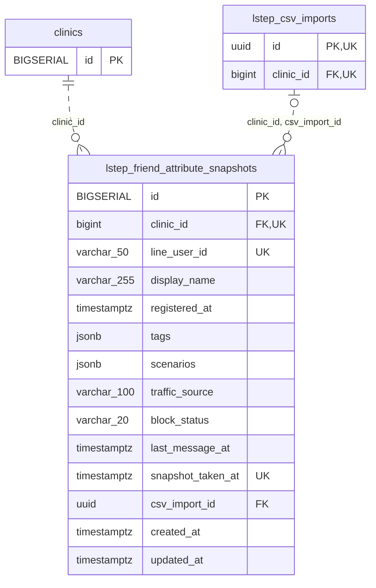

<!-- GENERATED: scripts/tools/generate-erd-detail.py; do not edit -->
# `lstep_friend_attribute_snapshots`

[詳細ERD一覧](index.md) · [概要ERD](../erd.md)

このページは、マイグレーションをファイル名順に静的解析した最終定義です。稼働DBの状態は未確認です。

## カラム

型・DEFAULTはDDLの宣言表記です。`bigserial` は採番宣言であり、DBカタログ上の型名ではありません。

| カラム | 型（DDL） | NULL | DEFAULT（DDL） | キー構成列 | 定義元 |
|:---|:---|:---|:---|:---|:---|
| `id` | `BIGSERIAL` | NOT NULL | — | PK | [001_init.sql:599](../../../backend/migrations/001_init.sql#L599) |
| `clinic_id` | `bigint` | NOT NULL | — | FK, UK | [001_init.sql:600](../../../backend/migrations/001_init.sql#L600) |
| `line_user_id` | `varchar(50)` | NOT NULL | — | UK | [001_init.sql:601](../../../backend/migrations/001_init.sql#L601) |
| `display_name` | `varchar(255)` | NULL | — | — | [001_init.sql:602](../../../backend/migrations/001_init.sql#L602) |
| `registered_at` | `timestamptz` | NULL | — | — | [001_init.sql:603](../../../backend/migrations/001_init.sql#L603) |
| `tags` | `jsonb` | NULL | — | — | [001_init.sql:604](../../../backend/migrations/001_init.sql#L604) |
| `scenarios` | `jsonb` | NULL | — | — | [001_init.sql:605](../../../backend/migrations/001_init.sql#L605) |
| `traffic_source` | `varchar(100)` | NULL | — | — | [001_init.sql:606](../../../backend/migrations/001_init.sql#L606) |
| `block_status` | `varchar(20)` | NULL | — | — | [001_init.sql:607](../../../backend/migrations/001_init.sql#L607) |
| `last_message_at` | `timestamptz` | NULL | — | — | [001_init.sql:608](../../../backend/migrations/001_init.sql#L608) |
| `snapshot_taken_at` | `timestamptz` | NOT NULL | — | UK | [001_init.sql:609](../../../backend/migrations/001_init.sql#L609) |
| `csv_import_id` | `uuid` | NULL | — | FK | [001_init.sql:610](../../../backend/migrations/001_init.sql#L610) |
| `created_at` | `timestamptz` | NOT NULL | `now()` | — | [001_init.sql:611](../../../backend/migrations/001_init.sql#L611) |
| `updated_at` | `timestamptz` | NOT NULL | `now()` | — | [001_init.sql:612](../../../backend/migrations/001_init.sql#L612) |

PK/FK/UKはキーの構成列を示します。複合キーの各列が単独で一意という意味ではありません。部分uniqueは下記indexの述語を参照してください。

## ERD

このテーブルの全カラムと、すべての参照先を表示します。参照先はFKの対象列だけを表示し、全カラムは各テーブルのページに置きます。

親側の任意参照はFK列のNULL可否、子側の最大1件は無条件のPK/UNIQUEから導出します。部分uniqueによる条件付きの最大件数は図に反映せず、index一覧に記録します。実線はFK全列が子のPKに含まれる識別関係、破線はそれ以外です。

## 外部キー（全件）

| 制約 | 子の列（順序あり） | 参照先 | 親の列（順序あり） | 削除時の動作 | 定義元 |
|:---|:---|:---|:---|:---|:---|
| `lstep_friend_attribute_snapshots_clinic_id_fkey` | `clinic_id` | [clinics](clinics.md) | `id` | `ON DELETE RESTRICT` | [001_init.sql:600](../../../backend/migrations/001_init.sql#L600) |
| `fk_lstep_snapshots_clinic_csv_import` | `clinic_id, csv_import_id` | [lstep_csv_imports](lstep_csv_imports.md) | `clinic_id, id` | `ON DELETE RESTRICT` | [001_init.sql:3875](../../../backend/migrations/001_init.sql#L3875) |

正確なON UPDATE・MATCH・DEFERRABLE等を含む制約DDL:

- `lstep_friend_attribute_snapshots_clinic_id_fkey`: `REFERENCES clinics(id)       ON DELETE RESTRICT`
- `fk_lstep_snapshots_clinic_csv_import`: `CONSTRAINT fk_lstep_snapshots_clinic_csv_import     FOREIGN KEY (clinic_id, csv_import_id)     REFERENCES lstep_csv_imports (clinic_id, id)     ON DELETE RESTRICT`

## その他の制約

| 制約 | 種別 | DDL | 定義元 |
|:---|:---|:---|:---|
| `lstep_friend_attribute_snapshots_pkey` | primary | `PRIMARY KEY` | [001_init.sql:599](../../../backend/migrations/001_init.sql#L599) |
| `lstep_friend_attribute_snapsh_clinic_id_line_user_id_snapsh_key` | unique | `UNIQUE (clinic_id, line_user_id, snapshot_taken_at)` | [001_init.sql:613](../../../backend/migrations/001_init.sql#L613) |

## インデックス

| 名前 | UNIQUE | 述語 | DDL | 定義元 |
|:---|:---|:---|:---|:---|
| `idx_lstep_friend_attribute_snapshots_clinic_user` | NO | — | `CREATE INDEX idx_lstep_friend_attribute_snapshots_clinic_user     ON lstep_friend_attribute_snapshots (clinic_id, line_user_id)` | [001_init.sql:616](../../../backend/migrations/001_init.sql#L616) |
| `idx_lstep_friend_attribute_snapshots_clinic_taken` | NO | — | `CREATE INDEX idx_lstep_friend_attribute_snapshots_clinic_taken     ON lstep_friend_attribute_snapshots (clinic_id, snapshot_taken_at DESC)` | [001_init.sql:618](../../../backend/migrations/001_init.sql#L618) |
