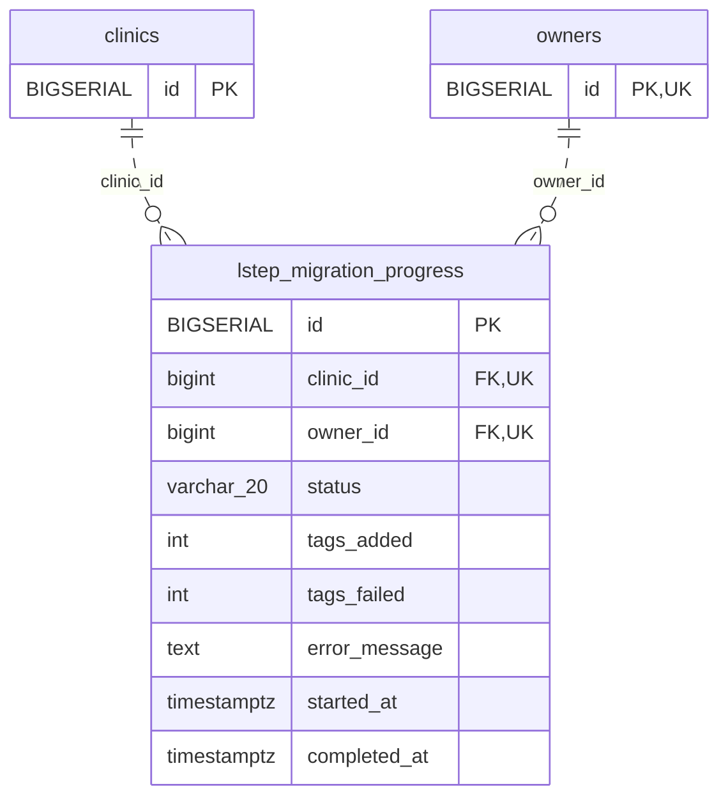

<!-- GENERATED: scripts/tools/generate-erd-detail.py; do not edit -->
# `lstep_migration_progress`

[詳細ERD一覧](index.md) · [概要ERD](../erd.md)

このページは、マイグレーションをファイル名順に静的解析した最終定義です。稼働DBの状態は未確認です。

## カラム

型・DEFAULTはDDLの宣言表記です。`bigserial` は採番宣言であり、DBカタログ上の型名ではありません。

| カラム | 型（DDL） | NULL | DEFAULT（DDL） | キー構成列 | 定義元 |
|:---|:---|:---|:---|:---|:---|
| `id` | `BIGSERIAL` | NOT NULL | — | PK | [001_init.sql:465](../../../backend/migrations/001_init.sql#L465) |
| `clinic_id` | `bigint` | NOT NULL | — | FK, UK | [001_init.sql:466](../../../backend/migrations/001_init.sql#L466) |
| `owner_id` | `bigint` | NOT NULL | — | FK, UK | [001_init.sql:467](../../../backend/migrations/001_init.sql#L467) |
| `status` | `varchar(20)` | NOT NULL | `'pending'` | — | [001_init.sql:468](../../../backend/migrations/001_init.sql#L468) |
| `tags_added` | `int` | NOT NULL | `0` | — | [001_init.sql:469](../../../backend/migrations/001_init.sql#L469) |
| `tags_failed` | `int` | NOT NULL | `0` | — | [001_init.sql:470](../../../backend/migrations/001_init.sql#L470) |
| `error_message` | `text` | NULL | — | — | [001_init.sql:471](../../../backend/migrations/001_init.sql#L471) |
| `started_at` | `timestamptz` | NULL | — | — | [001_init.sql:472](../../../backend/migrations/001_init.sql#L472) |
| `completed_at` | `timestamptz` | NULL | — | — | [001_init.sql:473](../../../backend/migrations/001_init.sql#L473) |

PK/FK/UKはキーの構成列を示します。複合キーの各列が単独で一意という意味ではありません。部分uniqueは下記indexの述語を参照してください。

## ERD

このテーブルの全カラムと、すべての参照先を表示します。参照先はFKの対象列だけを表示し、全カラムは各テーブルのページに置きます。

親側の任意参照はFK列のNULL可否、子側の最大1件は無条件のPK/UNIQUEから導出します。部分uniqueによる条件付きの最大件数は図に反映せず、index一覧に記録します。実線はFK全列が子のPKに含まれる識別関係、破線はそれ以外です。

## 外部キー（全件）

| 制約 | 子の列（順序あり） | 参照先 | 親の列（順序あり） | 削除時の動作 | 定義元 |
|:---|:---|:---|:---|:---|:---|
| `lstep_migration_progress_clinic_id_fkey` | `clinic_id` | [clinics](clinics.md) | `id` | `ON DELETE RESTRICT` | [001_init.sql:466](../../../backend/migrations/001_init.sql#L466) |
| `lstep_migration_progress_owner_id_fkey` | `owner_id` | [owners](owners.md) | `id` | `ON DELETE RESTRICT` | [001_init.sql:467](../../../backend/migrations/001_init.sql#L467) |

正確なON UPDATE・MATCH・DEFERRABLE等を含む制約DDL:

- `lstep_migration_progress_clinic_id_fkey`: `REFERENCES clinics(id) ON DELETE RESTRICT`
- `lstep_migration_progress_owner_id_fkey`: `REFERENCES owners(id) ON DELETE RESTRICT`

## その他の制約

| 制約 | 種別 | DDL | 定義元 |
|:---|:---|:---|:---|
| `lstep_migration_progress_pkey` | primary | `PRIMARY KEY` | [001_init.sql:465](../../../backend/migrations/001_init.sql#L465) |
| `lstep_migration_progress_clinic_id_owner_id_key` | unique | `UNIQUE (clinic_id, owner_id)` | [001_init.sql:474](../../../backend/migrations/001_init.sql#L474) |

## インデックス

| 名前 | UNIQUE | 述語 | DDL | 定義元 |
|:---|:---|:---|:---|:---|
| `idx_lstep_migration_progress_clinic_id` | NO | — | `CREATE INDEX idx_lstep_migration_progress_clinic_id     ON lstep_migration_progress (clinic_id)` | [001_init.sql:477](../../../backend/migrations/001_init.sql#L477) |
