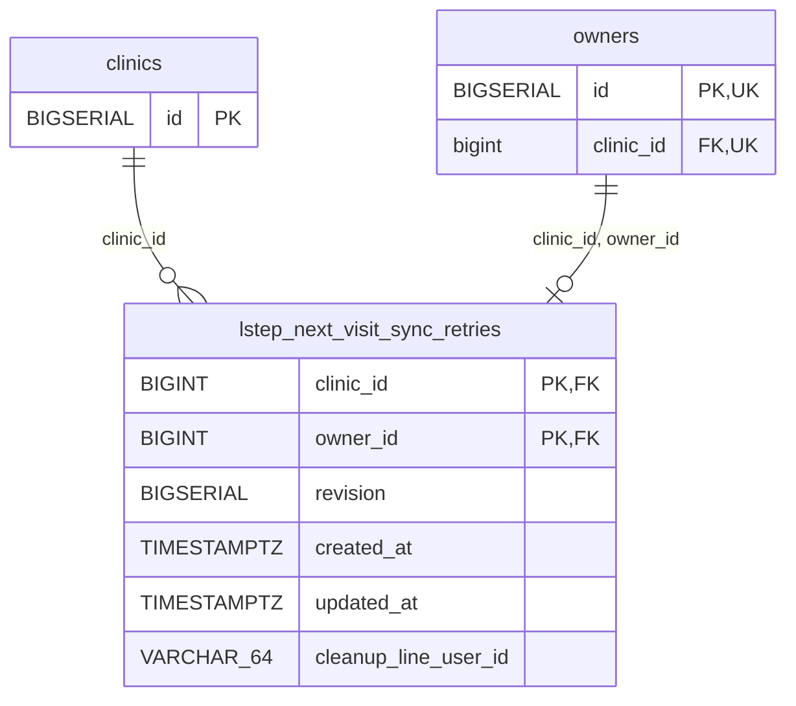

<!-- GENERATED: scripts/tools/generate-erd-detail.py; do not edit -->
# `lstep_next_visit_sync_retries`

[詳細ERD一覧](index.md) · [概要ERD](../erd.md)

このページは、マイグレーションをファイル名順に静的解析した最終定義です。稼働DBの状態は未確認です。

## カラム

型・DEFAULTはDDLの宣言表記です。`bigserial` は採番宣言であり、DBカタログ上の型名ではありません。

| カラム | 型（DDL） | NULL | DEFAULT（DDL） | キー構成列 | 定義元 |
|:---|:---|:---|:---|:---|:---|
| `clinic_id` | `BIGINT` | NOT NULL | — | PK, FK | [033_lstep_next_visit_sync_retries.sql:7](../../../backend/migrations/033_lstep_next_visit_sync_retries.sql#L7) |
| `owner_id` | `BIGINT` | NOT NULL | — | PK, FK | [033_lstep_next_visit_sync_retries.sql:8](../../../backend/migrations/033_lstep_next_visit_sync_retries.sql#L8) |
| `revision` | `BIGSERIAL` | NOT NULL | — | — | [033_lstep_next_visit_sync_retries.sql:9](../../../backend/migrations/033_lstep_next_visit_sync_retries.sql#L9) |
| `created_at` | `TIMESTAMPTZ` | NOT NULL | `NOW()` | — | [033_lstep_next_visit_sync_retries.sql:10](../../../backend/migrations/033_lstep_next_visit_sync_retries.sql#L10) |
| `updated_at` | `TIMESTAMPTZ` | NOT NULL | `NOW()` | — | [033_lstep_next_visit_sync_retries.sql:11](../../../backend/migrations/033_lstep_next_visit_sync_retries.sql#L11) |
| `cleanup_line_user_id` | `VARCHAR(64)` | NULL | — | — | [034_lstep_next_visit_cleanup_target.sql:2](../../../backend/migrations/034_lstep_next_visit_cleanup_target.sql#L2) |

PK/FK/UKはキーの構成列を示します。複合キーの各列が単独で一意という意味ではありません。部分uniqueは下記indexの述語を参照してください。

## ERD

このテーブルの全カラムと、すべての参照先を表示します。参照先はFKの対象列だけを表示し、全カラムは各テーブルのページに置きます。

親側の任意参照はFK列のNULL可否、子側の最大1件は無条件のPK/UNIQUEから導出します。部分uniqueによる条件付きの最大件数は図に反映せず、index一覧に記録します。実線はFK全列が子のPKに含まれる識別関係、破線はそれ以外です。

## 外部キー（全件）

| 制約 | 子の列（順序あり） | 参照先 | 親の列（順序あり） | 削除時の動作 | 定義元 |
|:---|:---|:---|:---|:---|:---|
| `lstep_next_visit_sync_retries_clinic_id_fkey` | `clinic_id` | [clinics](clinics.md) | `id` | `ON DELETE RESTRICT` | [033_lstep_next_visit_sync_retries.sql:7](../../../backend/migrations/033_lstep_next_visit_sync_retries.sql#L7) |
| `fk_lstep_next_visit_sync_retries_owner_clinic` | `clinic_id, owner_id` | [owners](owners.md) | `clinic_id, id` | `ON DELETE RESTRICT` | [033_lstep_next_visit_sync_retries.sql:13](../../../backend/migrations/033_lstep_next_visit_sync_retries.sql#L13) |

正確なON UPDATE・MATCH・DEFERRABLE等を含む制約DDL:

- `lstep_next_visit_sync_retries_clinic_id_fkey`: `REFERENCES clinics(id) ON DELETE RESTRICT`
- `fk_lstep_next_visit_sync_retries_owner_clinic`: `CONSTRAINT fk_lstep_next_visit_sync_retries_owner_clinic         FOREIGN KEY (clinic_id, owner_id) REFERENCES owners(clinic_id, id) ON DELETE RESTRICT`

## その他の制約

| 制約 | 種別 | DDL | 定義元 |
|:---|:---|:---|:---|
| `lstep_next_visit_sync_retries_pkey` | primary | `PRIMARY KEY (clinic_id, owner_id)` | [033_lstep_next_visit_sync_retries.sql:12](../../../backend/migrations/033_lstep_next_visit_sync_retries.sql#L12) |
| `chk_lstep_next_visit_sync_retries_cleanup_line_user_id` | check | `CONSTRAINT chk_lstep_next_visit_sync_retries_cleanup_line_user_id     CHECK (cleanup_line_user_id IS NULL OR cleanup_line_user_id ~ '^[A-Za-z0-9_-]{1,64}$')` | [034_lstep_next_visit_cleanup_target.sql:5](../../../backend/migrations/034_lstep_next_visit_cleanup_target.sql#L5) |

## インデックス

明示的なCREATE INDEXなし。PK/UNIQUEに付随する暗黙のindexは制約欄を参照してください。
