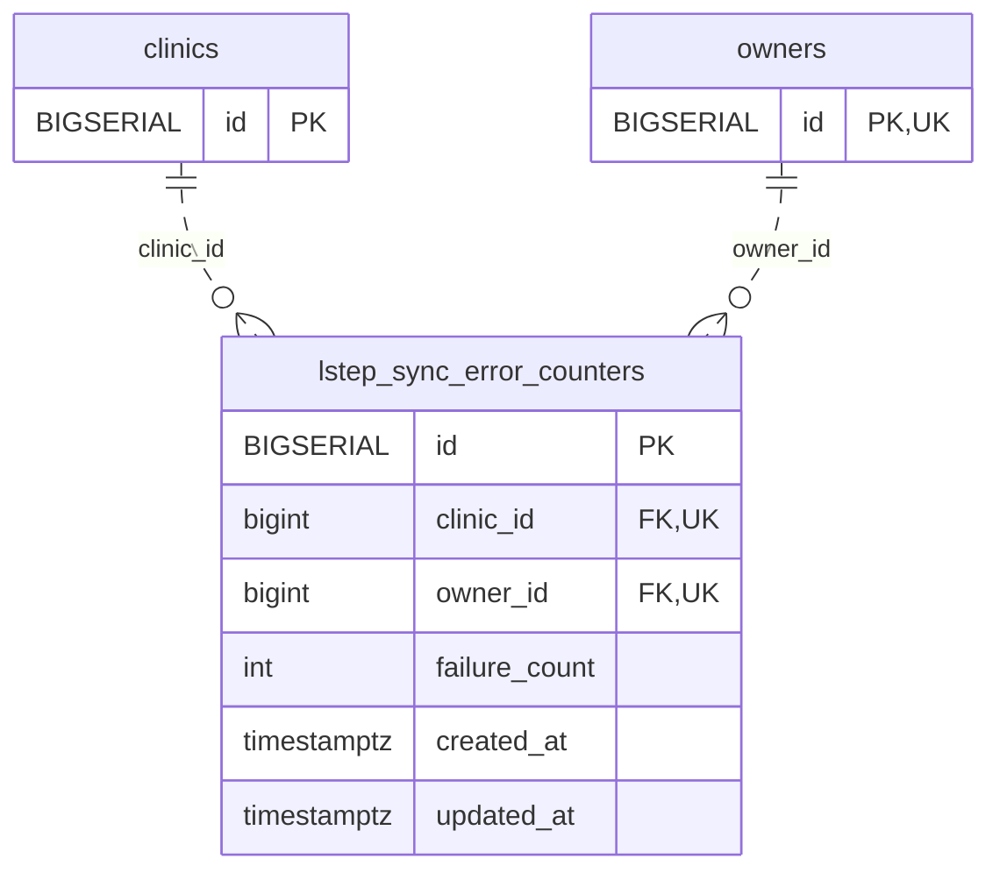

<!-- GENERATED: scripts/tools/generate-erd-detail.py; do not edit -->
# `lstep_sync_error_counters`

[詳細ERD一覧](index.md) · [概要ERD](../erd.md)

このページは、マイグレーションをファイル名順に静的解析した最終定義です。稼働DBの状態は未確認です。

## カラム

型・DEFAULTはDDLの宣言表記です。`bigserial` は採番宣言であり、DBカタログ上の型名ではありません。

| カラム | 型（DDL） | NULL | DEFAULT（DDL） | キー構成列 | 定義元 |
|:---|:---|:---|:---|:---|:---|
| `id` | `BIGSERIAL` | NOT NULL | — | PK | [001_init.sql:480](../../../backend/migrations/001_init.sql#L480) |
| `clinic_id` | `bigint` | NOT NULL | — | FK, UK | [001_init.sql:481](../../../backend/migrations/001_init.sql#L481) |
| `owner_id` | `bigint` | NOT NULL | — | FK, UK | [001_init.sql:482](../../../backend/migrations/001_init.sql#L482) |
| `failure_count` | `int` | NOT NULL | `0` | — | [001_init.sql:483](../../../backend/migrations/001_init.sql#L483) |
| `created_at` | `timestamptz` | NOT NULL | `now()` | — | [001_init.sql:484](../../../backend/migrations/001_init.sql#L484) |
| `updated_at` | `timestamptz` | NOT NULL | `now()` | — | [001_init.sql:485](../../../backend/migrations/001_init.sql#L485) |

PK/FK/UKはキーの構成列を示します。複合キーの各列が単独で一意という意味ではありません。部分uniqueは下記indexの述語を参照してください。

## ERD

このテーブルの全カラムと、すべての参照先を表示します。参照先はFKの対象列だけを表示し、全カラムは各テーブルのページに置きます。

親側の任意参照はFK列のNULL可否、子側の最大1件は無条件のPK/UNIQUEから導出します。部分uniqueによる条件付きの最大件数は図に反映せず、index一覧に記録します。実線はFK全列が子のPKに含まれる識別関係、破線はそれ以外です。

## 外部キー（全件）

| 制約 | 子の列（順序あり） | 参照先 | 親の列（順序あり） | 削除時の動作 | 定義元 |
|:---|:---|:---|:---|:---|:---|
| `lstep_sync_error_counters_clinic_id_fkey` | `clinic_id` | [clinics](clinics.md) | `id` | `ON DELETE RESTRICT` | [001_init.sql:481](../../../backend/migrations/001_init.sql#L481) |
| `lstep_sync_error_counters_owner_id_fkey` | `owner_id` | [owners](owners.md) | `id` | `ON DELETE RESTRICT` | [001_init.sql:482](../../../backend/migrations/001_init.sql#L482) |

正確なON UPDATE・MATCH・DEFERRABLE等を含む制約DDL:

- `lstep_sync_error_counters_clinic_id_fkey`: `REFERENCES clinics(id)  ON DELETE RESTRICT`
- `lstep_sync_error_counters_owner_id_fkey`: `REFERENCES owners(id)   ON DELETE RESTRICT`

## その他の制約

| 制約 | 種別 | DDL | 定義元 |
|:---|:---|:---|:---|
| `lstep_sync_error_counters_pkey` | primary | `PRIMARY KEY` | [001_init.sql:480](../../../backend/migrations/001_init.sql#L480) |
| `lstep_sync_error_counters_clinic_id_owner_id_key` | unique | `UNIQUE (clinic_id, owner_id)` | [001_init.sql:486](../../../backend/migrations/001_init.sql#L486) |

## インデックス

| 名前 | UNIQUE | 述語 | DDL | 定義元 |
|:---|:---|:---|:---|:---|
| `idx_lstep_sync_error_counters_clinic_owner` | NO | — | `CREATE INDEX idx_lstep_sync_error_counters_clinic_owner ON lstep_sync_error_counters (clinic_id, owner_id)` | [001_init.sql:489](../../../backend/migrations/001_init.sql#L489) |
