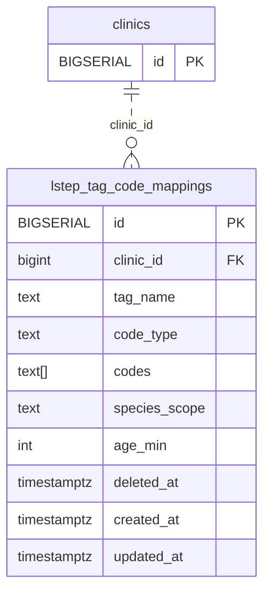

<!-- GENERATED: scripts/tools/generate-erd-detail.py; do not edit -->
# `lstep_tag_code_mappings`

[詳細ERD一覧](index.md) · [概要ERD](../erd.md)

このページは、マイグレーションをファイル名順に静的解析した最終定義です。稼働DBの状態は未確認です。

## カラム

型・DEFAULTはDDLの宣言表記です。`bigserial` は採番宣言であり、DBカタログ上の型名ではありません。

| カラム | 型（DDL） | NULL | DEFAULT（DDL） | キー構成列 | 定義元 |
|:---|:---|:---|:---|:---|:---|
| `id` | `BIGSERIAL` | NOT NULL | — | PK | [001_init.sql:497](../../../backend/migrations/001_init.sql#L497) |
| `clinic_id` | `bigint` | NOT NULL | — | FK | [001_init.sql:498](../../../backend/migrations/001_init.sql#L498) |
| `tag_name` | `text` | NOT NULL | — | — | [001_init.sql:499](../../../backend/migrations/001_init.sql#L499) |
| `code_type` | `text` | NOT NULL | — | — | [001_init.sql:500](../../../backend/migrations/001_init.sql#L500) |
| `codes` | `text[]` | NOT NULL | `'{}'` | — | [001_init.sql:501](../../../backend/migrations/001_init.sql#L501) |
| `species_scope` | `text` | NULL | — | — | [001_init.sql:502](../../../backend/migrations/001_init.sql#L502) |
| `age_min` | `int` | NULL | — | — | [001_init.sql:503](../../../backend/migrations/001_init.sql#L503) |
| `deleted_at` | `timestamptz` | NULL | — | — | [001_init.sql:504](../../../backend/migrations/001_init.sql#L504) |
| `created_at` | `timestamptz` | NOT NULL | `now()` | — | [001_init.sql:505](../../../backend/migrations/001_init.sql#L505) |
| `updated_at` | `timestamptz` | NOT NULL | `now()` | — | [001_init.sql:506](../../../backend/migrations/001_init.sql#L506) |

PK/FK/UKはキーの構成列を示します。複合キーの各列が単独で一意という意味ではありません。部分uniqueは下記indexの述語を参照してください。

## ERD

このテーブルの全カラムと、すべての参照先を表示します。参照先はFKの対象列だけを表示し、全カラムは各テーブルのページに置きます。

親側の任意参照はFK列のNULL可否、子側の最大1件は無条件のPK/UNIQUEから導出します。部分uniqueによる条件付きの最大件数は図に反映せず、index一覧に記録します。実線はFK全列が子のPKに含まれる識別関係、破線はそれ以外です。

## 外部キー（全件）

| 制約 | 子の列（順序あり） | 参照先 | 親の列（順序あり） | 削除時の動作 | 定義元 |
|:---|:---|:---|:---|:---|:---|
| `lstep_tag_code_mappings_clinic_id_fkey` | `clinic_id` | [clinics](clinics.md) | `id` | `ON DELETE RESTRICT` | [001_init.sql:498](../../../backend/migrations/001_init.sql#L498) |

正確なON UPDATE・MATCH・DEFERRABLE等を含む制約DDL:

- `lstep_tag_code_mappings_clinic_id_fkey`: `REFERENCES clinics(id) ON DELETE RESTRICT`

## その他の制約

| 制約 | 種別 | DDL | 定義元 |
|:---|:---|:---|:---|
| `lstep_tag_code_mappings_pkey` | primary | `PRIMARY KEY` | [001_init.sql:497](../../../backend/migrations/001_init.sql#L497) |

## インデックス

| 名前 | UNIQUE | 述語 | DDL | 定義元 |
|:---|:---|:---|:---|:---|
| `idx_lstep_tag_code_mappings_clinic_tag_type` | YES | `deleted_at IS NULL` | `CREATE UNIQUE INDEX idx_lstep_tag_code_mappings_clinic_tag_type     ON lstep_tag_code_mappings (clinic_id, tag_name, code_type)     WHERE deleted_at IS NULL` | [001_init.sql:509](../../../backend/migrations/001_init.sql#L509) |
