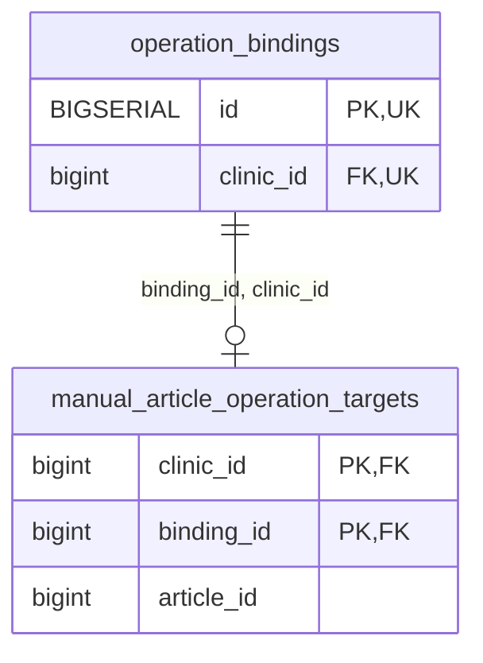

<!-- GENERATED: scripts/tools/generate-erd-detail.py; do not edit -->
# `manual_article_operation_targets`

[詳細ERD一覧](index.md) · [概要ERD](../erd.md)

このページは、マイグレーションをファイル名順に静的解析した最終定義です。稼働DBの状態は未確認です。

## カラム

型・DEFAULTはDDLの宣言表記です。`bigserial` は採番宣言であり、DBカタログ上の型名ではありません。

| カラム | 型（DDL） | NULL | DEFAULT（DDL） | キー構成列 | 定義元 |
|:---|:---|:---|:---|:---|:---|
| `clinic_id` | `bigint` | NOT NULL | — | PK, FK | [001_init.sql:11415](../../../backend/migrations/001_init.sql#L11415) |
| `binding_id` | `bigint` | NOT NULL | — | PK, FK | [001_init.sql:11416](../../../backend/migrations/001_init.sql#L11416) |
| `article_id` | `bigint` | NOT NULL | — | — | [001_init.sql:11417](../../../backend/migrations/001_init.sql#L11417) |

PK/FK/UKはキーの構成列を示します。複合キーの各列が単独で一意という意味ではありません。部分uniqueは下記indexの述語を参照してください。

## ERD

このテーブルの全カラムと、すべての参照先を表示します。参照先はFKの対象列だけを表示し、全カラムは各テーブルのページに置きます。

親側の任意参照はFK列のNULL可否、子側の最大1件は無条件のPK/UNIQUEから導出します。部分uniqueによる条件付きの最大件数は図に反映せず、index一覧に記録します。実線はFK全列が子のPKに含まれる識別関係、破線はそれ以外です。

## 外部キー（全件）

| 制約 | 子の列（順序あり） | 参照先 | 親の列（順序あり） | 削除時の動作 | 定義元 |
|:---|:---|:---|:---|:---|:---|
| `manual_article_operation_targets_binding_id_clinic_id_fkey` | `binding_id, clinic_id` | [operation_bindings](operation_bindings.md) | `id, clinic_id` | `ON DELETE RESTRICT` | [001_init.sql:11419](../../../backend/migrations/001_init.sql#L11419) |

正確なON UPDATE・MATCH・DEFERRABLE等を含む制約DDL:

- `manual_article_operation_targets_binding_id_clinic_id_fkey`: `FOREIGN KEY (binding_id, clinic_id) REFERENCES operation_bindings (id, clinic_id) ON DELETE RESTRICT`

## その他の制約

| 制約 | 種別 | DDL | 定義元 |
|:---|:---|:---|:---|
| `manual_article_operation_targets_clinic_id_check` | check | `CHECK (clinic_id > 0)` | [001_init.sql:11415](../../../backend/migrations/001_init.sql#L11415) |
| `manual_article_operation_targets_binding_id_check` | check | `CHECK (binding_id > 0)` | [001_init.sql:11416](../../../backend/migrations/001_init.sql#L11416) |
| `manual_article_operation_targets_article_id_check` | check | `CHECK (article_id > 0)` | [001_init.sql:11417](../../../backend/migrations/001_init.sql#L11417) |
| `manual_article_operation_targets_pkey` | primary | `PRIMARY KEY (clinic_id, binding_id)` | [001_init.sql:11418](../../../backend/migrations/001_init.sql#L11418) |

## インデックス

明示的なCREATE INDEXなし。PK/UNIQUEに付随する暗黙のindexは制約欄を参照してください。
